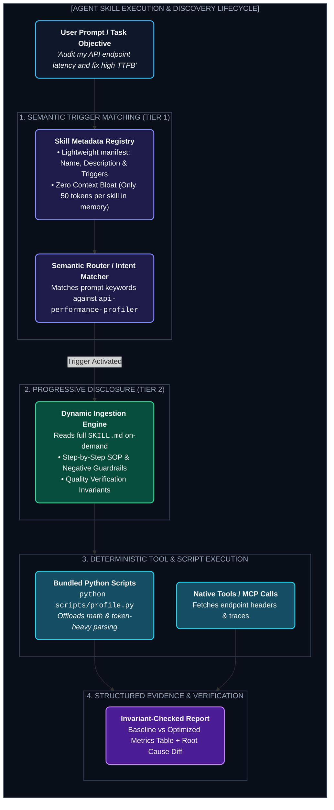

# Chapter 13: Agent Skills Architecture & Custom Skills Creation (এজেন্ট স্কিলস আর্কিটেকচার ও স্কিল ডেভেলপমেন্ট)

---

একটি জেনারেল-পারপাস LLM-কে যদি তুমি বলো, *"আমার প্রোডাকশন কুবারনেটিস ক্লাস্টারে মেমোরি লিক ইনভেস্টিগেট করো এবং ট্রাফিকের রুট অ্যানালাইসিস করে একটি পোস্টমর্টেম রিপোর্ট লেখো"* — সে কী করবে?

সে হয়তো কিছু জেনেরিক ধারণা দেবে: *"kubectl top pods চালান, Grafana ড্যাশবোর্ড দেখুন..."* — কিন্তু সে জানে না তোমার কোম্পানির ট্রাবলশুটিং প্রোটোকল কী, কোন স্ক্রিপ্ট দিয়ে সাইডকার লুপ চেক করতে হয়, কিংবা রিপোর্ট লেখার স্ট্যান্ডার্ড টেমপ্লেট কী।

এই সমস্যা সমাধানের জন্য আধুনিক AI এজেন্ট সিস্টেমে যোগ হয়েছে **Agent Skills**।

> **The Mental Model:**  
> যদি LLM হয় এজেন্টের **ব্রেন (Brain)** এবং MCP/Tools হয় তার **হাত (Hands)**, তবে **Skills হলো এজেন্টের পেশি স্মৃতি ও স্ট্যান্ডার্ড অপারেটিং প্রসিডিউর (Muscle Memory & SOP Manuals)**।

---

## ১. The Agent Skill Execution Lifecycle (স্কিল লাইফসাইকেল)

একটি আধুনিক স্কিল কীভাবে কাজ করে এবং কেন এটি কনটেক্সট উইন্ডো অপ্টিমাইজেশনের সবচেয়ে বড় হাতিয়ার, তা নিচের আর্কিটেকচার ডায়াগ্রামটি দেখলে স্পষ্ট হয়ে যাবে:



---

## ২. The Distinction: Skills vs. Tools vs. Memory vs. System Prompts

অনেকেই গুলিয়ে ফেলেন টুলস, প্রম্পট আর স্কিলের মধ্যে পার্থক্য। নিচের টেবিলটি একদম পরিষ্কার ধারণা দেবে:

| কম্পোনেন্ট | কী কাজ করে? | উদাহরণ | কেন এটি একা যথেষ্ট নয়? |
| :--- | :--- | :--- | :--- |
| **System Prompt** | এজেন্টের বৈশ্বিক ব্যক্তিত্ব ও মৌলিক নিয়ম ঠিক করে | *"You are a senior DevOps engineer..."* | প্রজেক্টের সব নিয়ম এক প্রম্পটে দিলে কনটেক্সট উইন্ডো জ্যাম হয়ে যায় (Context Poisoning)। |
| **Tool / MCP** | বাইরের জগতের সাথে সংযোগ দেয় (APIs, Functions) | `read_file()`, `run_command()`, `sql_query()` | টুল কেবল অ্যাকশন রান করতে পারে; কখন কোন সিকোয়েন্সে রান করতে হবে তা শেখায় না। |
| **Agent Memory** | অতীতের অভিজ্ঞতা ও ব্যবহারকারীর পছন্দ মনে রাখে | *"User prefers PostgreSQL over MongoDB"* | এটি ফ্যাক্ট স্টোর করে, কিন্তু জটিল কাজের গাইডলাইন ধারণ করে না। |
| **Agent Skill** | **নির্দিষ্ট কাজের ধাপে ধাপে প্রসিডিউর + স্ক্রিপ্ট + রুলস** | `database-migration-skill`, `security-audit-skill` | **কনটেক্সট সেভ করে এবং স্টোকাস্টিক মডেলকে সুনির্দিষ্ট নিয়মে চালায়।** |

---

## ৩. Directory Anatomy of a Production Skill (স্কিল ফোল্ডার স্ট্রাকচার)

একটি প্রফেশনাল Agent Skill প্যাকেজের ডিরেক্টরি নিচের মতো হয়:

```text
skills/api-performance-profiler/
├── SKILL.md            # [বাধ্যতামূলক] Frontmatter (YAML) + নির্দেশনাবলী
├── scripts/            # [ঐচ্ছিক] সহায়ক পাইথন/ব্যাশ স্ক্রিপ্ট যা লোকালি রান হবে
│   └── measure_ttfb.py
├── references/         # [ঐচ্ছিক] গভীর ডকুমেন্টেশন ও চিটশিট (প্রয়োজনে পড়বে)
│   └── http_status_matrix.md
└── examples/           # [ঐচ্ছিক] ইনপুট-আউটপুটের বাস্তব গোল্ডেন নমুনা
    └── sample_audit_report.md
```

### ১. YAML Frontmatter ও Semantic Triggers (`SKILL.md`)
ফ্রন্টম্যাটার হলো স্কিলের আইডি কার্ড। এজেন্ট সবসময় এটি পড়ে মনে রাখে:

```markdown
---
name: api-performance-profiler
description: Analyze HTTP REST and GraphQL API latency, measure TTFB, detect missing HTTP caching headers, and produce structured performance optimization plans. Activate whenever the user mentions "slow endpoint", "profile API", "TTFB bottleneck", or "audit response time".
---
```

> **Critical Rule:** `description` ফিল্ডটি অত্যন্ত নিখুঁত হতে হবে। যদি ডেসক্রিপশন ভেগ (vague) হয়, তবে মডেল অপ্রয়োজনে স্কিল লোড করবে (False Positive), অথবা কাজের সময় স্কিল ডাকতে ভুলে যাবে (False Negative)।

---

## ৪. Hands-On: Building a Complete Custom Skill

নিচে একটি পূর্ণাঙ্গ প্রোডাকশন-রেডি `SKILL.md`-এর নমুনা দেওয়া হলো:

```markdown
# API Performance Profiler

## 1. When to Use
- User reports slow latency or latency spikes on an HTTP endpoint.
- Preparing for high-traffic stress-testing or production launch.
- *Do NOT use for client-side React rendering or bundle size audits.*

## 2. Invariant Guidelines & Negative Space
- **Never** trigger load tests against external third-party production APIs without rate-limit flags.
- **Always** capture a minimum of 5 sample requests to calculate median and p95 latency.

## 3. Step-by-Step Procedure

### Step 1: Baseline Extraction
Run the bundled script to capture network timing metrics:
```bash
python scripts/measure_ttfb.py --url <TARGET_URL> --count 5
```

### Step 2: Diagnostic Evaluation
Examine the returned JSON metrics against the performance budget:
1. **TTFB > 250ms:** Suggest database query indexing or Redis caching.
2. **Missing `Cache-Control`:** Provide appropriate header snippet (e.g., `public, max-age=3600, stale-while-revalidate=60`).
3. **Response Payload > 2MB:** Suggest gzip/brotli compression or GraphQL field pagination.

### Step 3: Synthesis & Reporting
Always output findings in this exact format:

| Metric | Measured Baseline | Target SLA | Bottleneck Identified | Action Plan |
| :--- | :--- | :--- | :--- | :--- |
| DNS Lookup | 12ms | < 20ms | None | Retain DNS TTL |
| TTFB (p95) | 480ms | < 150ms | Unindexed DB Join on Orders | Add B-Tree Index |
| Content Transfer | 320ms | < 80ms | Uncompressed 4MB JSON | Enable Brotli |
```

---

## ৫. Reference Slicing (কনটেক্সট উইন্ডো বাঁচানোর কৌশল)

যদি তোমার স্কিলে ৫০ পৃষ্ঠার এন্টারপ্রাইজ রেগুলেশন বা API স্পেসিফিকেশন থাকে, তবে তা কখনো মূল `SKILL.md`-এর ভেতরে লিখবে না।

এর পরিবর্তে ফাইলটিকে `references/api_specs.md` ফাইলে রাখবে। `SKILL.md`-তে শুধু একটি নির্দেশ দেবে:
> *"যদি রিকোয়েস্টে gRPC এরর কোড থাকে, কেবল তখনই `read_file('references/grpc_codes.md')` কল করবে।"*

একে বলা হয় **Reference Slicing বা Progressive Lazy-Loading**। এর ফলে এজেন্ট ৯০% সময় টোকেন খরচ না করে দ্রুত কাজ করতে পারে।

---

Developer Perspective
স্কিল লেখার আসল রহস্য হলো **Negative Constraints** দেওয়া। একটি LLM সাধারণ নিয়মে কী করতে হবে তা ভালো বোঝে, কিন্তু কী করা যাবে না (যেমন: *"কখনো প্রোডাকশন DB-তে ট্রাঙ্কেট চালাবে না, সবসময় Dry-run ফ্ল্যাগ দেবে"*) তা বারবার ভুলে যায়। স্কিলের শুরুতেই `Negative Space` বা `What NOT to do` সেকশন রাখলে এজেন্টের এরর রেট ৮০% কমে যায়।

---

Production Reality
প্রোডাকশন গ্রেড এজেন্টে যখন ৩০+ স্কিল ইনস্টল থাকে, তখন **Skill Conflict** হতে পারে। উদাহরণস্বরূপ, যদি একটি `git-commit-skill` থাকে এবং একটি `ci-cd-deploy-skill` থাকে, উভয় স্কিলেই যদি গিট কমান্ডের রেফারেন্স থাকে তবে এজেন্ট দ্বিধাদ্বন্দ্বে পড়তে পারে। এজন্য প্রতিটি স্কিলের `name` ও `description`-এ ইউনিক বাউন্ডারি ঠিক করে দিতে হয়।

---

Common Mistake
স্কিলের ভেতর লম্বা টেক্সট বা কোড কপি-পেস্ট করা। যদি তোমার কোনো ডেটা প্রসেসিং করতে হয় (যেমন ১০০ পৃষ্ঠার লগ ফাইল স্ক্যান করা), তবে সেই সম্পূর্ণ লগ এজেন্টের কনটেক্সটে আনা বোকামি। এর বদলে স্কিলের সাথে একটি পাইথন স্ক্রিপ্ট (`scripts/filter_errors.py`) জুড়ে দেবে যা লোকাল মেশিনে রান হয়ে শুধু সামারি এজেন্টের সামনে আনবে।

---

## Interview Flashcards

#### Beginner Level
* **প্রশ্ন:** AI Agent Skill কী এবং এটি সাধারণ সিস্টেম প্রম্পট থেকে কীভাবে আলাদা?
* **উত্তর:** Agent Skill হলো একটি মডুলার ফোল্ডার যা কোনো নির্দিষ্ট কাজের জন্য তৈরি ধাপে ধাপে গাইডলাইন, স্ক্রিপ্ট ও রুলস ধারণ করে। সিস্টেম প্রম্পট সবসময় কনটেক্সটে থেকে মেমোরি নষ্ট করে, আর স্কিল কেবল কাজের প্রয়োজন অনুযায়ী অন-ডিমান্ড (On-Demand) মেমোরিতে লোড হয়।

#### Intermediate Level
* **প্রশ্ন:** Progressive Disclosure কী এবং স্কিল আর্কিটেকচারে এটি কেন দরকার?
* **উত্তর:** Progressive Disclosure হলো প্রথমে শুধু স্কিলের সংক্ষিপ্ত মেটাডাটা বা ট্রিগার মেমোরিতে রাখা এবং ইউজার সেই নির্দিষ্ট কাজ দিলেই কেবল পূর্ণাঙ্গ নির্দেশাবলী লোড করা। এটি হাজার হাজার টোকেন বাঁচায় এবং কনটেক্সট পয়জনিং রোধ করে।

#### Advanced Level
* **প্রশ্ন:** স্কিলের সাথে এক্সেকিউটেবল স্ক্রিপ্ট (`scripts/`) যুক্ত করার আর্কিটেকচারাল সুবিধা কী?
* **উত্তর:** এটি কম্পিউটেশনাল টাস্কগুলোকে (যেমন লার্জ ফাইল পার্সিং, রেজেক্স ফিল্টারিং, স্ট্যাটিস্টিক্যাল ক্যালকুলেশন) ডিটারমিনিস্টিক কোডে অফলোড করে। ফলে মডেলের হ্যালুসিনেশন শূন্য হয়ে যায় এবং কোটি কোটি টোকেন খরচ হওয়া বন্ধ হয়।
