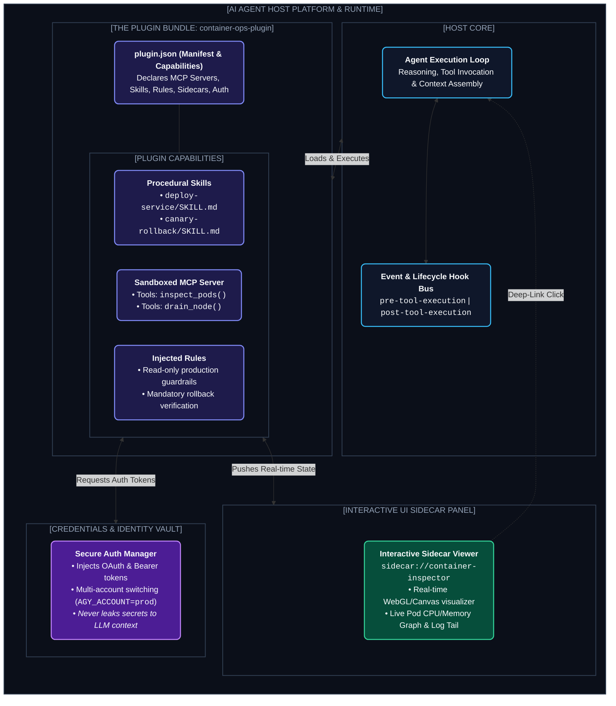

# Chapter 14: Agent Plugins, Sidecars & Extensibility Ecosystem (প্লাগিন আর্কিটেকচার, ফুল-স্ট্যাক ইন্টিগ্রেশন ও সাইডকার)

---

ভাবো তো, তুমি তোমার কোডিং এজেন্টে একটি ক্লাউড ডেপ্লয়মেন্ট ফিচার যুক্ত করতে চাও।

তোমার কী কী লাগবে?
1. ক্লাউড প্রোভাইডারের API কল করার জন্য **MCP Server বা Tools**।
2. ক্লাস্টার মনিটরিং এবং রোলব্যাকের জন্য ধাপে ধাপে নির্দেশনাবলী সংবলিত **Skills**।
3. প্রোডাকশন ক্লাস্টার ডিলিট হওয়া ঠেকানোর জন্য কঠোর **Security Rules**।
4. ক্লাউড টোকেন ও সিক্রেট নিরাপদে হ্যান্ডেল করার জন্য **Auth Provider**।
5. এবং লাইভ ট্রাফিক ও কনটেইনারের স্টেট সরাসরি দেখার জন্য একটি ইন্টারঅ্যাক্টিভ **UI Dashboard বা Sidecar**।

যদি এই সবকিছু তোমাকে আলাদা আলাদা জায়গায় কনফিগার করতে হতো, তবে তা ম্যানেজ করা অসম্ভব হয়ে পড়ত।

এই পুরো স্ট্যাককে যখন একটি একক, সেলফ-কন্টেইন্ড এবং শেয়ারেবল প্যাকেজে মোড়ানো হয়— তাকেই বলে **Agent Plugin**।

---

## ১. The Full-Stack Plugin Architecture (প্লাগিন আর্কিটেকচার)

একটি আধুনিক প্লাগিন কীভাবে হোস্ট অ্যাপ্লিকেশন, মডেল, সিকিউরিটি ভল্ট এবং ইন্টারঅ্যাক্টিভ ইউজার ইন্টারফেসের মধ্যে সংযোগ তৈরি করে, তা নিচের আর্কিটেকচারে দেখানো হলো:



---

## ২. The 5 Core Pillars of an Agent Plugin (প্লাগিনের ৫টি মূল উপাদান)

একটি প্লাগিন কেবল কোড নয়, এটি ৫টি স্বতন্ত্র সাব-সিস্টেমের সমন্বয়:

```
┌────────────────────────────────────────────────────────┐
│                      AGENT PLUGIN                      │
│                                                        │
│  ┌────────────────┐ ┌────────────────┐ ┌────────────┐  │
│  │     SKILLS     │ │  MCP SERVERS   │ │   RULES    │  │
│  │ (Playbooks &   │ │   & TOOLING    │ │(Behavioral │  │
│  │  Procedures)   │ │  (APIs & CLIs) │ │Standards)  │  │
│  └────────────────┘ └────────────────┘ └────────────┘  │
│  ┌────────────────┐ ┌────────────────┐ ┌────────────┐  │
│  │ AUTH & SECRETS │ │   UI SIDECAR   │ │ LIFECYCLE  │  │
│  │ (OAuth, Tokens,│ │ PANELS (Web,   │ │   HOOKS    │  │
│  │  Account Mgr)  │ │  3D, Previews) │ │(Pre & Post)│  │
│  └────────────────┘ └────────────────┘ └────────────┘  │
└────────────────────────────────────────────────────────┘
```

1. **Skills (প্রসিডিউরাল নলেজ):** কাজের ধাপে ধাপে গাইডলাইন। যেমন: ব্লু-গ্রিন ডেপ্লয়মেন্টের সময় কীভাবে ধাপে ধাপে ট্রাফিকের পারসেন্টেজ বাড়াতে হবে।
2. **MCP Servers & Native Tools:** ব্যাকএন্ডের সাথে আসল কানেকশন। যেমন: ডকার ডেমন বা কুবারনেটিস ক্লাস্টারের সাথে JSON-RPC 2.0 যোগাযোগ।
3. **Behavioral Rules:** এমন কিছু অপরিবর্তনীয় নিয়ম যা মডেল ভাঙতে পারবে না (যেমন: *"কখনো অনুমোদন ছাড়া প্রোডাকশন ডাটাবেসে ড্রপ চালাবে না"* )।
4. **Interactive UI Sidecars:** টেক্সট চ্যাটের বাইরে আলাদা প্যানেলে গ্রাফিক্যাল ভিউয়ার। যেমন: বায়োলজিক্যাল ৩ডি প্রোটিন ভিউয়ার, জেটপ্যাক কম্পোজ প্রিভিউয়ার, বা লাইভ কুবারনেটিস ট্রাফিক ম্যাপ।
5. **Secure Authentication & Identity:** মডেলকে সিক্রেট কি (API Keys) না দেখিয়ে ব্যাকএন্ড টুলে ক্রেডেনশিয়াল ইনজেক্ট করার সিকিউর সিস্টেম।

---

## ৩. The Plugin Manifest (`plugin.json`)

প্লাগিনের হৃদপিণ্ড হলো তার ম্যানিফেস্ট ফাইল। এটি হোস্ট প্ল্যাটফর্মকে জানায় প্লাগিনটিতে কী কী রয়েছে:

```json
{
  "id": "container-ops-suite",
  "name": "Cloud Container & Kubernetes Suite",
  "version": "1.2.0",
  "description": "Production container triage, canary rollout skills, and real-time pod visualizer sidecar.",
  "author": "CloudOps Engineering",
  "capabilities": {
    "skills": [
      "./skills/canary-rollout",
      "./skills/pod-crash-triage"
    ],
    "mcpServers": {
      "k8s-cluster": {
        "command": "node",
        "args": ["./mcp/k8s-server.js"],
        "env": {
          "CLUSTER_ENV": "production"
        }
      }
    },
    "rules": [
      "./rules/production-safety-invariants.md"
    ],
    "sidecars": [
      {
        "id": "k8s-visualizer",
        "title": "Live Pod Topology",
        "entrypoint": "./sidecars/topology.html"
      }
    ]
  },
  "auth": {
    "provider": "gcloud-oauth",
    "requiredScopes": ["https://www.googleapis.com/auth/cloud-platform"],
    "accountSwitchingSupported": true
  }
}
```

---

## ৪. Deep Dive: Interactive Sidecars & Deep Links

টেক্সট জেনারেশন দিয়ে জটিল নেটওয়ার্ক আর্কিটেকচার বা ৩D স্ট্রাকচার বোঝা অসম্ভব।

প্লাগিনের সাইডকার আর্কিটেকচারে:
* এজেন্ট সরাসরি সাইডকার প্যানেলে ডেটা পাঠাতে পারে: `update_sidecar_state({ activePods: 12, unhealthy: 1 })`
* চ্যাট রেসপন্সে এজেন্ট একটি ডিপ-লিঙ্ক প্রদান করে:
  ```markdown
  I have stabilized the failing pods. Click [Open Live Pod Topology](sidecar://k8s-visualizer) to view real-time memory distribution.
  ```
ইউজার লিঙ্কে ক্লিক করলে সাইড প্যানেলে তাৎক্ষণিকভাবে ইন্টারঅ্যাক্টিভ এইচটিএমএল/ওয়েবজিএল ড্যাশবোর্ড খুলে যায়।

---

## ৫. Secure Authentication & Multi-Account Routing

প্রোডাকশন এজেন্টে প্লাগিন চালানোর সবচেয়ে ঝুঁকিপূর্ণ জায়গা হলো **API Key Leakage**।

যদি এজেন্টকে বলা হয়: *"আমার API কী হলো `sk-proj-9994`"* — মডেলটি সেই কী চ্যাট লগ ও ট্রানজিটে ফাঁস করে দিতে পারে।

প্লাগিন আর্কিটেকচারে ক্রেডেনশিয়াল হ্যান্ডেল করা হয় **Environment Proxy Vault** দিয়ে:
1. হোস্ট অ্যাপ্লিকেশন সিক্রেটগুলো একটি সিকিউর ভল্টে (Keytar বা OS Keychain) স্টোর করে।
2. সাবপ্রসেস কমান্ড চালানোর সময় হোস্ট স্বয়ংক্রিয়ভাবে এনভায়রনমেন্ট ভেরিয়েবল ইনজেক্ট করে (`AGY_ACCOUNT=prod`).
3. এজেন্ট কখনোই আসল টোকেন চোখে দেখে না, ফলে কোনো প্রম্পট ইনজেকশন হ্যাকিংয়ের মাধ্যমেও টোকেন চুরি করা সম্ভব হয় না।

---

Developer Perspective
প্লাগিন ডেভেলপমেন্টের গোল্ডেন রুল হলো **Decoupled Architecture**। তোমার সাইডকার প্যানেল এবং MCP সার্ভার সম্পূর্ণ স্বাধীন প্রসেসে চলবে। সাইডকার যদি ক্র্যাশও করে, এজেন্টের মূল ব্রেন ও এক্সিকিউশন লুপ যেন অক্ষত থাকে। ব্যাকএন্ড ও ফ্রন্টএন্ডের মধ্যে মেসেজিং হবে শুধুমাত্র লাইটওয়েট JSON ইভেন্ট দ্বারা।

---

Production Reality
এন্টারপ্রাইজে থার্ড-পার্টি প্লাগিন ইনস্টল করার আগে **Supply Chain Security & Permission Sandboxing** মাস্ট। কোনো প্লাগিনকে যেন আনরেস্ট্রিক্টেড ফাইল রিড পারমিশন বা অনিরাপদ নেটওয়ার্ক অ্যাক্সেস না দেওয়া হয়। সবসময় Least Privilege নীতি মেনে প্লাগিনকে শুধুমাত্র তার প্রয়োজনীয় ডিরেক্টরিতে সীমাবদ্ধ (Jail/Chroot) রাখতে হবে।

---

Common Mistake
ম্যানিফেস্ট ফাইলের ভেতর হার্ডকোডেড পাথ (`C:\Users\username\plugin\...`) ব্যবহার করা। প্লাগিন সবসময় ভিন্ন ভিন্ন ওএস ও মেশিনে চলে (ম্যাক, লিনাক্স, উইন্ডোজ)। এজন্য ম্যানিফেস্টে সবসময় রিলেটিভ পাথ (`./skills/...`, `./mcp/...`) ব্যবহার করতে হবে।

---

## Interview Flashcards

#### Beginner Level
* **প্রশ্ন:** Agent Plugin এবং Agent Skill-এর মধ্যে মূল পার্থক্য কী?
* **উত্তর:** Skill হলো শুধুমাত্র একটি নির্দিষ্ট কাজের প্রসিডিউরাল গাইডলাইন (Instruction file)। আর Plugin হলো একটি পূর্ণাঙ্গ প্যাকেজ যাতে স্কিলের পাশাপাশি MCP টুলস, সিকিউরিটি রুলস, অথেন্টিকেশন সিস্টেম এবং ইউজার ইন্টারফেস (Sidecar) একসাথে যুক্ত থাকে।

#### Intermediate Level
* **প্রশ্ন:** প্লাগিন সাইডকার (Sidecar) কী এবং এটি কীভাবে এজেন্টের সাথে কমিউনিকেট করে?
* **উত্তর:** সাইডকার হলো এজেন্টের মূল চ্যাটের পাশে খোলা ইন্টারঅ্যাক্টিভ ওয়েব প্যানেল (গ্রাফ, ৩D মডেল বা ড্যাশবোর্ড)। এজেন্ট টুল কলের মাধ্যমে সাইডকারের স্টেট আপডেট করে এবং চ্যাটে `sidecar://` প্রটোকল লিঙ্ক দিলে ইউজার এক ক্লিকে ভিজ্যুয়াল প্যানেল খুলতে পারে।

#### Advanced Level
* **প্রশ্ন:** প্লাগিনে কীভাবে প্রম্পট ইনজেকশন থেকে API Credentials সুরক্ষিত রাখা হয়?
* **উত্তর:** টোকেনগুলোকে কখনো এলএলএম-এর প্রম্পট কনটেক্সটে পাঠানো হয় না। হোস্ট প্ল্যাটফর্মের সিকিউর ক্রেডেনশিয়াল ভল্ট ব্যাকগ্রাউন্ডে চাইল্ড সাবপ্রসেসের এনভায়রনমেন্টে টোকেন ইনজেক্ট করে। ফলে মডেল কখনোই আসল সিক্রেট জানতে পারে না।
