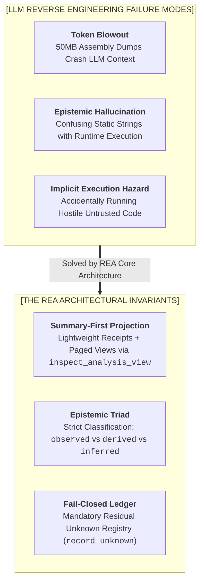
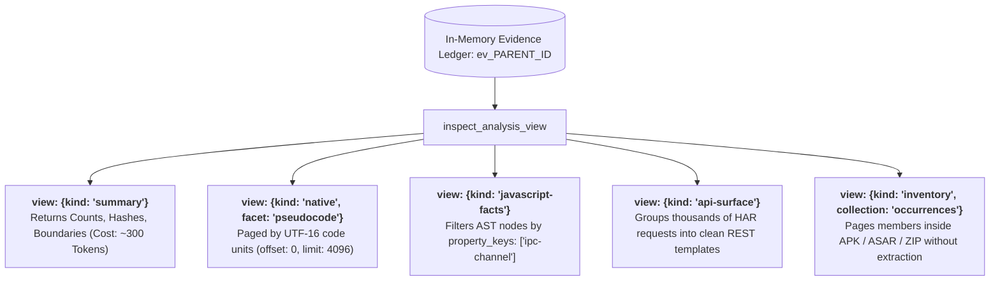
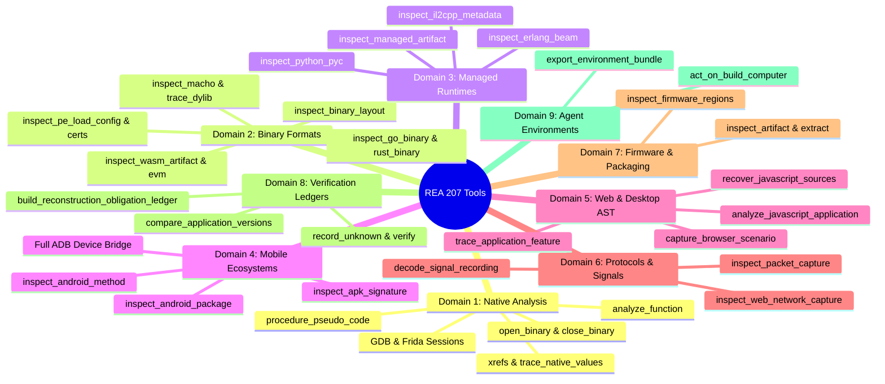
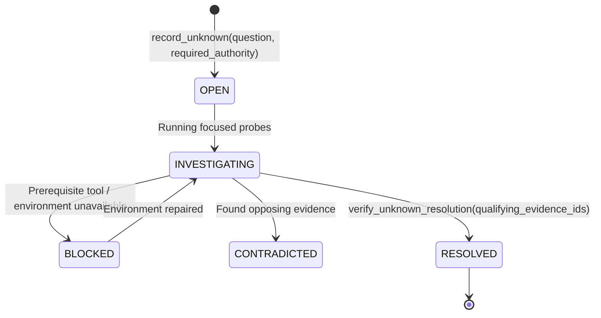

# Chapter 15: Reverse Engineer Anything (REA) — Engine Architecture, 207-Tool Matrix & Cognitive Mechanics (রিভার্স ইঞ্জিনিয়ার এনিথিং: ইঞ্জিন আর্কিটেকচার, ২০৭-টুল ম্যাট্রিক্স ও কগনিটিভ লেজার)

---

ভাবো তো, একটি এন্টারপ্রাইজ তোমাকে একটি কম্পাইল করা ক্লোজড-সোর্স লিনাক্স ELF বাইনারি, একটি প্রডাকশন ইলেকট্রন অ্যাপের `.asar` প্যাকেজ অথবা একটি অজানা প্রটোকলের `.pcap` নেটওয়ার্ক ডাম্প দিয়ে বলল:
> *"এই সফটওয়্যারের ভেতর কী লাইসেন্স ভ্যালিডেশন অ্যালগরিদম চলছে তা রিভার্স ইঞ্জিনিয়ার করো এবং আমাদের ইন্টারনাল সিস্টেমে এর একটি ভেরিফায়েড পাইথন রিকনস্ট্রাকশন তৈরি করো।"*

তুমি যদি একটি সাধারণ LLM-কে এই কাজ দাও, সে সাথে সাথে ক্র্যাশ করবে অথবা চরম হ্যালুসিনেশন শুরু করবে:
1. একটি বাইনারির ডিসঅ্যাসেম্বলিতে কয়েক লক্ষ লাইন অ্যাসেম্বলি ইনস্ট্রাকশন থাকে—যা LLM-এর কনটেক্সট উইন্ডোকে মুহূর্তেই ব্লো-আউট (Token Overflow) করে দেবে।
2. LLM যদি নির্দিষ্ট কোনো ফাংশন প্রথম ২০ লাইনে না দেখে, তবে সে ভ্রান্তভাবে দাবি করে বসবে: *"এই ফাংশনটি বাইনারিতে নেই!"* (Absence of Evidence = Evidence of Absence ভ্রান্তি)।
3. অনেক টুলস আনট্রাস্টেড বাইনারি রান করিয়ে মেমোরি রিড করতে গিয়ে হোস্ট সিস্টেমে ম্যালওয়্যার এক্সিকিউশনের বড় ঝুঁকি তৈরি করে।

এই চরম জটিল সমস্যাটির সমাধান হলো **Reverse Engineer Anything (REA)**।

> **The Mental Model:**  
> REA হলো ফ্রন্টিয়ার AI এজেন্টদের জন্য নির্মিত এমন একটি **উচ্চ-নির্ভরযোগ্যতাসম্পন্ন (High-Assurance) রিভার্স ইঞ্জিনিয়ারিং প্ল্যাটফর্ম**, যা ২০৭টি বিশেষায়িত টুলস, একটি ইন-মেমোরি ক্রিপ্টোগ্রাফিক **Evidence Ledger**, এবং ডিপ এনালাইসিস ইঞ্জিন (Ghidra, IDA, Kuna, JADX, WABT, TShark, Sigrok, CDP)-কে কাজে লাগিয়ে ক্লোজড-সোর্স সফটওয়্যারকে গাণিতিকভাবে যাচাইযোগ্য নলেজ গ্রাফে রূপান্তর করে।

---

## ১. The Genesis & Architectural Philosophy (কেন REA তৈরি হলো?)

ঐতিহ্যবাহী রিভার্স ইঞ্জিনিয়ারিং টুলস (যেমন রিডা, গিড্রা বা আইডিএ প্রো) তৈরি হয়েছিল হিউম্যান অ্যানালিস্টদের জন্য, যারা চোখে দেখে ক্লিক করে বিশ্লেষণ করেন। কিন্তু একটি অটোনোমাস LLM এজেন্টের কাছে রিভার্স ইঞ্জিনিয়ারিং পরিচালনার জন্য প্রয়োজন সম্পূর্ণ ভিন্ন ধরনের আর্কিটেকচারাল ডিসিপ্লিন।



### The Epistemological Triad (এপিস্টেমিক ত্রয়ী)
REA-এর প্রতিটি টুল যখন কোনো তথ্য ফেরত দেয়, তখন তা নিচের তিনটি কঠোর ক্যাটাগরিতে বিভক্ত থাকে:

| ক্যাটাগরি | প্রামাণিক অর্থ (Meaning & Authority) | REA-এর বাস্তব উদাহরণ |
| :--- | :--- | :--- |
| **`observed`** | কোনো ইন্টারপ্রিটেশন ছাড়া অপরিবর্তনীয় বাইট বা ট্রেস থেকে সরাসরি দেখা তথ্য। | অফসেট `0x00401150`-তে থাকা হেক্স বাইট, ELF PT_NOTE হেডার, `.rodata`-এর র টেক্সট। |
| **`derived`** | অবসার্ভড তথ্যের ওপর গাণিতিক বা অ্যালগরিদমিক নিশ্চিত রূপান্তর। | বাইট থেকে ডিকোড করা ওপকোড, ফাইলের SHA-256 ডাইজেস্ট, বেসিক ব্লকের কন্ট্রোল ফ্লো গ্রাফ। |
| **`inferred`** | হিউরিস্টিক বা প্রোবাবিলিস্টিক হাইপোথিসিস (যা পুনঃপরীক্ষাযোগ্য কিন্তু শতভাগ নিশ্চিত নয়)। | ডিকম্পাইলারের লোকাল ভ্যারিয়েবলের নাম, সম্ভাব্য EVM ফাংশন সিলেক্টর, আনভেরিফায়েড IPC পেয়ারিং। |

### REA-এর ৭টি গোল্ডেন ইনভ্যারিয়েন্ট (The 7 Invariants)
1. **Evidence-First Grounding:** প্রমাণ ছাড়া কোনো ক্লেইম করা যাবে না। প্রতিটি দাবির সাথে হেক্স ডাইজেস্টযুক্ত `evidence_id` (`ev_<64hex>`) থাকা বাধ্যতামূলক।
2. **Summary-First Progressive Disclosure:** টুল প্রথমে সংক্ষিপ্ত সামারি রিসিপ্ট দেয়; মডেল তার প্রয়োজন অনুযায়ী স্পেসিফিক ফ্যাসেট পেজ করে পড়ে।
3. **Fail-Closed Boundaries:** অস্পষ্ট ইমপোর্ট বা আনরিসলভড পয়েন্টারকে কখনোই মনগড়া মান দিয়ে পূরণ করা যাবে না; তা সরাসরি `unknown` হিসেবে রেকর্ড হবে।
4. **Zero-Execution by Default:** কোনো ফাইল স্ট্যাটিক অ্যানালাইসিস করতে গিয়ে এক্সিকিউট করা হবে না।
5. **Cryptographic Identity Anchor:** ফাইলের নাম পরিবর্তন হলেও তার SHA-256 হ্যাশ অপরিবর্তিত থাকে এবং লেজারে ফাইলটি একক সত্তা হিসেবে সংরক্ষিত হয়।
6. **Strict Separation of Target and Host:** অ্যানালাইজার প্রসেসের হিপ বা স্যান্ডবক্স টার্গেট বাইনারি থেকে সম্পূর্ণ বিচ্ছিন্ন থাকে।
7. **Residual Unknown Lifecycle:** অটোনোমাস ইনভেস্টিগেশন ততক্ষণ পর্যন্ত শেষ বলা যাবে না, যতক্ষণ না সমস্ত ওপেন `unknown` প্রমাণ সহ মীমাংসিত হয়।

---

## ২. The Tripartite Engine & Cryptographic Evidence Ledger

REA তিনটি স্বতন্ত্র লেয়ারে বিভক্ত হয়ে কাজ করে:

```mermaid
graph TD
    subgraph AGENT_LAYER ["1. LLM AGENT & HARNESS"]
        LLM[Frontier Reasoning Agent]
        TOKEN_BUDGET[Strict Context Budget: ~4K tokens per turn]
    end

    subgraph ENGINE_CORE ["2. REA CORE RUNTIME (rea-agents)"]
        SESSION[Session & Lifecycle Coordinator]
        LEDGER[(In-Memory Evidence Ledger)]
        LENS[Projection Lens: <code>inspect_analysis_view</code>]
        UNK_REG[Residual Unknown State Machine]
        OBL_ENGINE[Obligation & Verification Engine]
        
        SESSION --- LEDGER
        LEDGER --- LENS
        LEDGER --- UNK_REG
        UNK_REG --- OBL_ENGINE
    end

    subgraph PROVIDERS ["3. ISOLATED ANALYSIS PROVIDERS"]
        P_GHIDRA[Ghidra Headless / IDA Pro / Kuna / Rizin]
        P_JADX[JADX JVM Engine (Java / Dalvik)]
        P_AST[Babel / AST / Wakaru Source Deobfuscator]
        P_NET[Wireshark TShark / Sigrok Decoders / Qlog / SAZ]
        P_BIN[Offline Parsers: ELF / PE / Mach-O / WASM / EVM / SQLite]
    end

    LLM <-->|MCP JSON-RPC Calls| SESSION
    SESSION --> PROVIDERS
    PROVIDERS -->|Raw Fact Streams & Spans| LEDGER
    LENS -->|Paged View Slices & Compact Receipts| LLM
```

### Evidence Record-এর শরীর ব্যবচ্ছেদ (Anatomy of an Evidence Record)
REA-এর মেমোরিতে প্রতিটি অ্যানালাইসিস অবসার্ভেশন নিচের কঠোর স্কিমায় স্টোর হয়:

```json
{
  "evidence_id": "ev_8f3a1b09c2d4e5f67890123456789abcdef0123456789abcdef0123456789abc",
  "subject": {
    "name": "auth_daemon",
    "local_path": "/opt/app/bin/auth_daemon",
    "digest": { "sha256": "4b227777d4dd1fc61c6f884f48641d02b4d121d3fd328cb08b5531fcacdabf8a" },
    "format": "elf",
    "architecture": "x86_64"
  },
  "provider": { "id": "ghidra", "name": "Ghidra Headless", "version": "11.1.2" },
  "authority": "shipped-artifact",
  "confidence": "observed",
  "locations": [
    { "kind": "address", "address": "0x00401150" },
    { "kind": "file-offset-range", "start": 4432, "end": 4680 }
  ],
  "relationship_coverage": {
    "status": "partial",
    "limitations": ["Indirect jump table target dynamic at 0x0040117a"],
    "limited_directions": ["callees"]
  },
  "normalized_result": {
    "procedure_name": "verify_jwt_signature",
    "parent_evidence_id": "ev_8f3a1b09c2d4e5f67890123456789abcdef0123456789abcdef0123456789abc"
  },
  "limitations": ["Symbols stripped; function name inferred from static log string"]
}
```

---

## ৩. The Universal Projection Lens: `inspect_analysis_view`

একটি বাইনারিতে ১০,০০০ ফাংশন বা ১,০০,০০০ নোডের AST গ্রাফ থাকতে পারে। যদি সব ডেটা একবারে পাঠানো হয়, তবে মডেলের রেসপন্স ব্যর্থ হবে।

REA এই সমস্যা দূর করেছে **`inspect_analysis_view`** টুলের মাধ্যমে। এটি মেমোরিতে জমে থাকা বিশালাকার এভিডেন্সের ওপর একটি ইনডেক্সড ডাটাবেজ কোয়েরি ইঞ্জিনের মতো কাজ করে:



### পেজিনেশন এবং কার্সার মেকানিক্স (Pagination Mechanics)
* **টেক্সট ফেসেট (Pseudocode, WAT, Assembly):** পেজিনেশন হয় UTF-16 কোড ইউনিটে (`offset`, `limit`) এবং রেসপন্সে পরবর্তী পেজের জন্য গ্যারান্টেড `next_offset` প্রদান করা হয়।
* **কালেকশন ফেসেট (Modules, Sections, Symbols, Callers):** রো-ভিত্তিক অফসেট (`offset: 0, limit: 64`) ব্যবহার করা হয়।
* **প্রপার্টি ডিসকভারি:** মডেল যদি না জানে অবজেক্টে কী কী অ্যাট্রিবিউট আছে, তবে সে `include_available_property_keys: true` দিয়ে শুধুমাত্র ফিল্ডের নামগুলো দেখতে পারে।

---

## ৪. The Complete 207-Tool Taxonomic Matrix (২০৭-টুলসের ৯টি ডোমেন)

REA-এর ২০৭টি টুলস নিচের ৯টি মূল ডোমেনে বিন্যস্ত:



### ডোমেন পরিচিতি ও সক্ষমতা:
1. **Native & Low-Level Code Analysis (৬৪ টুলস):** গিড্রা, আইডিএ বা কুনা এঞ্জিনের সাহায্যে ফাংশন ডিকম্পাইলেশন, রিভার্স জাম্প ট্রেসিং, কল পাথ বিল্ড করা এবং ফ্রিডা স্ক্রিপ্ট ইনজেক্ট করে রানটাইম মেমোরি হুক করা।
2. **Binary Formats, Loaders & Mitigations (২৪ টুলস):** কোনো ডিসঅ্যাসেম্বলার ছাড়াই আল্ট্রা-ফাস্ট অফলাইন পার্সিং—লিনাক্স ELF রিলোকেশন, উইন্ডোজ PE Authenticode সার্টিফিকেট ও SafeSEH/CFG সিকিউরিটি কুকি, ম্যাক Mach-O dylib রেজোলিউশন, গো ল্যাঙ্গুয়েজের `pclntab` স্ট্যাটিক স্ট্রিং টেবিল এবং রাস্টের `.dep-v0` কার্গো ক্রেইট ডিপেন্ডেন্সি গ্রাফ।
3. **Managed Runtimes (.NET, Unity, BEAM) (১৫ টুলস):** .NET CLI মেটাডাটা ও P/Invoke বাউন্ডারি অডিট, ইউনিটি গেমের `global-metadata.dat` (IL2CPP) থেকে মেথড পয়েন্টার ও টাইপ উদ্ধার, এবং আর্ল্যাং বিম চাঙ্ক পার্সিং।
4. **Mobile Ecosystems (Android, iOS, HarmonyOS) (৩২ টুলস):** অ্যান্ড্রয়েড APK পার্সিং, JADX-এর মাধ্যমে ডালভিক বাইটকোডকে জাভায় ডিকম্পাইল করা, APK সিগনেচার স্কিম v1–v3.1 কী-রোটেশন ভেরিফিকেশন, এবং সম্পূর্ণ ADB ব্রিজ অটোমেশন (লগক্যাট, স্ক্রিনশট, মেমোরি স্টেট)।
5. **Web & Desktop Apps (Electron, JS, AST) (২৩ টুলস):** ইলেকট্রন অ্যাপের `.asar` আনপ্যাকিং ছাড়া সরাসরি AST লেভেলে মডিউল অ্যানালাইসিস, সোর্সম্যাপ রিকভারি, IPC চ্যানেলের রিচাবিলিটি ট্রেসিং এবং ব্রাউজার সিডিপি সিনারিও ক্যাপচার।
6. **Protocol, Network & Signal Analysis (১৬ টুলস):** ফিল্টারসহ TShark দিয়ে অফলাইন PCAP পার্সিং, ব্রাউজার ট্রাফিকের HAR/SAZ থেকে অটোমেটিক REST API এপিআই-সারফেস ডিটেকশন, এবং Sigrok দিয়ে SPI/I2C/UART হার্ডওয়্যার লজিক সিগন্যাল ডিকোডিং।
7. **Firmware & Artifact Packaging (১০ টুলস):** বিনওয়াক/আনব্লব দিয়ে ফার্মওয়্যার কার্ভিং, PyInstaller CArchive প্যাকেজ এনালাইসিস এবং বান ও ডেনো সিঙ্গেল এক্সিকিউটেবল পার্সিং।
8. **Verification & Obligation Ledgers (১৫ টুলস):** ম্যাথমেটিক্যাল রিভার্স ইঞ্জিনিয়ারিং—রিকনস্ট্রাকশন অবলিগেশন লেজার তৈরি, মেথড-লেভেল ডিফারেন্সিয়াল ম্যাচিং এবং রেসিডুয়াল আননোন ট্র্যাকিং।
9. **Agent Environments & Desktop Builds (৮ টুলস):** ব্রাউজার বা লিনাক্স ডেস্কটপ অ্যাপের লাইভ ইন্টারঅ্যাকশন রেকর্ড করে স্বয়ংক্রিয়ভাবে ডিসপোজেবল `AgentEnv` টেস্টবেড সিন্থেসিস করা।

---

## ৫. Cognitive Mechanics: হ্যালুসিনেশন প্রতিরোধ ও অবলিগেশন লেজার

### ক. The Residual Unknown State Machine
সাধারণ LLM যখন কোনো সমস্যার উত্তর নিশ্চিত হতে পারে না, তখন সে বানিয়ে বানিয়ে উত্তর দেয়। কিন্তু REA-তে মডেলকে বাধ্য করা হয় **`record_unknown`** কল করে তার অজ্ঞানতাকে ফরমাল স্টেট মেশিনে নথিভুক্ত করতে:



একটি ইনভেস্টিগেশন রিপোর্টে মডেল কখনোই দাবি করতে পারবে না যে তার কাজ সম্পন্ন হয়েছে, যদি লেজারে কোনো `OPEN` বা `BLOCKED` আননোন অবশিষ্ট থাকে।

### খ. Reconstruction Obligation Ledger (ক্লোজড-সোর্স কোড পোর্টিংয়ের নিরাপত্তা বলয়)
যখন কোনো ডেভেলপার এজেন্টকে বলে: *"এই C++ বাইনারিটি রিভার্স করো এবং একই লজিক রাস্টে লিখে দাও"*—সাধারণ এজেন্টরা ৯০% ফিচার লিখে বাকি ১০% গুরুত্বপূর্ণ এরর-হ্যান্ডলিং বা বাউন্ডারি চেক বাদ দিয়ে কাজ শেষ দাবি করে।

REA এখানে ব্যবহার করে **`build_reconstruction_obligation_ledger`**:
1. বাইনারির প্রতিটি এক্সপ্লোরড বিহেভিয়ারের জন্য একটি করে **Obligation Unit** তৈরি হয় (যেমন: পজিটিভ কেস, ম্যালফর্মড ইনপুট কেস, মেমোরি ক্যান্সেলেশন কেস)।
2. প্রতিটি অবলিগেশনের সাথে একটি ভেরিফায়ার অথরিটি বাইন্ড করা থাকে (যেমন: Unit Test, Protocol Mock, Native ABI Test)।
3. যতক্ষণ না পর্যন্ত রিকনস্ট্রাক্টেড কোড প্রতিটি অবলিগেশনের বিপরীতে টেস্ট পাস করতে পারে, ততক্ষণ পর্যন্ত লেজার **Fail-Closed** থাকে। ফলে কোনো বাউন্ডারি বাগ বা মিসিং ফিচার লুকিয়ে থাকা অসম্ভব।

---

## Developer Perspective
> **ইঞ্জিনিয়ারিং টিপ:**  
> যখন REA দিয়ে কোনো বড় আর্টফ্যাক্ট বিশ্লেষণ করবে, তখন কখনোই সরাসরি `open_binary` করে শত শত মেগাবাইট ডাম্প নেবে না। প্রথমে `binary_overview` বা `detail: "summary"` কল করবে। এরপর শুধুমাত্র তোমার প্রশ্নের প্রাসঙ্গিক অ্যাড্রেস বা সিম্বলের ওপর `inspect_analysis_view` চালাবে। এতে যেমন এজেন্টের কনটেক্সট ক্লিন থাকবে, তেমনি রেসপন্স টাইম ১০০ গুণ দ্রুত হবে।

---

## Production Reality
> **বাস্তব অভিজ্ঞতা:**  
> এন্টারপ্রাইজ সিস্টেমে রিভার্স ইঞ্জিনিয়ারিংয়ের মূল চ্যালেঞ্জ হলো ডিপেন্ডেন্সি ও এনভায়রনমেন্টাল রিকোয়ারমেন্ট। জাভা জেডিকে (JDK 17+) ছাড়া JADX চলবে না, কিংবা প্রপার রুট ছাড়া গিড্রার জাভা প্রসেস অনেক সময় মেমোরি লিমিট খায়। প্রডাকশনে নামার আগে সবসময় `npx -y rea-agents@6.7.0 doctor --client <your_client> --json` চালিয়ে হেলথ চেক করে নিতে হবে।

---

## Common Mistake
> **মারাত্মক ভুল:**  
> স্ট্যাটিক সোর্স বা বাইনারিতে কোনো API এন্ডপয়েন্ট বা IPC চ্যানেলের নাম (যেমন: `/api/v1/delete-user` বা `ipcRenderer.send('admin')`) দেখেই ধরে নেওয়া যে ফাংশনটি রানটাইমে সরাসরি এক্সিকিউট করা সম্ভব। স্ট্যাটিক টেক্সট দেখা মানে কেবল কোডে তার নাম বিদ্যমান (`observed`); কিন্তু সার্ভারের পলিসি বা রানটাইম মিডলওয়্যার তা ব্লক করছে কিনা—তা ভেরিফাই না করে সিদ্ধান্ত নেওয়া চরম ভুল।

---

## Interview Flashcards

#### Beginner Level
* **প্রশ্ন:** REA-এর ফুল ফর্ম কী এবং এর মূল উদ্দেশ্য কী?
* **উত্তর:** REA মানে *Reverse Engineer Anything*। এটি ফ্রন্টিয়ার AI এজেন্টদের জন্য এমন একটি MCP-বেজড ইঞ্জিন, যা সোর্স কোড ছাড়া কম্পাইল করা বাইনারি, মোবাইল প্যাকেজ, নেটওয়ার্ক ট্রাফিক এবং ইলেকট্রন অ্যাপকে নির্ভুলভাবে বিশ্লেষণ করার জন্য ২০৭টি বিশেষায়িত টুল সরবরাহ করে।

#### Intermediate Level
* **প্রশ্ন:** `inspect_analysis_view` টুলটি কীভাবে LLM-এর কনটেক্সট উইন্ডো ব্লো-আউট প্রতিরোধ করে?
* **উত্তর:** এই টুলটি মেমোরিতে সংরক্ষিত এভিডেন্স লেজার থেকে শুধুমাত্র নির্দিষ্ট ফেসেটের ডেটা (যেমন নির্দিষ্ট ফাংশনের সিউডোকোড বা স্পেসিফিক ফিল্ড) পেজ আকারে (`offset` ও `limit` দিয়ে) এজেন্টের কাছে পাঠায়। ফলে পুরো ফাইলের লক্ষ লক্ষ লাইন কনটেক্সটে না এনেও অল্প টোকেনে গভীর বিশ্লেষণ করা যায়।

#### Advanced Level
* **প্রশ্ন:** REA-এর `build_reconstruction_obligation_ledger` কীভাবে নিশ্চিত করে যে কোনো ক্লোজড-সোর্স অ্যাপ্লিকেশনের রি-রাইট সম্পূর্ণ নিখুঁত হয়েছে?
* **উত্তর:** এটি মূল অ্যাপের প্রতিটি বিহেভিয়ারকে এক-একটি গাণিতিক অবলিগেশন ইউনিটে পরিণত করে এবং প্রতিটি ইউনিটের সাথে অটোমেটেড ভেরিফায়ার বাইন্ড করে। যদি নতুন কোড কোনো এজ-কেস মিস করে বা টেস্ট ফেইল করে, তবে অবলিগেশন লেজার *Fail-Closed* হয়ে পোর্টিং অসমাপ্ত ঘোষণা করে।