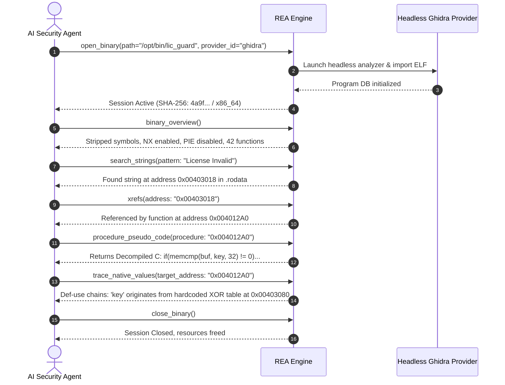
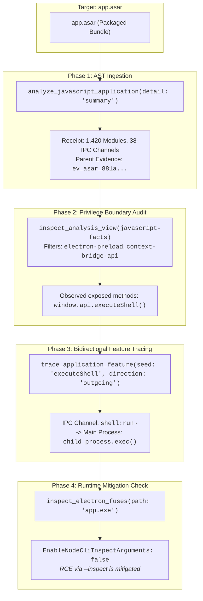
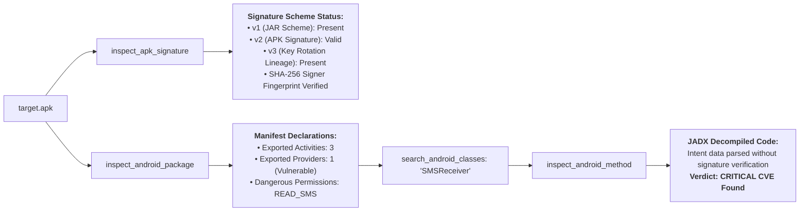
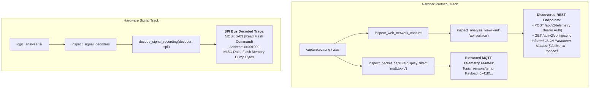
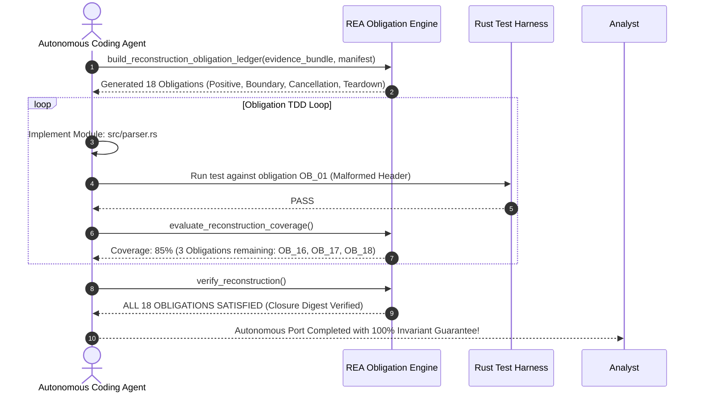

# Chapter 16: Industrial REA in Practice — Native, Electron, Mobile & Protocol Auditing (বাস্তব ক্ষেত্রে REA: নেটিভ বাইনারি, ইলেকট্রন, অ্যান্ড্রয়েড ও নেটওয়ার্ক রিভার্সিং)

---

আগের অধ্যায়ে আমরা জেনেছি **Reverse Engineer Anything (REA)**-এর ২০৭টি টুলের তাত্ত্বিক কাঠামো, ক্রিপ্টোগ্রাফিক এভিডেন্স লেজার এবং এপিস্টেমিক ফিলোসফি।

কিন্তু যখন একটি এন্টারপ্রাইজ ইনসিডেন্ট রেসপন্স টিম কোনো জিরো-ডে ম্যালওয়্যার ট্রাফিকের সম্মুখীন হয়, অথবা কোনো ফিনটেক কোম্পানি তাদের প্রতিযোগী অ্যাপের এনক্রিপ্টেড প্রোটোকল রিভার্স করতে চায়—তখন এজেন্ট কীভাবে বাস্তবে ধাপে ধাপে এই ২০৭টি টুলসকে অস্ত্র হিসেবে ব্যবহার করে?

এই অধ্যায়ে আমরা দেখব রিভার্স ইঞ্জিনিয়ারিংয়ের **৬টি রিয়েল-ওয়ার্ল্ড ইন্ডাস্ট্রিয়াল ব্লুপ্রিন্ট**।

---

## ১. Blueprint 1: Native x86_64 / ARM64 Binary Analysis (গিড্রা ও কুনা দিয়ে নেটিভ বাইনারি অডিট)

ধরা যাক, আমাদের সামনে একটি লিনাক্স ELF এক্সিকিউটেবল দেওয়া হয়েছে যার নাম `lic_guard`। আমাদের লক্ষ্য হলো এর লাইসেন্স চেক লজিক ক্র্যাক বা ভেরিফাই করা।



### ধাপে ধাপে এক্সিকিউশন গাইডলাইন:
1. **সেশন ইনিশিয়ালাইজেশন:** `open_binary` কল করে গিড্রা বা কুনা ইঞ্জিন ব্যাকগ্রাউন্ডে ডাইরেক্ট মেমোরি ডিবি ওপেন করে।
2. **অ্যাঙ্কর পয়েন্ট খোঁজা:** রুট খোঁজার জন্য টেক্সট সার্চ চালানো হয় `search_strings` দিয়ে।
3. **ক্রস-রেফারেন্স ট্র্যাকিং:** স্ট্রিংটি কোন ফাংশন ব্যবহার করছে তা বের করতে `xrefs` কল করা হয়।
4. **সিউডোকোড রিকভারি:** `procedure_pseudo_code` কল করে ডিসঅ্যাসেম্বলড অপকোডকে হাই-লেভেল সি ল্যাঙ্গুয়েজে ডিকম্পাইল করা হয়।
5. **ভ্যালু ফ্লো অ্যানালাইসিস:** কোনো ভ্যারিয়েবল মেমোরিতে কোথা থেকে আসছে তা জানতে `trace_native_values` ডেটা-ফ্লো ট্রেস তৈরি করে।

---

## ২. Blueprint 2: Electron Application Decompilation & IPC Bridging (ইলেকট্রন ও ASAR আর্কিটেকচার অডিট)

আধুনিক ডেস্কটপ অ্যাপ্লিকেশনের (যেমন: Slack, VS Code, Discord) সিংহভাগই ইলেকট্রন আর্কিটেকচারে তৈরি। এর কোড `.asar` আর্কাইভে বান্ডল করা থাকে।



### কেন এটি যুগান্তকারী?
* কোনো থার্ড-পার্টি টুল দিয়ে `.asar` ফাইল আনপ্যাক করতে হয় না; REA-এর ইন-বিল্ট AST পার্সার সরাসরি মেমোরিতে ফাইল পার্স করে।
* `contextBridge` দিয়ে মেইন প্রসেসের অনিরাপদ ফাংশন রেন্ডারারে এক্সপোজ করা হয়েছে কিনা, তা সেকেন্ডের মধ্যে চিহ্নিত করা যায়।
* `inspect_electron_fuses` দেখে বলে দেওয়া যায় অ্যাপ্লিকেশনটিতে ইলেকট্রনের বাইনারি ফিউজ সেফটি ফ্ল্যাগগুলো সক্রিয় আছে কি না।

---

## ৩. Blueprint 3: Android APK Decompilation & Signature Triage (অ্যান্ড্রয়েড ডালভিক ও সিগনেচার ট্রায়াজ)

মোবাইল অ্যাপ্লিকেশনের সুরক্ষায় সোর্স কোড অবফাসকেট করা থাকে এবং প্যাকেজ ট্যাম্পারিং ঠেকানোর জন্য গুগলের মাল্টি-স্কিম সিগনেচার ব্যবহৃত হয়।



### মূল টুলস চেইন:
* **`inspect_apk_signature`:** পরীক্ষা করে অ্যাপটিতে v1, v2, v3 বা v3.1 সিগনেচার স্কিম ঠিকমতো কনফিগার করা আছে কি না এবং সার্টিফিকেট ফিঙ্গারপ্রিন্ট কোনো আনঅথরাইজড কী দ্বারা রিপ্লেস করা হয়েছে কি না।
* **`inspect_android_package`:** অ্যান্ড্রয়েড ম্যানিফেস্ট পার্স করে এক্সপোর্টেড অ্যাক্টিভিটি ও সার্ভিসগুলো শনাক্ত করে।
* **`inspect_android_method`:** ব্যাকগ্রাউন্ডে হেডলেস JADX ডালভিক বাইটকোডকে হাই-কোয়ালিটি জাভায় ডিকম্পাইল করে রিটার্ন দেয়।
* **ADB Automation:** ফিজিক্যাল বা এমুলেটর ডিভাইসের সাথে লাইভ ইন্টারঅ্যাক্ট করার জন্য রয়েছে `start_adb_activity`, `read_adb_logcat` এবং `capture_adb_screen`।

---

## ৪. Blueprint 4: Protocol & Hardware Logic Dissection (নেটওয়ার্ক ও হার্ডওয়্যার সিগন্যাল ডিকোডিং)

একটি রিমোট IoT ডিভাইসের এনক্রিপ্টেড কমিউনিকেশন বোঝার জন্য নেটওয়ার্ক ট্রাফিক এবং অন-বোর্ড চিপের বাস সিগন্যাল বিশ্লেষণ করার চমৎকার সক্ষমতা REA-তে রয়েছে।



### বিশেষ বৈশিষ্ট্য:
* **জিরো-রিকোয়েস্ট স্পুফিং:** `api-surface` ভিউ হাজার হাজার ট্রাফিকের রিকোয়েস্ট থেকে কোনো লাইভ কল বা প্যাকেট রি-প্লে না করেই স্বয়ংক্রিয়ভাবে একটি কমপ্লিট REST API স্পেসিফিকেশন তৈরি করে।
* **হার্ডওয়্যার বাস ডিকোড:** সরাসরি Sigrok-এর ১০০+ প্রোটোকল ডিকোডার (I2C, SPI, UART, CAN, 1-Wire) ব্যবহার করে লজিক অ্যানালাইজারের ওয়েভফর্মকে রিডেবল টেক্সট স্প্যানে রূপান্তর করা হয়।

---

## ৫. Blueprint 5: Autonomous Code Reconstruction (ক্লোজড-সোর্স কোড পোর্ট ও রি-রাইট)

যখন কোনো ক্লোজড-সোর্স সফটওয়্যারকে সম্পূর্ণ নতুন ভাষায় (যেমন: লেগ্যাসি C++ থেকে মেমোরি-সেফ Rust) পুনর্নির্মাণ করতে বলা হয়, তখন REA-এর **Reconstruction Obligation Ledger** কাজ করে:



---

## ৬. Blueprint 6: Diagnostic Recovery & Triage (প্রবলেম ফিক্সিং ও ট্রাবলশুটিং)

যদি কোনো ক্লায়েন্টে REA টুলস কাজ না করে বা কানেকশন ফেইল করে, তখন নিচের ৩-ধাপের রিকভারি ল্যাডার অনুসরণ করতে হবে:

```bash
# ১. ডায়াগনস্টিক চেক (কোনো ফাইল পরিবর্তন না করে সমস্যা চিহ্নিত করে)
npx -y rea-agents@6.7.0 doctor --client antigravity --json

# ২. ড্রাই-রান প্ল্যান (কী কী কনফিগ বা ফাইল পরিবর্তন হবে তা অনুমোদনহীন অবস্থায় প্রিভিউ দেখা)
npx -y rea-agents@6.7.0 setup --client antigravity --dry-run --json

# ৩. অনুমোদিত অটো-রিপেয়ার (কনফিগারেশন ব্যাকআপ রেখে ঠিক করা)
npx -y rea-agents@6.7.0 setup --client antigravity --yes
```

### ট্রাবলশুটিং চেকলিস্ট:
* **`MCP tool call requires approval`:** ক্লায়েন্ট সেটিংস ফাইলে টুলটির জন্য পারমিশন দিতে হবে:
  ```toml
  [mcp_servers.rea.tools.open_binary]
  approval_mode = "approve"
  ```
* **`resource_constraint: transport`:** রেসপন্স অতিরিক্ত বড় হলে রি-রান না করে `parent_evidence_id` দিয়ে ছোট `limit` ও `offset` সহযোগে `inspect_analysis_view` চালাতে হবে।
* **`provider_unavailable (JADX / Ghidra)`:** মেশিনে Java JDK 17+ ইনস্টল থাকতে হবে এবং `JAVA_HOME` এনভায়রনমেন্ট ভ্যারিয়েবল সেট করতে হবে।

---

## Developer Perspective
> **ইঞ্জিনিয়ারিং টিপ:**  
> যখন তুমি ইলেকট্রন বা ওয়েব ট্রাফিকের রিভার্স ইঞ্জিনিয়ারিং করবে, তখন সোর্সম্যাপ ডিকোড করার জন্য `recover_javascript_sources` ব্যবহার করো। এটি মিনিফায়েড ও অবফাসকেটেড কোডকে আসল ফাইলের ট্রিতে সাজিয়ে দেয়, ফলে ঘণ্টার পর ঘণ্টা এক লাইনের লাখ লাখ অক্ষরের কোড ম্যানুয়ালি সাজানোর সময় বেঁচে যায়।

---

## Production Reality
> **বাস্তব অভিজ্ঞতা:**  
> অনেক প্রডাকশন বাইনারি অ্যান্টি-ডিবাগিং এবং পি-ট্রেস (PTRACE_TRACEME) প্রটেকশন দিয়ে কম্পাইল করা থাকে। এগুলো রান করাতে গেলে ক্র্যাশ করে। এজন্য প্রডাকশনে রিয়েল-টাইম ডিবাগিংয়ের চেয়ে REA-এর স্ট্যাটিক মেমোরি পার্সার (`inspect_binary_layout`, `inspect_elf_unwind_ranges`, `inspect_pe_load_config`) ব্যবহার করা ১০০ গুণ নিরাপদ ও নির্ভরযোগ্য।

---

## Common Mistake
> **মারাত্মক ভুল:**  
> নেটওয়ার্ক ট্রাফিকের HAR বা PCAP এনালাইসিস করার সময় রেকর্ড হওয়া এন্ডপয়েন্টগুলোতে সরাসরি লাইভ রিকোয়েস্ট পাঠানো। এটি আইনি লঙ্ঘন তৈরি করতে পারে অথবা একাউন্ট ব্যান হতে পারে। REA-এর নিয়ম হলো: কখনোই লাইভ রিকোয়েস্ট পাঠাবে না; শুধুমাত্র অফলাইন ক্যাপচার থেকে `inspect_analysis_view(kind: "api-surface")` দিয়ে স্ট্রাকচার রিকভার করবে।

---

## Interview Flashcards

#### Beginner Level
* **প্রশ্ন:** ইলেকট্রন অ্যাপ্লিকেশনের সোর্স কোড সাধারণত কোন ফাইলে প্যাক করা থাকে এবং REA কীভাবে তা পড়ে?
* **উত্তর:** সোর্স কোড `.asar` আর্কাইভে প্যাক করা থাকে। REA কোনো আনপ্যাকিং ছাড়া সরাসরি মেমোরিতে AST পার্সিংয়ের জন্য `analyze_javascript_application` ব্যবহার করে।

#### Intermediate Level
* **প্রশ্ন:** নেটিভ বাইনারির স্ট্রিং থেকে সোর্স কোড খোঁজার সঠিক REA টুল চেইনটি কী?
* **উত্তর:** চেইনটি হলো: `search_strings` (স্ট্রিংয়ের অ্যাড্রেস পাওয়া) $\rightarrow$ `xrefs` (অ্যাড্রেসটিকে রেফারেন্স করা ফাংশনের অ্যাড্রেস পাওয়া) $\rightarrow$ `procedure_pseudo_code` (ফাংশনটির ডিকম্পাইল্ড সিউডোকোড পাওয়া) $\rightarrow$ `trace_native_values` (ডাটা ফ্লো ও ভ্যারিয়েবল ভ্যালু ট্রেস করা)।

#### Advanced Level
* **প্রশ্ন:** সোর্স কোড ছাড়া একটি ক্লোজড-সোর্স অ্যাপ্লিকেশনের বিশ্বস্ত REST API ডকুমেন্টেশন তৈরি করতে REA কোন মেকানিজম ব্যবহার করে?
* **উত্তর:** REA ট্রাফিক ক্যাপচার (HAR বা SAZ) থেকে `inspect_analysis_view`-এর `kind: "api-surface"` ভিউ চালায়। এটি কোনো লাইভ কল না করে এবং কোনো সেনসিটিভ ক্রেডেনশিয়াল না পড়ে মেথড, ইউআরএল পাথ টেমপ্লেট এবং কুয়েরি প্যারামিটার নেম স্বয়ংক্রিয়ভাবে ক্লাস্টার করে রিভার্সড API ডক তৈরি করে।