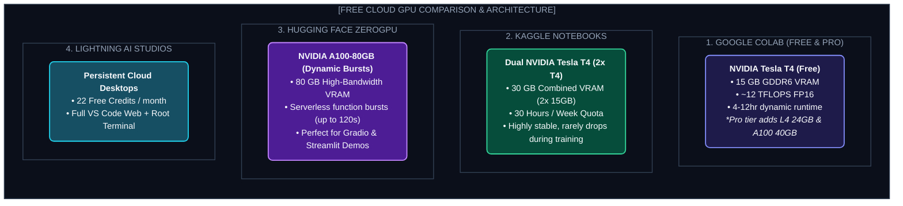

# Chapter 20: Free Cloud GPU Mastery & Environment Setup (ফ্রি ক্লাউড জিপিইউ ও পরিবেশ সেটআপ)

---

AI ইঞ্জিনিয়ারিং বা রিসার্চের পথে সবচেয়ে বড় বাধার নাম কী? 

যেকোনো ডেভেলপার বা স্টুডেন্টকে জিজ্ঞেস করলে উত্তর আসবে একটাই— **"ভাই, GPU কেনার টাকা নেই!"**

একটি 7B বা 14B প্যারামিটারের মডেল ফাইন-টিউন করতে গেলে যে পরিমাণ VRAM লাগে, তা আমাদের সাধারণ ল্যাপটপে তো দূরের কথা, সাধারণ গেমিং পিসির RTX 3060 বা 4060 কার্ডেও কুলায় না। আর ক্লাউডে একটি NVIDIA A100 বা H100 জিপিইউ ভাড়া করতে গেলে ঘণ্টায় ৩ থেকে ৫ ডলার (প্রায় ৪০০-৬০০ টাকা) গুনতে হয়। 

তাহলে কি পকেটের টাকা খরচ না করে বড় বড় মডেল রান, টেস্ট আর ট্রেইন করা সম্ভব নয়?

**অবশ্যই সম্ভব!** 

আজকের দিনে Google Colab, Kaggle, এবং Hugging Face-এর মতো প্ল্যাটফর্মগুলো বিশ্বব্যাপী ডেভেলপারদের জন্য সম্পূর্ণ বিনামূল্যে মিলিয়ন ডলারের এন্টারপ্রাইজ জিপিইউ উন্মুক্ত করে রেখেছে। শুধু জানতে হবে কীভাবে সেগুলোর সঠিক ব্যবহার করতে হয় এবং কীভাবে ১৫ জিবি VRAM-এর ভেতর একটি দৈত্যাকার মডেলকে আটকে ফেলতে হয়।

---

## ১. The Free Cloud GPU Landscape (ফ্রি ক্লাউড জিপিইউ ইকোসিস্টেম)

ক্লাউডে কোড রান করার আগে আমাদের জানা প্রয়োজন কোন প্ল্যাটফর্ম আমাদের কী ধরণের সুযোগ ও সীমাবদ্ধতা দেয়:



---

## ২. VRAM Mathematics: কেন 7B মডেল 15GB জিপিইউতে ওওএম (OOM) হয়?

অনেকেই ভাবেন, একটি 7 Billion প্যারামিটারের মডেল 15 GB জিপিইউতে অনায়াসেই ফিট হয়ে যাবে। কিন্তু রান করার সাথে সাথেই স্ক্রিনে লাল অক্ষরে ভেসে ওঠে:
`torch.cuda.OutOfMemoryError: CUDA out of memory.`

কেন এমন হয়? চল অঙ্কটা দেখে নিই:

$$\text{Total VRAM} = \text{Model Weights} + \text{KV Cache (Inference)} + \text{Activations} + \text{Optimizer States (Training)}$$

1. **Model Weights (FP16):**
   প্রতিটি প্যারামিটার ১৬-বিট বা ২ বাইট জায়গা নেয়।
   $$7{,}000{,}000{,}000 \times 2 \text{ bytes} \approx 14 \text{ GB}$$
   শুধুমাত্র মডেল লোড করতেই ১৪ জিবি শেষ! ইনপুট টোকেন প্রসেস করার জন্য বাকি থাকে মাত্র ১ জিবি।

2. **Training Overhead (Adam Optimizer):**
   ট্রেনিংয়ের সময় AdamW অপ্টিমাইজার প্রতিটি প্যারামিটারের জন্য মোমেন্টাম ও ভ্যারিয়েন্স ট্র্যাক করে (অতিরিক্ত ৮ বাইট প্রতি প্যারামিটার)। এর সাথে গ্র্যাডিয়েন্টস (৪ বাইট)।
   ফলে ফুল ফাইন-টিউনিংয়ে মোট খরচ দাঁড়ায়:
   $$2 \text{ (weights)} + 4 \text{ (grads)} + 8 \text{ (optimizer)} + 2 \text{ (activations)} = 16 \text{ bytes per param}$$
   $$7\text{B} \times 16 \approx 112\text{ GB VRAM!}$$
   মানে কমপক্ষে দুটি ৮০ জিবি A100 জিপিইউ লাগবে!

### জাদু যেখানে ঘটে: ৪-বিট NF4 কোয়ান্টাইজেশন
আমরা যদি মডেলের ওজনকে **৪-বিটে (0.5 বাইট)** সংকুচিত করি:
$$7\text{B} \times 0.5 \text{ bytes} \approx 3.5 \text{ GB VRAM!}$$
১৫ জিবি T4 জিপিইউতে ৩.৫ জিবি ওজন লোড করার পর আমাদের হাতে তখনও **১১.৫ জিবি বাফার** থাকে! এই বাফারে আমরা বিশাল কনটেক্সট এবং LoRA অ্যাডাপ্টার খুব সহজেই ট্রেইন করতে পারি।

---

## ৩. Google Colab Survival Guide (ডিসকানেকশন ও ড্রাইভ ম্যানেজমেন্ট)

Google Colab ফ্রি টিয়ারে কাজ করার সময় সবচেয়ে বড় ঝুঁকি হলো ব্রাউজার ট্যাব ইনঅ্যাক্টিভ হলে বা রানটাইম টাইমআউট হলে ট্রেইন্ড মডেল হারিয়ে যাওয়া।

নিচের ৪টি গোল্ডেন রুল তোমাকে সুরক্ষিত রাখবে:

### ১. গুগল ড্রাইভ অটো-মাউন্টিং
প্রতিটি ট্রেনিং সেশনের শুরুতেই গুগল ড্রাইভ কানেক্ট করে নেবে যাতে প্রতি ৫০ স্টেপ পর পর চেকপয়েন্ট সরাসরি তোমার গুগল ড্রাইভে সেভ হয়:

```python
from google.colab import drive
import os

drive.mount('/content/drive')

# চেকপয়েন্ট সেভ করার ডিরেক্টরি তৈরি
CHECKPOINT_DIR = "/content/drive/MyDrive/ai_models/checkpoints"
os.makedirs(CHECKPOINT_DIR, exist_ok=True)
print(f"Persistent storage ready at: {CHECKPOINT_DIR}")
```

### ২. জিপিইউ হেলথ ও ভি-র‍্যাম টেলিমেট্রি ফাংশন
ট্রেনিং চলাকালীন যেকোনো মুহূর্তে জিপিইউ মেমরির রিয়েল-টাইম হিসাব পাওয়ার জন্য এই ইউটিলিটি ফাংশনটি নোটবুকে রাখবে:

```python
import torch

def print_gpu_memory():
    if torch.cuda.is_available():
        allocated = torch.cuda.memory_allocated() / (1024 ** 3)
        reserved = torch.cuda.memory_reserved() / (1024 ** 3)
        max_allocated = torch.cuda.max_memory_allocated() / (1024 ** 3)
        print(f"📊 GPU: {torch.cuda.get_device_name(0)}")
        print(f"Allocated: {allocated:.2f} GB | Reserved: {reserved:.2f} GB | Peak: {max_allocated:.2f} GB")
    else:
        print("⚠️ No GPU detected! Make sure to set Runtime -> Change runtime type -> T4 GPU")

print_gpu_memory()
```

---

## ৪. Installing & Running Models in Google Colab

চল দেখে নিই কীভাবে ফ্রি Colab সেশনে ৩টি ভিন্ন পদ্ধতিতে মডেল রান করা যায়:

### পদ্ধতি ১: Hugging Face `transformers` দিয়ে ৪-বিটে মডেল লোড ও টেস্ট
সবচেয়ে স্ট্যান্ডার্ড পাইথন পদ্ধতি:

```python
# ডিপেন্ডেন্সি ইনস্টলেশন
!pip install -q -U torch transformers accelerate bitsandbytes

import torch
from transformers import AutoModelForCausalLM, AutoTokenizer, BitsAndBytesConfig

model_id = "meta-llama/Meta-Llama-3.1-8B-Instruct"

# 4-bit Quantization Configuration
bnb_config = BitsAndBytesConfig(
    load_in_4bit=True,
    bnb_4bit_quant_type="nf4",
    bnb_4bit_compute_dtype=torch.float16,
    bnb_4bit_use_double_quant=True
)

tokenizer = AutoTokenizer.from_pretrained(model_id)
model = AutoModelForCausalLM.from_pretrained(
    model_id,
    quantization_config=bnb_config,
    device_map="auto"
)

# ইনফারেন্স টেস্ট
prompt = "Explain quantum computing in 2 simple sentences."
inputs = tokenizer(prompt, return_tensors="pt").to("cuda")

with torch.no_grad():
    outputs = model.generate(**inputs, max_new_tokens=60, temperature=0.7)

print(tokenizer.decode(outputs[0], skip_special_tokens=True))
```

---

### পদ্ধতি ২: Google Colab-এর ভেতর সরাসরি Ollama চালানো!

অনেকেই জানেন না যে Google Colab-এর ব্যাকগ্রাউন্ড টার্মিনালে সরাসরি Ollama ইনস্টল করে নিমেষেই মডেল সার্ভ করা যায়:

```bash
# ১. Colab লিনাক্স এনভায়রনমেন্টে Ollama ইনস্টল
!curl -fsSL https://ollama.com/install.sh | sh

# ২. ব্যাকগ্রাউন্ডে সার্ভার চালু করা (STDIO লগ আলাদা রেখে)
import subprocess
import time

ollama_process = subprocess.Popen(["ollama", "serve"])
time.sleep(3) # সার্ভার বুট হওয়ার সময়

# ৩. দ্রুততম ও শক্তিশালী ছোট মডেল নামানো (Llama 3.2 3B বা Qwen 2.5 7B)
!ollama run qwen2.5:7b "বল তো, বাংলাদেশে কৃত্রিম বুদ্ধিমত্তার ভবিষ্যৎ কেমন?"
```

---

### পদ্ধতি ৩: GGUF ও llama-cpp-python দিয়ে আল্ট্রা-ফাস্ট লোকাল এক্সিকিউশন

যদি তুমি সর্বনিম্ন VRAM-এ সর্বোচ্চ টোকেন জেনারেশন স্পিড চাও:

```bash
!CMAKE_ARGS="-DGGML_CUDA=on" pip install llama-cpp-python
!wget -q https://huggingface.co/bartowski/Llama-3.2-3B-Instruct-GGUF/resolve/main/Llama-3.2-3B-Instruct-Q4_K_M.gguf
```

```python
from llama_cpp import Llama

# n_gpu_layers=-1 মানে সমস্ত লেয়ার জিপিইউতে অফলোড হবে
llm = Llama(
    model_path="Llama-3.2-3B-Instruct-Q4_K_M.gguf",
    n_gpu_layers=-1,
    n_ctx=2048
)

output = llm("Q: What are the three laws of robotics? A:", max_tokens=100)
print(output["choices"][0]["text"])
```

---

Developer Perspective
Google Colab-এ বড় ফাইল ডাউনলোড করার সময় সবসময় `wget -c` বা `aria2c` ব্যবহার করবে। সাধারণ `curl` বা পাইথন ডাউনলোডার অনেক সময় নেটওয়ার্ক ফ্লিকার হলে কেটে যায় এবং শুরু থেকে আবার ডাউনলোড শুরু করতে হয়। `aria2c -x 16` ব্যবহার করলে ১৬টি প্যারালাল থ্রেডে মাত্র ৩০ সেকেন্ডে ৫ জিবির GGUF মডেল ডাউনলোড হয়ে যায়।

---

Production Reality
ফ্রি ক্লাউড প্ল্যাটফর্মের জিপিইউগুলো ট্রেইনিংয়ের জন্য চমৎকার, কিন্তু **প্রোডাকশন API হিসেবে ব্যবহারের জন্য অনুপযুক্ত**। গুগল কোলাবের সেশন যেকোনো সময় বন্ধ হয়ে যেতে পারে। তাই কোলাবকে ব্যবহার করবে শুধুমাত্র **মডেল ফাইন-টিউনিং, এক্সপেরিমেন্টেশন ও GGUF কনভার্শনের কারখানা হিসেবে**। ট্রেনিং শেষে মডেলটি এক্সপোর্ট করে Hugging Face Hub, RunPod Serverless বা লোকাল Ollama-তে ডেপ্লয় করবে।

---

Common Mistake
কোলাবে সেল এক্সিকিউট করে ব্রাউজার উইন্ডো মিনিমাইজ করে ঘুমিয়ে পড়া। গুগল কোলাব ইউজারের মাউস/কিবোর্ড ইন্টারঅ্যাকশন না পেলে ৯০ মিনিট পর স্বয়ংক্রিয়ভাবে কার্নেল কিল করে দেয়। কোলাবে বড় ট্রেনিং রান করার সময় স্ক্রিন অন রাখা অথবা গুগল কোলাব প্রো সাবস্ক্রিপশন ব্যবহার করা উচিত যা ব্যাকগ্রাউন্ড এক্সিকিউশন সাপোর্ট করে।

---

## Interview Flashcards

#### Beginner Level
* **প্রশ্ন:** Google Colab-এর ফ্রি টিয়ারে কোন GPU দেওয়া হয় এবং এর VRAM কত?
* **উত্তর:** Google Colab-এর ফ্রি টিয়ারে সাধারণত NVIDIA Tesla T4 GPU পাওয়া যায়, যার VRAM ১৫ জিবি (GDDR6)।

#### Intermediate Level
* **প্রশ্ন:** ৭ বিলিয়ন প্যারামিটারের মডেল ১৬-বিটে লোড না হয়ে ৪-বিট NF4 কোয়ান্টাইজেশনে কেন সহজে ফিট হয়?
* **উত্তর:** ১৬-বিটে প্রতিটি প্যারামিটার ২ বাইট জায়গা নেওয়ায় শুধু বেস মডেলের ওজনই ১৪ জিবি হয়ে যায়, যা ১৫ জিবি কার্ডে ওওএম ঘটায়। কিন্তু ৪-বিট NF4 কোয়ান্টাইজেশনে প্যারামিটার প্রতি মাত্র ০.৫ বাইট খরচ হওয়ায় মেমরি সাইজ নেমে আসে প্রায় ৩.৫ জিবিতে, ফলে বাকি ১১.৫ জিবি মেমরিতে আরামসে কাজ করা যায়।

#### Advanced Level
* **প্রশ্ন:** ট্রেনিং চলাকালীন Colab সেশন ডিসকানেক্টের হাত থেকে ট্রেইন্ড মডেল বাঁচানোর সেরা আর্কিটেকচার কী?
* **উত্তর:** ট্রেনিং লুপের সাথে Google Drive মাউন্ট করে প্রতি ৫০ বা ১০০ স্টেপ পর পর `save_steps` প্যারামিটারের মাধ্যমে LoRA অ্যাডাপ্টার সরাসরি ড্রাইভে সেভ করা। এতে সেশন ড্রপ করলেও ড্রাইভে থাকা সর্বশেষ চেকপয়েন্ট থেকে `resume_from_checkpoint=True` দিয়ে কাজ পুনরায় শুরু করা যায়।
