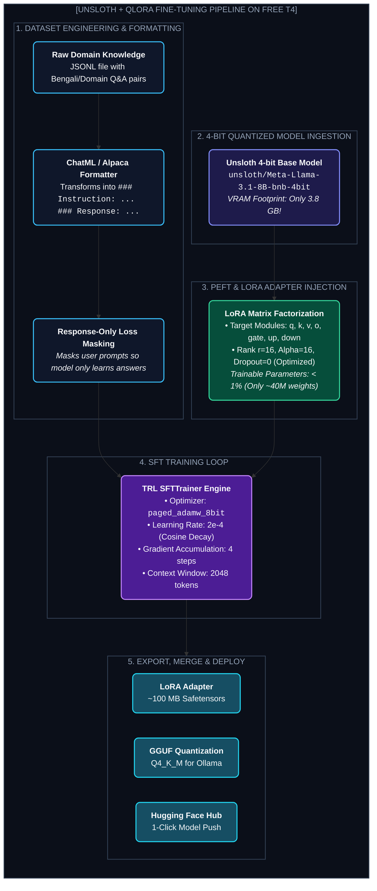

# Chapter 21: Hands-On Fine-Tuning Bootcamp with Unsloth & QLoRA (হ্যান্ডস-অন ফাইন-টিউনিং বুটক্যাম্প)

---

আগের চ্যাপ্টারে আমরা ফ্রি ক্লাউড জিপিইউর পরিবেশ তৈরি করেছি। 

এবার আসল খেলার পালা— **একটি আস্ত Foundation Model (Llama 3.1 8B বা Mistral 7B)-কে সম্পূর্ণ বিনামূল্যে তোমার নিজের কাস্টম ডেটাসেটে ফাইন-টিউন করা!**

ধরো, তুমি এমন একটি AI বানাতে চাও যা:
1. খাঁটি ও মিষ্টি বাংলায় জটিল আইনি বা মেডিকেল পরামর্শ দেবে, অথবা
2. তোমার কোম্পানির নিজস্ব ডাটাবেস স্কিমা অনুযায়ী নিখুঁত SQL কোয়েরি জেনারেট করবে।

সাধারণ Hugging Face বা PyTorch দিয়ে ১৫ জিবি T4 জিপিইউতে এটি করতে গেলে মেমোরি ক্র্যাশ অনিবার্য ছিল। কিন্তু ২০২৪-২০২৫ সালে ওপেন-সোর্স কমিউনিটিকে কাঁপিয়ে দেওয়া লাইব্রেরি **Unsloth** এসে পুরো খেলার নিয়ম বদলে দিয়েছে।

> **The Unsloth Miracle:**  
> Daniel ও Michael Han ভাইদের তৈরি Unsloth লাইব্রেরি PyTorch-এর ধীরগতির ব্যাকপ্রোপাগেশন কার্নেলগুলো হাতে লিখে OpenAI Triton অ্যাসেম্বলি কোডে নতুন করে তৈরি করেছে।  
> ফলাফল? **২ থেকে ৫ গুণ দ্রুত ট্রেনিং এবং ৭০% থেকে ৮০% পর্যন্ত মেমরি সেভিংস!**  
> যে ট্রেনিং করতে আগে ৮টি A100 জিপিইউ লাগত, তা এখন ফ্রি Google Colab-এর সাধারণ T4 জিপিইউতেই মাত্র ২০ মিনিটে সম্পন্ন করা সম্ভব!

---

## ১. The 5-Step Fine-Tuning Pipeline Architecture

একটি সফল ফাইন-টিউনিং পাইপলাইনের ৫টি স্তর নিচের ডায়াগ্রামে লক্ষ্য করো:



---

## ২. Dataset Engineering: Alpaca বনাম ShareGPT ফরম্যাট

মডেল ফাইন-টিউনিংয়ের সবচেয়ে গুরুত্বপূর্ণ অংশ হলো ডেটাসেটের ফরম্যাটিং। যদি ডেটাসেটের ফরম্যাটে ভুল থাকে, মডেল ট্রেনিং চলাকালীন ভুল সিনট্যাক্স শিখে ফেলবে।

### ফরম্যাট ১: Alpaca Format (সিঙ্গেল-টার্ন টাস্কের জন্য সেরা)
```json
[
  {
    "instruction": "নিচের ইংরেজি বাক্যটিকে প্রাঞ্জল ও সাধু বাংলায় অনুবাদ করো।",
    "input": "Artificial intelligence is revolutionizing modern healthcare.",
    "output": "কৃত্রিম বুদ্ধিমত্তা আধুনিক চিকিৎসাব্যবস্থায় এক বৈপ্লবিক পরিবর্তন আনয়ন করিতেছে।"
  },
  {
    "instruction": "SQL কোয়েরি লিখো যাতে কাস্টমার টেবিল থেকে সর্বোচ্চ ব্যালেন্সের ৫ জন গ্রাহককে পাওয়া যায়।",
    "input": "Table: customers (id, name, balance)",
    "output": "SELECT id, name, balance FROM customers ORDER BY balance DESC LIMIT 5;"
  }
]
```

### ফরম্যাট ২: ChatML / Llama-3 Format (মাল্টি-টার্ন কনভার্সেশনের জন্য সেরা)
```json
[
  {
    "conversations": [
      {"role": "system", "content": "তুমি একজন অত্যন্ত পারদর্শী বাংলা এআই বিশেষজ্ঞ।"},
      {"role": "user", "content": "ল্যাপটপে কি LLM ফাইন-টিউন করা সম্ভব?"},
      {"role": "assistant", "content": "হ্যাঁ! QLoRA এবং Unsloth ব্যবহার করে সাধারণ ৮-১৬ জিবি VRAM কার্ডেই ৭ বিলিয়ন প্যারামিটারের মডেল ফাইন-টিউন করা সম্ভব।"}
    ]
  }
]
```

---

## ৩. Complete End-to-End Fine-Tuning Code (রান করার জন্য প্রস্তুত)

নিচের সম্পূর্ণ কোডটি একটি একক Google Colab T4 সেশনে সরাসরি রান করা যাবে।

### ধাপ ১: ডিপেন্ডেন্সি ইনস্টলেশন
```python
# Unsloth ও এর অ্যাক্সিলারেটেড কার্নেল ইনস্টল
!pip install -q "unsloth[colab-new] @ git+https://github.com/unslothai/unsloth.git"
!pip install -q --no-deps xformers "trl<0.9.0" peft accelerate bitsandbytes
```

---

### ধাপ ২: মডেল ও টোকেনাইজার ৪-বিট লোডিং
আমরা মেটা-র লেটেস্ট Llama 3.1 8B মডেলটি ৪-বিটে লোড করব:

```python
from unsloth import FastLanguageModel
import torch

max_seq_length = 2048  # কনটেক্সট উইন্ডো (Colab T4-এর জন্য ২০৪৮ একদম পারফেক্ট)
dtype = None           # অটো-ডিটেকশন (T4 এর জন্য Float16)
load_in_4bit = True    # 4-bit QLoRA এনাবলড

model, tokenizer = FastLanguageModel.from_pretrained(
    model_name="unsloth/Meta-Llama-3.1-8B-bnb-4bit",
    max_seq_length=max_seq_length,
    dtype=dtype,
    load_in_4bit=load_in_4bit,
)

print(f"Base model loaded successfully! Current VRAM: {torch.cuda.memory_allocated() / 1e9:.2f} GB")
```

---

### ধাপ ৩: LoRA অ্যাডাপ্টার ইনজেকশন
আমরা মডেলের সমস্ত অ্যাটেনশন ও এমএলপি প্রজেকশন লেয়ারে LoRA অ্যাডাপ্টার যুক্ত করব:

```python
model = FastLanguageModel.get_peft_model(
    model,
    r=16,                    # LoRA Rank (৮ বা ১৬ সাধারণত আদর্শ)
    target_modules=[
        "q_proj", "k_proj", "v_proj", "o_proj",
        "gate_proj", "up_proj", "down_proj",
    ],
    lora_alpha=16,           # স্কেলিং ফ্যাক্টর
    lora_dropout=0,          # Unsloth-এ ড্রপআউট ০ রাখা মেমরির জন্য অপ্টিমাইজড
    bias="none",
    use_gradient_checkpointing="unsloth", # গ্র্যাডিয়েন্ট চেকপয়েন্টিং মেমরি বাঁচায়
    random_state=3407,
    max_seq_length=max_seq_length,
)

print("LoRA Adapters successfully injected!")
```

---

### ধাপ ৪: ডেটাসেট প্রিপারেশন ও প্রম্পট ম্যাপিং
```python
from datasets import Dataset

# স্যাম্পল ডোমেন ডেটাসেট (বাস্তবে তুমি JSON ফাইল লোড করবে)
custom_data = [
    {
        "instruction": "একটি সহজ পাইথন ফাংশন লিখো যা দুটি সংখ্যার গ.সা.গু (GCD) বের করে।",
        "input": "",
        "output": "import math\n\ndef calculate_gcd(a, b):\n    return math.gcd(a, b)\n\n# উদাহরণ:\nprint(calculate_gcd(48, 18)) # Output: 6"
    },
    {
        "instruction": "বাংলায় সংক্ষেপে ব্যাখ্যা করো: LoRA কী?",
        "input": "",
        "output": "LoRA (Low-Rank Adaptation) হলো এমন একটি ফাইন-টিউনিং কৌশল যেখানে মূল মডেলের বিলিয়ন বিলিয়ন ওজন লক রেখে পাশে ছোট্ট দুটি ম্যাট্রিক্স ট্রেইন করা হয়। এতে ৯০% মেমরি বাঁচে।"
    }
]

# Alpaca প্রম্পট টেমপ্লেট
alpaca_prompt = """Below is an instruction that describes a task, paired with an input that provides further context. Write a response that appropriately completes the request.

### Instruction:
{}

### Input:
{}

### Response:
{}"""

def formatting_prompts_func(examples):
    instructions = examples["instruction"]
    inputs       = examples["input"]
    outputs      = examples["output"]
    texts = []
    for instruction, input_text, output in zip(instructions, inputs, outputs):
        text = alpaca_prompt.format(instruction, input_text, output) + tokenizer.eos_token
        texts.append(text)
    return { "text" : texts }

dataset = Dataset.from_list(custom_data)
dataset = dataset.map(formatting_prompts_func, batched=True)
print(f"Dataset ready with {len(dataset)} examples.")
```

---

### ধাপ ৫: SFTTrainer কনফিগারেশন ও ট্রেনিং শুরু
```python
from trl import SFTTrainer
from transformers import TrainingArguments

trainer = SFTTrainer(
    model=model,
    tokenizer=tokenizer,
    train_dataset=dataset,
    dataset_text_field="text",
    max_seq_length=max_seq_length,
    dataset_num_proc=2,
    packing=False, # ছোট ডেটাসেটে প্যাফেকিং ফলস রাখা ভালো
    args=TrainingArguments(
        per_device_train_batch_size=2,      # মাইক্রো-ব্যাচ
        gradient_accumulation_steps=4,      # এফেক্টিভ ব্যাচ সাইজ = ৮
        warmup_steps=5,
        max_steps=60,                       # ডেমো টেস্টের জন্য ৬০ স্টেপ
        learning_rate=2e-4,                 # অ্যাডাম অপ্টিমাইজারের স্ট্যান্ডার্ড লার্নিং রেট
        fp16=not torch.cuda.is_bf16_supported(),
        bf16=torch.cuda.is_bf16_supported(),
        logging_steps=10,
        optim="paged_adamw_8bit",           # আল্ট্রা মেমরি সেভিং অপ্টিমাইজার
        weight_decay=0.01,
        lr_scheduler_type="cosine",
        seed=3407,
        output_dir="outputs",
    ),
)

# ট্রেনিং শুরু!
trainer_stats = trainer.train()
print("Training completed successfully!")
```

---

## ৪. Post-Training: Testing, Merging & GGUF Export

ট্রেনিং শেষ হওয়ার পর মডেলটি আমরা কীভাবে ব্যবহার করব?

### ১. লাইভ ইনফারেন্স টেস্ট (Inference Test)
```python
# মডেলকে ফাস্ট ইনফারেন্স মোডে নেওয়া
FastLanguageModel.for_inference(model)

inputs = tokenizer(
[
    alpaca_prompt.format(
        "বাংলায় সংক্ষেপে ব্যাখ্যা করো: LoRA কী?", # Instruction
        "",                                          # Input
        "",                                          # Output (মডেল পূরণ করবে)
    )
], return_tensors="pt").to("cuda")

outputs = model.generate(**inputs, max_new_tokens=128, use_cache=True)
print(tokenizer.batch_decode(outputs)[0])
```

---

### ২. শুধুমাত্র ১০০ মেগাবাইট LoRA অ্যাডাপ্টার সেভ করা
বেস মডেল বারবার সেভ করার দরকার নেই। শুধু ফাইন-টিউন করা অ্যাডাপ্টার গুগল ড্রাইভে সেভ করে রাখলেই চলবে:

```python
# গুগল ড্রাইভে সেভ
model.save_pretrained("/content/drive/MyDrive/my_bengali_lora_model")
tokenizer.save_pretrained("/content/drive/MyDrive/my_bengali_lora_model")
print("LoRA weights (~100MB) saved safely to Google Drive!")
```

---

### ৩. সরাসরি ৪-বিট GGUF-এ কনভার্ট ও ডাউনলোড (Ollama / LM Studio-র জন্য)
Unsloth-এর সবচেয়ে বড় পাওয়ার হলো— এটি এক লাইনের কমান্ডে ট্রেইন্ড মডেলকে `Q4_K_M` GGUF ফাইলে পরিণত করে দেয়:

```python
# GGUF 4-bit কনভার্শন (সরাসরি লোকাল পিসিতে চালানোর জন্য)
model.save_pretrained_gguf("my_model_q4", tokenizer, quantization_method="q4_k_m")
print("GGUF model exported! Ready to run in Ollama or LM Studio.")
```

---

### ৪. Hugging Face Hub-এ মডেল আপলোড (1-Click Publish)
```python
# তোমার Hugging Face প্রোফাইলে সরাসরি আপলোড
HF_TOKEN = "hf_your_token_here"

model.push_to_hub_gguf(
    "your-username/bengali-llama-3.1-8b-gguf",
    tokenizer,
    quantization_method="q4_k_m",
    token=HF_TOKEN
)
print("Model published live to Hugging Face Hub!")
```

---

Developer Perspective
ফাইন-টিউনিংয়ের পর কখনো ভুলেও Raw LoRA অ্যাডাপ্টারকে প্রোডাকশন সার্ভিসিংয়ের জন্য ওপেন রাখবে না। ইনফারেন্সের সময় LoRA অ্যাডাপ্টার থাকলে মডেলের Latency দ্বিগুণ হয়ে যায় কারণ প্রতিটি টোকেনকে দুটি ম্যাট্রিক্স প্যারালালি পার হতে হয়। প্রোডাকশনে পাঠানোর আগে সবসময় `model.save_pretrained_merged("merged_model", tokenizer, save_method="merged_16bit")` দিয়ে অ্যাডাপ্টারের ওজনকে বেস মডেলের সাথে ব্লেন্ড (Merge) করে নেবে।

---

Production Reality
প্রোডাকশন ডেটাসেটের ক্ষেত্রে **Quality > Quantity**। ১ লক্ষ নিম্নমানের জেনেরিক ডেটার চেয়ে ১,০০০টি উচ্চমানের, নিখুঁতভাবে কিউরেট করা ডোমেন ডেটাসেটে ফাইন-টিউন করলে মডেলের পারফরম্যান্স নাটকীয়ভাবে ভালো হয় (একে বলে LIMA Hypothesis: *Less Is More for Alignment*)। ডেটাসেটে যেন কোনো ভুল ব্যাকরণ বা অসম্পূর্ণ তথ্য না থাকে তা প্রাক-প্রক্রিয়াকরণে নিশ্চিত করতে হবে।

---

Common Mistake
Learning Rate বেশি বাড়িয়ে দেওয়া। ফাইন-টিউনিংয়ে লার্নিং রেট যদি `1e-3` বা তার বেশি রাখা হয়, তবে **Catastrophic Forgetting** ঘটে— অর্থাৎ মডেল তার পূর্বের সমস্ত সাধারণ বুদ্ধি হারিয়ে ফেলে এবং একটি রোবটের মতো একই বাক্য বারবার আওড়াতে থাকে। QLoRA ফাইন-টিউনিংয়ে সেফ রেঞ্জ হলো `1e-4` থেকে `2e-4`।

---

## Interview Flashcards

#### Beginner Level
* **প্রশ্ন:** Unsloth লাইব্রেরি ব্যবহারের প্রধান সুবিধা কী?
* **উত্তর:** Unsloth কাস্টম OpenAI Triton কার্নেল ব্যবহার করে ব্যাকপ্রোপাগেশন চালায়, যার ফলে স্ট্যান্ডার্ড Hugging Face-এর তুলনায় ২ থেকে ৫ গুণ দ্রুত ট্রেনিং হয় এবং ৭০% পর্যন্ত GPU VRAM সাশ্রয় হয়।

#### Intermediate Level
* **প্রশ্ন:** ফাইন-টিউনিংয়ের সময় `paged_adamw_8bit` অপ্টিমাইজার কেন ব্যবহার করা হয়?
* **উত্তর:** AdamW অপ্টিমাইজার প্রচুর VRAM দখল করে। Paged AdamW অপ্টিমাইজারের ওজনগুলোকে ৮-বিটে কোয়ান্টাইজ করে এবং মেমরি স্পাইক হলে সাময়িকভাবে CPU RAM-এ পেজ আউট করে। ফলে ফ্রি T4 জিপিইউতেও মেমরি ক্র্যাশ (OOM) হয় না।

#### Advanced Level
* **প্রশ্ন:** ফাইন-টিউনিং শেষে মডেলকে GGUF ফরম্যাটে রূপান্তরের প্রয়োজনীয়তা কী?
* **উত্তর:** GGUF (GPT-Generated Unified Format) হলো আধুনিক কোয়ান্টাইজড মডেল ফরম্যাট যা খুব কম মেমরিতে সরাসরি সাধারণ ল্যাপটপের CPU বা কনজিউমার জিপিইউতে Ollama, llama.cpp এবং LM Studio দিয়ে অফলাইনে চালানোর সুবিধা দেয়।
