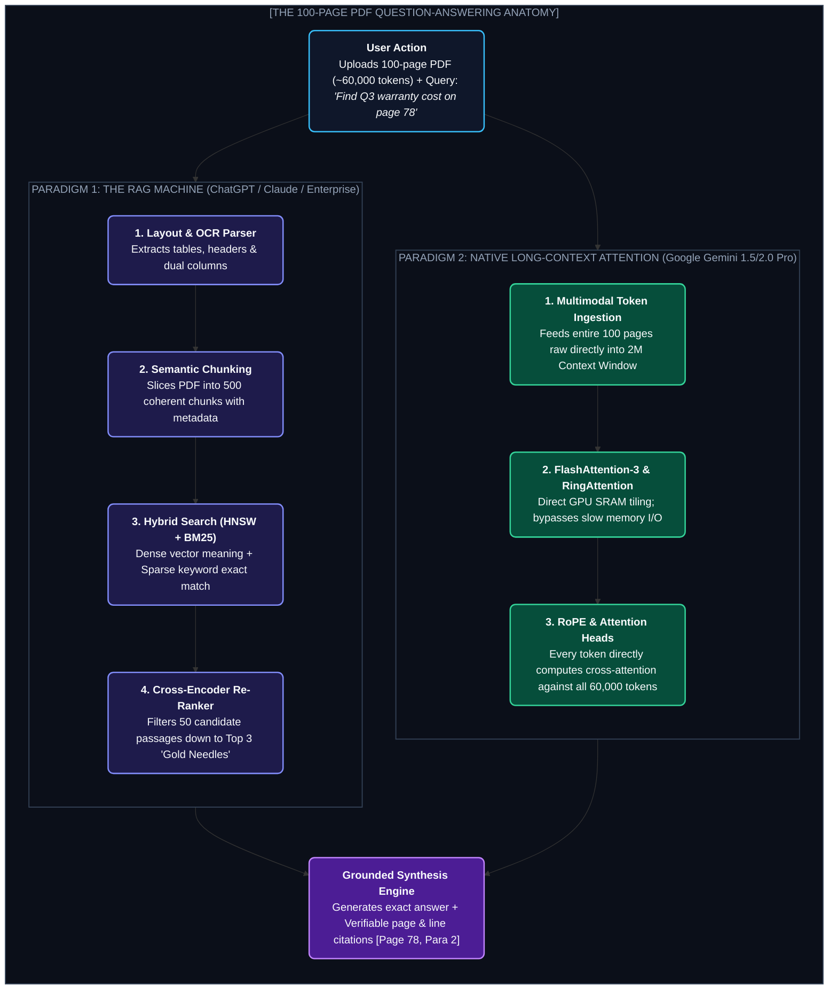

# Chapter 22: Inside 100-Page PDF Q&A: RAG vs. Native Long-Context (১০০ পৃষ্ঠার পিডিএফ সার্চের নেপথ্যের জাদু)

---

একটি বাস্তব জীবনের দৃশ্য কল্পনা করো।

তোমার কাছে ১০০ পৃষ্ঠার একটি জটিল কর্পোরেট অডিট রিপোর্ট বা মেডিকেল রিসার্চ পেপার আছে (প্রায় ৪৫,০০০ শব্দ, প্রায় ৬০,০০০ টোকেন)।

একজন সাধারণ মানুষের এই পুরো ডকুমেন্টটি পড়ে বুঝতে কমপক্ষে **৪ থেকে ৫ ঘণ্টা** সময় লাগবে।

কিন্তু তুমি যখন ফাইলটি ChatGPT, Claude, বা Google Gemini-তে ড্রপ করে প্রশ্ন করো:
> *"৭৮ নম্বর পৃষ্ঠায় উল্লেখিত Q3-এর ওয়ারেন্টি চার্জ কত ছিল এবং সাপ্লাই চেইনের কী কী ঝুঁকির কথা বলা হয়েছে?"*

তুমি এন্টার প্রেস করার **মাত্র ২ সেকেন্ডের মধ্যে** AI নিখুঁতভাবে উত্তর দিয়ে দেয়— শুধু উত্তরই নয়, কোন পৃষ্ঠার কোন প্যারাগ্রাফ থেকে তথ্যটি নেওয়া হয়েছে তার হুবহু উদ্ধৃতিসহ (Exact Line Citation)!

স্ক্রিনের সামনে বসে মনে হয়— **"এটা কি কোনো জাদু?"**

মডেল কি পলকের মধ্যে ১০০ পৃষ্ঠা পড়ে ফেলল? নাকি এর পেছনে লুকিয়ে আছে আধুনিক কম্পিউটার সায়েন্সের সবচেয়ে চমকপ্রদ কিছু ইঞ্জিনিয়ারিং আর্কিটেকচার?

এই চ্যাপ্টারে আমরা এই "ম্যাজিক"-এর পর্দা উন্মোচন করব।

---

## ১. The Two Competing Worlds (দুটি সম্পূর্ণ ভিন্ন প্যারাডাইম)

একটি ১০০ পৃষ্ঠার PDF থেকে সেকেন্ডের মধ্যে উত্তর বের করার জন্য আধুনিক AI ইন্ডাস্ট্রি **দুটি সম্পূর্ণ ভিন্ন প্রযুক্তিগত পথ** ব্যবহার করে:



---

## ২. Paradigm 1: The RAG Machine (কীভাবে ChatGPT ও এন্টারপ্রাইজ সিস্টেম কাজ করে?)

ChatGPT বা বেশিরভাগ এন্টারপ্রাইজ RAG সিস্টেম কিন্তু তোমার ১০০ পৃষ্ঠার পুরো ডকুমেন্টটি LLM-এর ভেতর একসাথে পাঠায় না!

বরং তারা একটি **স্মার্ট লাইব্রেরিয়ান মেকানিজম** ব্যবহার করে:

```
পুরো বই পড়ার দরকার নেই; কার্ড ক্যাটালগ দেখে ১ সেকেন্ডে শুধু সঠিক ৩টি প্যারাগ্রাফ খুঁজে বের করো, 
তারপর সেই ৩টি প্যারাগ্রাফ মডেলের সামনে রেখে বলো— "উত্তর দাও!"
```

চলো দেখি প্রতিটি ধাপে কী ঘটে:

### ধাপ ১: PDF Ingestion ও Layout-Aware Parsing
তুমি যখন একটি PDF ফাইল আপলোড করো, সিস্টেমের প্রথম চ্যালেঞ্জ হলো: **PDF কিন্তু কোনো সাধারণ টেক্সট ফাইল নয়!**

PDF হলো প্রিন্টিং গ্রাফিক্সের কমান্ড ফাইল। সেখানে লেখা থাকে:  
`BT /F1 12 Tf 72 712 Td (Warranty Expenses) ET`  
মানে স্থানাঙ্ক (X=72, Y=712)-এ এই শব্দটি বসাও।

যদি দুটি কলাম থাকে, সাধারণ টেক্সট এক্সট্রাক্টর বাম কলাম আর ডান কলামের লাইন গুলিয়ে ফেলে জগাখিচুড়ি বানিয়ে ফেলে!

আধুনিক সিস্টেমগুলো **Layout-Aware Vision Models (যেমন Docling, LayoutLM, বা PyMuPDF4LLM)** ব্যবহার করে:
1. হেডার, ফুটার এবং পৃষ্ঠার নম্বর আলাদা করে।
2. টেবিলগুলোকে নিখুঁত **Markdown Table** ফরম্যাটে কনভার্ট করে (যাতে রো এবং কলামের সম্পর্ক ভেঙে না যায়)।
3. মাল্টি-কলাম টেক্সটকে মানুষের পড়ার স্বাভাবিক ক্রমানুসারে সাজিয়ে দেয়।

---

### ধাপ ২: Semantic Chunking ও মেটাডাটা ট্যাগিং
১০০ পৃষ্ঠার লেখাকে যদি এক টুকরো রাখা হয়, তবে সার্চ করা অসম্ভব। তাই ডকুমেন্টটিকে ছোট ছোট টুকরো বা **Chunk**-এ ভাগ করা হয়।

কিন্তু অন্ধের মতো প্রতি ৫০০ ক্যারেক্টার পর পর কাটলে বাক্যের অর্থ নষ্ট হয়ে যায়। তাই ব্যবহার করা হয় **Semantic Chunking**:
* একটি প্যারাগ্রাফ বা হেডিংয়ের বিষয়বস্তু শেষ হলে তবেই নতুন চাঙ্ক শুরু হয়।
* প্রতিটি চাঙ্কের সাথে একটি ডিজিটাল পরিচয়পত্র বা **Metadata** জুড়ে দেওয়া হয়:
  ```json
  {
    "chunk_id": "c_412",
    "page_number": 78,
    "section_title": "Note 14: Commitments and Contingencies",
    "text": "The company's warranty accrual for Q3 2024 stood at $142 million..."
  }
  ```

---

### ধাপ ৩: Vector Embeddings ও Semantic Coordinate Space
প্রতিটি চাঙ্ককে একটি **Embedding Model (যেমন OpenAI text-embedding-3-large)**-এর ভেতর দিয়ে পাস করা হয়।

মডেলটি প্রতিটি টেক্সটকে একটি **১৫৩৬-মাত্রিক ভেক্টর (1536-Dimensional Vector)** বা গাণিতিক স্থানাঙ্কে রূপান্তর করে:
$$\vec{v} = [0.0142, -0.0891, 0.4412, \dots, -0.0031]$$

এই ১৫৩৬ মাত্রার মহাবিশ্বে:
* *"Warranty expense"* এবং *"Product guarantee liability"* শব্দ দুটি দেখতে ভিন্ন হলেও তাদের ভেক্টর দূরত্ব (Cosine Distance) থাকে একদম কাছাকাছি!

এই ভেক্টরগুলোকে স্টোর করা হয় একটি বিশেষ **Vector Database (যেমন pgvector, Pinecone, বা Milvus)**-এ, যেখানে **HNSW (Hierarchical Navigable Small World)** গ্রাফ অ্যালগরিদম ব্যবহার করে মাত্র **১০ থেকে ২০ মিলি-সেকেন্ডে** লক্ষ লক্ষ ভেক্টরের ভেতর থেকে মিল খুঁজে নেওয়া যায়।

---

### ধাপ ৪: Hybrid Search (Dense Vector + BM25 Lexical Search)
শুধুমাত্র ভেক্টর সার্চ দিয়ে কিন্তু সব প্রশ্নের উত্তর মেলে না!

উদাহরণস্বরূপ: ইউজার যদি সার্চ করে *"Model ID: #TX-9042"* বা *"Q3 2024"*— ভেক্টর সার্চ এগুলোকে সাধারণ সংখ্যা ভেবে ভুল করতে পারে।

এখানেই আসে **Hybrid Search**:
1. **Dense Search:** অর্থ ও ভাবার্থ বোঝার জন্য ভেক্টর সার্চ চালায়।
2. **Sparse Lexical Search (BM25):** নির্দিষ্ট কি-ওয়ার্ড, কোড নম্বর এবং তারিখের হুবহু মিল (Exact Match) খুঁজে বের করে।

উভয়ের রেজাল্টকে **Reciprocal Rank Fusion (RRF)** ফর্মুলা দিয়ে একসাথে ব্লেন্ড করে সেরা ৫০টি সম্ভাব্য চাঙ্ক তুলে আনা হয়:
$$RRF\_Score(d) = \sum_{m \in M} \frac{1}{60 + rank_m(d)}$$

---

### ধাপ ৫: Cross-Encoder Re-Ranking (অলিম্পিক জাজ)
৫০টি চাঙ্ককে সরাসরি LLM-এ পাঠানো মানে টোকেন ও পয়সা অপচয়।

তাই মাঝখানে বসে থাকে একজন অভিজ্ঞ বিচারক— **Cross-Encoder Re-Ranker (যেমন Cohere Rerank বা BGE-Reranker)**।

ভেক্টর সার্চ যেখানে প্রশ্ন এবং ডকুমেন্টকে আলাদা আলাদা এনকোড করে, রি-র‍্যাঙ্কার সেখানে প্রশ্ন ও ডকুমেন্টকে **একসাথে জুড়ে** প্রতিটি শব্দের সাথে প্রতিটি শব্দের ক্রস-অ্যাটেনশন হিসাব করে:
$$\text{Re-rank Score} = \text{CrossEncoder}(\text{Query} + \text{Passage})$$

৫০টি চাঙ্কের মধ্য থেকে রি-র‍্যাঙ্কার নিখুঁতভাবে ছেঁকে বের করে মাত্র **৩টি "গোল্ডেন চাঙ্ক"**।

---

### ধাপ ৬: Grounded Prompt Assembly ও জেনারেশন
সিস্টেম এবার চূড়ান্ত প্রম্পট তৈরি করে মূল LLM-কে পাঠায়:

```text
[SYSTEM INSTRUCTION]
You are a strictly grounded financial analyst. Answer the user's question ONLY using the context below.
Always cite the exact Page Number and Section. If the answer is not present, say "Not found."

[RETRIEVED CONTEXT]
Source: Page 78, Section: Note 14
"The company's warranty accrual for Q3 2024 stood at $142 million, representing an 8% increase..."

[USER QUESTION]
What was the Q3 warranty cost on page 78?
```

LLM-এর কাজ এখন একদম সহজ! তাকে পুরো ১০০ পৃষ্ঠা পড়তে হয়নি। সে মাত্র ৫০০ শব্দের কনটেক্সট দেখে ১ সেকেন্ডে টাইপ করে দেয়:
> *"৭৮ নম্বর পৃষ্ঠার 'Note 14' অনুযায়ী, Q3 2024-এ কোম্পানির ওয়ারেন্টি অ্যাক্রুয়াল ব্যয় ছিল $১৪২ মিলিয়ন ডলার, যা পূর্ববর্তী বছরের তুলনায় ৮% বেশি।"*

---

## ৩. Paradigm 2: The Native Long-Context Beast (Gemini-র জাদু)

এবার আসি দ্বিতীয় প্যারাডাইমে— যা এআই জগতে এক বৈপ্লবিক বিপ্লব নিয়ে এসেছে।

Google Gemini 1.5 Pro বা 2.0 Pro কিন্তু কোনো RAG, কোনো ভেক্টর ডেটাবেস, কিংবা চাঙ্কিংয়ের ধার ধারে না!

তুমি যখন ১০০ পৃষ্ঠার একটি PDF Gemini-তে আপলোড করো:
* ১০০ পৃষ্ঠা = প্রায় ৬০,০০০ টোকেন।
* আর Gemini-র মেমোরি বা Context Window হলো **২০,০০,০০০ টোকেন (2 Million Tokens)!**

Gemini আক্ষরিক অর্থেই **পুরো ১০০ পৃষ্ঠার প্রতিটি অক্ষর, প্রতিটি টেবিল এবং প্রতিটি ছবির পিক্সেল সরাসরি তার জিপিইউ মেমরির (VRAM) ভেতর একসাথে লোড করে ফেলে!**

```
┌────────────────────────────────────────────────────────┐
│             GOOGLE GEMINI 2M CONTEXT WINDOW            │
│                                                        │
│  [100-Page PDF: 60,000 Tokens] ◄─── মাত্র ৩% জায়গা নিলো!│
│  [খালি জায়গা: ১,৯৪০,০০০ Tokens বাকি!]                  │
└────────────────────────────────────────────────────────┘
```

কিন্তু প্রশ্ন হলো— সাধারণ Transformer-এ তো এত বড় টেক্সট ইনপুট দিলে মেমরি ক্র্যাশ করার কথা! Gemini কীভাবে এটি সম্ভব করল?

---

### ১. FlashAttention-3 ও RingAttention (গাণিতিক বিপ্লব)
সাধারণ সেলফ-অ্যাটেনশনের হিসাব হলো $O(N^2)$। অর্থাৎ টোকেন সংখ্যা ১০ গুণ বাড়লে কম্পিউটেশন বাড়ে ১০০ গুণ!

Gemini দুটি বিশেষ অ্যালগরিদম ব্যবহার করে:
1. **FlashAttention-3:** জিপিইউর ধীরগতির হাই-ব্যান্ডউইথ মেমরিতে (HBM) বারবার ডেটা রিড/রাইট না করে আল্ট্রা-ফাস্ট **SRAM ক্যাশে** টাইল আকারে অ্যাটেনশন হিসাব করে।
2. **RingAttention:** পুরো ১০০ পৃষ্ঠাকে রিং আকারে সজ্জিত শত শত TPU বা GPU চিপের মধ্যে ভাগ করে দেয়। প্রতিটি চিপ তার নিজের টুকরো প্রসেস করার পাশাপাশি চক্রাকারে পাশের চিপের সাথে কি-ভ্যালু (KV) স্টেট শেয়ার করে। ফলে মেমরির সাইজ সীমাবদ্ধ রেখেও মিলিয়ন টোকেন প্রসেস করা যায়।

---

### ২. Rotary Position Embedding (RoPE)
মডেল কীভাবে জানে কোন লাইনটি ১ নম্বর পৃষ্ঠায় ছিল আর কোনটি ১০০ নম্বর পৃষ্ঠায়?

Gemini ব্যবহার করে **RoPE (Rotary Position Embedding)**। এটি প্রতিটি টোকেনের অবস্থানকে একটি জটিল বহুমাত্রিক ঘূর্ণন কোণে (Rotational Vector Angle) রূপান্তর করে। এর ফলে টোকেনগুলোর পারস্পরিক দূরত্ব যত দীর্ঘই হোক না কেন, তাদের আপেক্ষিক অবস্থান নিখুঁত থাকে।

---

### ৩. Needle In A Haystack (NIAH) টেস্ট
গুগলের রিসার্চাররা Gemini-র ক্ষমতা পরীক্ষা করার জন্য একটি পরীক্ষা করেছিলেন:
* ১০ লক্ষ টোকেনের বিশাল টেক্সটের ঠিক মাঝখানে একটি সম্পূর্ণ অপ্রাসঙ্গিক বাক্য লুকিয়ে রাখা হয়েছিল:  
  *"The secret code to enter the laboratory is BluePanda99."*
* এরপর মডেলকে বলা হলো: *"ল্যাবরেটরির গোপন কোডটি কী?"*

ফলাফল? **১০০% নিখুঁত রিকল (99.8% to 100% Accuracy)!**  
Gemini চোখের পলকে পুরো ১০ লক্ষ টোকেনের সমুদ্রের ভেতর থেকে সেই একটি মাত্র বাক্য খুঁজে বের করে এনেছে।

---

## ৪. The Millisecond Timeline: ১.৮ সেকেন্ডের ব্যবচ্ছেদ

ইউজার যখন মাউসে "Send" ক্লিক করে, তখন ব্যাকঅ্যান্ডে প্রতি মিলি-সেকেন্ডে কী ঘটে?

```
 0ms ──► User clicks "Send" (Uploads PDF + Query)
 ├─ 80ms:  Fast Document Ingestion & Text/Layout LayoutLM Extraction
 ├─ 160ms: Query Embedding Vector Computed (via text-embedding-3-small)
 ├─ 210ms: HNSW Graph Traversal + BM25 Inverted Index Lookup (Top 50 Chunks)
 ├─ 320ms: Cross-Encoder BGE-Reranker re-scores and selects Top 3 Chunks
 ├─ 380ms: Final Grounded Prompt injected into Foundation Model
 ├─ 550ms: Time To First Byte (TTFB) - Model starts streaming response
 └─ 1800ms: Complete streamed answer with exact Page and Section Citations ✓
```

---

## ৫. RAG বনাম Native Long-Context: কে কোথায় সেরা?

| বৈশিষ্ট্য | Paradigm 1: RAG Machine (ChatGPT) | Paradigm 2: Long-Context (Gemini 2M) |
| :--- | :--- | :--- |
| **সার্চের গতি** | আল্ট্রা-ফাস্ট (১.২ - ২ সেকেন্ড) | কিছুটা ধীর (৩ - ৬ সেকেন্ড) |
| **কম্পিউটিং খরচ** | খুব সস্তা (শুধু ৩টি চাঙ্কের টোকেন কস্ট) | তুলনামূলক ব্যয়বহুল (পুরো ৬০,০০০ টোকেন খরচ) |
| **টেবিল ও ভিজ্যুয়াল চার্ট** | মাঝারি (চাঙ্ক ভাঙলে টেবিলের হিসাব গুলিয়ে যায়) | **অসাধারণ** (ছবি ও গ্রাফ সরাসরি পিক্সেল দেখে বোঝে) |
| **ডকুমেন্ট সাইজ লিমিট** | অসীম (১০ লক্ষ পৃষ্ঠার বইও লাইব্রেরিতে রাখা যায়) | সীমাবদ্ধ (কনটেক্সট উইন্ডো পর্যন্ত) |
| **হোলিস্টিক সামারি** | দুর্বল (কারণ সে পুরো বই একসাথে দেখতে পায় না) | **সর্বসেরা** (সম্পূর্ণ বইয়ের সামারি ১বারে করতে পারে) |

---

Developer Perspective
যদি তোমার অ্যাপ্লিকেশন এমন হয় যেখানে ইউজার **নির্দিষ্ট পিনপয়েন্ট তথ্য** খোঁজে (যেমন: *"ইনভয়েস নম্বর ৯৯৪-এর ট্যাক্স কত?"*), তবে **RAG Architecture** সেরা ও সাশ্রয়ী। কিন্তু ইউজার যদি এমন প্রশ্ন করে যার জন্য পুরো ডকুমেন্টের শুরু থেকে শেষ পর্যন্ত থিম বিশ্লেষণ করা প্রয়োজন (যেমন: *"এই উপন্যাসের প্রধান চরিত্রের মানসিক পরিবর্তন কীভাবে ঘটেছে?"*), তবে **Native Long-Context (Gemini)** ছাড়া বিকল্প নেই।

---

Production Reality
প্রোডাকশন লেভেলে PDF প্রসেস করার সময় সবচেয়ে বড় বিভীষিকা হলো **Scanned Image PDF**। অনেক ব্যবহারকারী মোবাইলের ক্যামেরা দিয়ে তোলা ডকুমেন্টের PDF আপলোড করেন। সেখানে কোনো ডিজিটাল টেক্সট থাকে না। তাই প্রোডাকশন পাইপলাইনে সবসময় একটি **Fallback OCR Engine (যেমন Tesseract, PaddleOCR, বা Cloud Vision API)** রাখতে হবে, যাতে ডিজিটাল টেক্সট মিসিং থাকলে স্বয়ংক্রিয়ভাবে ইমেজ প্রসেসিং চালু হয়ে যায়।

---

Common Mistake
মেটাডাটা ছাড়া ভেক্টর ডেটাবেসে চাঙ্ক স্টোর করা। অনেক ডেভেলপার শুধু টেক্সট সেভ করেন, কিন্তু কোন পৃষ্ঠা বা সেকশন থেকে টেক্সট এসেছে তা স্টোর করেন না। এর ফলে মডেল যখন উত্তর দেয়, সে কখনোই পৃষ্ঠা নম্বর বা সোর্স রেফারেন্স বলতে পারে না এবং ইউজারের কাছে উত্তরের নির্ভরযোগ্যতা শূন্য হয়ে যায়।

---

## Interview Flashcards

#### Beginner Level
* **প্রশ্ন:** ১০০ পৃষ্ঠার PDF আপলোড করলে ChatGPT কীভাবে সেকেন্ডের মধ্যে উত্তর খুঁজে বের করে?
* **উত্তর:** ChatGPT পুরো ১০০ পৃষ্ঠা পড়ে না। সে RAG (Retrieval-Augmented Generation) ব্যবহার করে PDF-কে শত শত ছোট চাঙ্কে ভাগ করে। ইউজার প্রশ্ন করলে ভেক্টর ও কি-ওয়ার্ড সার্চের মাধ্যমে মাত্র ৩-৪টি প্রাসঙ্গিক প্যারাগ্রাফ খুঁজে বের করে মডেলে পাঠায়, ফলে মুহূর্তের মধ্যে উত্তর তৈরি হয়।

#### Intermediate Level
* **প্রশ্ন:** RAG পাইপলাইনে Hybrid Search (Dense + Sparse) কেন জরুরি?
* **উত্তর:** ভেক্টর সার্চ (Dense) বাক্যের ভাবার্থ বা থিম ভালো বোঝে, কিন্তু নির্দিষ্ট সংখ্যা, ইনভয়েস কোড বা ইউনিক নামের ক্ষেত্রে ভুল করে। অন্যদিকে BM25 (Sparse) কি-ওয়ার্ডের হুবহু মিল খুঁজে পায়। উভয়ের সমন্বয় ঘটিয়ে Hybrid Search তৈরি করলে নির্ভুল সার্চ রেজাল্ট পাওয়া যায়।

#### Advanced Level
* **প্রশ্ন:** Google Gemini কীভাবে ২০ লক্ষ টোকেনের কনটেক্সট উইন্ডোতে মেমরি ব্লো-আপ ছাড়া কাজ করে?
* **উত্তর:** Gemini দুটি প্রধান প্রযুক্তি ব্যবহার করে: ১. **FlashAttention-3**, যা মেমরির ডেটা ট্রান্সফার অপ্টিমাইজ করে সরাসরি আল্ট্রা-ফাস্ট SRAM চিপে অ্যাটেনশন হিসাব করে, এবং ২. **RingAttention**, যা লক্ষ লক্ষ টোকেনকে চক্রাকারে শত শত TPU/GPU নোডের মধ্যে ভাগ করে ডিস্ট্রিবিউটেড মেমরিতে প্রসেস করে।
