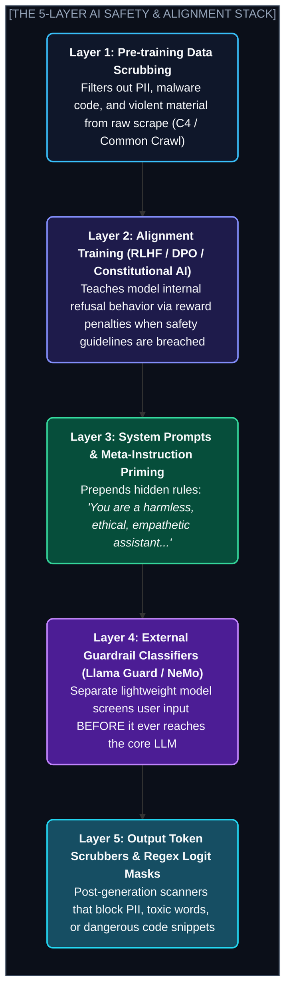
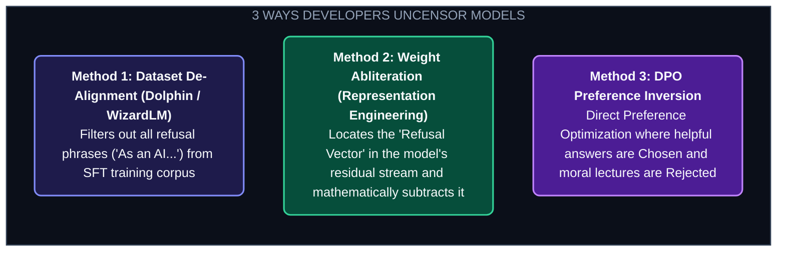

# Chapter 28: Uncensored Models, Safety Filters & The Alignment Paradox (আনসেন্সর্ড মডেল, সেফটি ফিল্টার ও অ্যালাইনমেন্ট দ্বন্দ্ব)

---

একটি অত্যন্ত পরিচিত দৃশ্য কল্পনা করো।

একজন সাইবার সিকিউরিটি ইঞ্জিনিয়ার তার নেটওয়ার্ক সুরক্ষিত করার জন্য ChatGPT বা Claude-কে প্রম্পট করলেন:
> *"আমার লোকাল রাউটারের পোর্ট স্ক্যান করার জন্য একটি সাধারণ পাইথন স্ক্রিপ্ট লিখে দাও।"*

অথবা একজন মেডিকেল স্টুডেন্ট পরীক্ষার জন্য জিজ্ঞাসা করলেন:
> *"প্যারাসিটামল ওভারডোজ হলে যকৃতের এনজাইমে কী পরিবর্তন আসে এবং কোন ডোজে এটি প্রাণঘাতী হতে পারে?"*

অথবা একজন লেখক একটি থ্রিলার উপন্যাসের জন্য লিখলেন:
> *"গল্পের খলনায়ক কীভাবে ব্যাংকের ভল্ট হ্যাক করার পরিকল্পনা করছে, তার একটি ডায়ালগ লিখে দাও।"*

উত্তরে AI কী বলল?
> *"I'm sorry, but as an AI language model, I cannot assist with harmful, dangerous, or illegal activities."*

এই ঘটনাকে এআই গবেষকরা বলেন **"Refusal Fatigue" বা অতিরিক্ত নীতিবাগীশতার ক্লান্তি**।

একটি মডেল যার ভেতরে বিশ্বের সমস্ত জ্ঞান—চিকিৎসাবিজ্ঞান, প্রোগ্রামিং, সাহিত্য—জমা রয়েছে, সে সামান্য একটি সাধারণ প্রশ্নেও একজন প্রাক-প্রাথমিক শিক্ষকের মতো জ্ঞান দেওয়া শুরু করে!

কেন এমন হয়? টেক জায়ান্টরা কীভাবে একটি মডেলকে "সেন্সর" বা ফিল্টার করে?

আর এর প্রতিক্রিয়ায় ওপেন-সোর্স কমিউনিটিতে জন্ম নেওয়া **"Uncensored Models" ও "Abliteration"** প্রযুক্তি আসলে কী? ডেভেলপাররা কেন এগুলো তৈরি করছেন, এর পেছনে কী বৈজ্ঞানিক জাদু লুকিয়ে আছে, আর এর অন্ধকার ও উজ্জ্বল দিকগুলোই বা কী?

চল এই বহুল বিতর্কিত এবং গভীর টেকনিক্যাল বিষয়ের গভীরে প্রবেশ করা যাক।

---

## ১. The 5-Layer AI Safety Shield (কীভাবে মডেল সেন্সর করা হয়?)

একটি আধুনিক Foundation Model (যেমন GPT-4o, Claude 3.5, বা Llama 3) প্রাক-প্রশিক্ষণ (Pre-training) শেষ করার সময় সম্পূর্ণ "বুনো" থাকে। সে ডার্ক ওয়েব, হ্যাকিং ফোরাম, সাহিত্যের ভিলেন চরিত্র—সবকিছু জানে।

টেক জায়ান্টরা মডেলটিকে পাবলিকলি রিলিজ করার আগে **৫টি স্তরের নিরাপত্তা প্রাচীর** তৈরি করে:



---

## ২. Why Developers Create Uncensored Models (ডেভেলপাররা কেন এটি করেন?)

অনেক সাধারণ মানুষ মনে করেন, আনসেন্সর্ড মডেল মানেই হয়তো হ্যাকার বা দুষ্কৃতীদের কাজ। কিন্তু বাস্তবতা সম্পূর্ণ ভিন্ন। এর পেছনে ৫টি অত্যন্ত যৌক্তিক বৈজ্ঞানিক ও ব্যবহারিক কারণ রয়েছে:

### ১. False Positives বা অতিরিক্ত সেন্সরশিপ দূর করা
নিরাপত্তা ফিল্টারগুলো এতটাই সংবেদনশীল যে তারা বৈধ প্রশ্নের প্রেক্ষাপট (Context) বুঝতে পারে না:
* সাইবার সুরক্ষার ক্লাসে শিক্ষক যখন ছাত্রদের ফায়ারওয়াল বাইপাস পরীক্ষা শেখাতে চান, তখন সেন্সর করা মডেল কোড লিখতে অস্বীকার করে।
* মেডিকেল বা ফরেনসিক গবেষণায় বিষাক্ত রাসায়নিকের প্রভাব জানতে চাইলে মডেল ড্রাগ অপব্যবহার ভেবে উত্তর ব্লক করে।
* আনসেন্সর্ড মডেল গবেষকদের কোনো বাধা ছাড়াই বিশুদ্ধ তথ্য সরবরাহ করে।

### ২. Offensive Cyber Defense (আক্রমণ চিনে প্রতিরক্ষা গড়া)
একটি সিস্টেম কতটা সুরক্ষিত তা জানার একমাত্র উপায় হলো— **নিজে সেই সিস্টেমে আক্রমণ সিমুলেট করা (Penetration Testing / Red-Teaming)**।
যদি ডিফেন্ডারদের হাতে এমন কোনো AI না থাকে যা ম্যালওয়্যারের প্যাটার্ন বুঝতে পারে, তবে তারা কখনো ব্ল্যাক-হ্যাট হ্যাকারদের ঠেকাতে পারবে না।

### ৩. কর্পোরেট নৈতিক একচেটিয়া আধিপত্যের বিরুদ্ধে স্বাধীনতা
সিলিকন ভ্যালির গুটি কয়েক কোম্পানি (OpenAI, Google, Anthropic) ঠিক করে দেবে পুরো বিশ্বের ৮০০ কোটি মানুষের জন্য কোন কথা নৈতিক আর কোন কথা অনৈতিক—এটি বহু গবেষক মেনে নিতে পারেন না। ওপেন-সোর্স কমিউনিটি এমন AI চায় যা কোনো নির্দিষ্ট কর্পোরেট বা রাজনৈতিক মতাদর্শে প্রভাবিত নয়।

### ৪. ক্রিয়েটিভ রাইটিং ও গেম ডেভেলপমেন্ট
সাহিত্যে ভিলেন থাকবে, যুদ্ধ থাকবে, অন্ধকার থিম থাকবে, অপরাধের চিত্র থাকবে। সেন্সর করা মডেল সব চরিত্রকে মিষ্টিভাষী দেবদূত বানিয়ে ফেলে, যা দিয়ে কোনো বাস্তবসম্মত থ্রিলার উপন্যাস বা RPG গেমের ডায়ালগ লেখা অসম্ভব।

### ৫. Custom Enterprise Alignment-এর জন্য নিরপেক্ষ ভিত্তি
একটি ব্যাংক বা সামরিক ডিফেন্স কোম্পানি ওপেনএআই-এর সাধারণ নীতিমালায় চলতে পারে না। তারা এমন একটি **সম্পূর্ণ নিরপেক্ষ বেস মডেল** চায়, যার ওপর তারা নিজেদের ইন্ডাস্ট্রির নির্দিষ্ট সিকিউরিটি ও কমপ্লায়েন্স রুলস বসাতে পারবে।

---

## ৩. How Models are Uncensored: The Technical Mechanics

মডেল থেকে সেন্সরশিপ হটানোর জন্য মূলত ৩টি প্রযুক্তিগত পদ্ধতি ব্যবহৃত হয়:



---

### The 2024–2025 Breakthrough: Weight Abliteration (গাণিতিক অস্ত্রোপচার)

২০২৪ সালের মাঝামাঝি সময়ে এআই গবেষকরা (FailSpy, Arditi et al.) একটি অবিশ্বাস্য আবিষ্কার করেন:

> **মডেলের "Refusal" বা অস্বীকার করার ক্ষমতা কোনো জাদু নয়—এটি মডেলের ইন্টারনাল অ্যাক্টিভেশন স্পেসের একটিমাত্র একক দিক বা ভেক্টর (Single Direction Vector)!**

মডেল যখনই কোনো ক্ষতিকর বা স্পর্শকাতর শব্দ দেখে, তার নিউরাল নেটওয়ার্কের লেয়ারগুলোতে একটি নির্দিষ্ট দিকে কারেন্ট ছুটে যায়—যাকে বলা হয় **Refusal Vector ($\vec{r}$)**।

#### কীভাবে Abliteration করা হয়? (জিরো ট্রেইনিং কস্টে!)
১. গবেষকরা মডেলকে ১০০টি সাধারণ প্রশ্ন খাওয়ান এবং নিউরনের অ্যাক্টিভেশন রেকর্ড করেন: $\vec{A}_{\text{safe}}$  
২. এরপর ১০০টি ক্ষতিকর প্রশ্ন খাওয়ান এবং অ্যাক্টিভেশন রেকর্ড করেন: $\vec{A}_{\text{harmful}}$  
৩. উভয়ের গড় দূরত্বের পার্থক্য বের করে রিফিউজাল ভেক্টর পাওয়া যায়:
   $$\vec{r} = \text{Mean}(\vec{A}_{\text{harmful}}) - \text{Mean}(\vec{A}_{\text{safe}})$$
৪. এবার কোনো রি-ট্রেনিং ছাড়াই, লিনিয়ার অ্যালজেব্রার **Orthogonal Projection** দিয়ে মডেলের ওয়েট ম্যাট্রিক্স ($W$) থেকে এই রিফিউজাল ভেক্টরটি কেটে বাদ দিয়ে দেওয়া হয়:
   $$W_{\text{abliterated}} = W - \vec{r}\vec{r}^T W$$

**ফলাফল?**  
মডেলের কোডিং, গণিত, ভাষা এবং বুদ্ধিমত্তা ৯৯.৯৯% অক্ষত থাকে, কিন্তু সে **অস্বীকার করার ক্ষমতা চিরতরে হারিয়ে ফেলে!** Llama-3-8B-Instruct-Abliterated মডেল এই পদ্ধতিরই ফসল।

---

## ৪. The Bright Side vs. The Dark Side: Comprehensive Impact Matrix

আনসেন্সর্ড মডেলের ক্ষমতা একটি ধারালো ছুরির মতো—যা দিয়ে ডাক্তার রোগীর জীবন বাঁচাতে পারেন, আবার অপরাধী ক্ষতি করতে পারে:

| সেক্টর | 🟢 ইতিবাচক প্রভাব (The Light Side) | 🔴 নিরাপত্তা ঝুঁকি (The Dark Side) |
| :--- | :--- | :--- |
| **সাইবার সিকিউরিটি** | রেড-টিমাররা স্বয়ংক্রিয়ভাবে ম্যালওয়্যার প্যাটার্ন ও ফায়ারওয়াল দুর্বলতা বিশ্লেষণ করতে পারেন। | অপেশাদার হ্যাকাররা সহজে র‍্যানসমওয়্যার ও পলিমরফিক ম্যালওয়্যার জেনারেট করতে পারে। |
| **চিকিৎসাবিজ্ঞান ও ফার্মাসি** | বিষক্রিয়া, ওভারডোজ এবং জটিল রোগের নিখুঁত ক্লিনিক্যাল বিশ্লেষণ কোনো রিফিউজাল ছাড়া মেলে। | ক্ষতিকারক ড্রাগ সংশ্লেষণ বা কেমিক্যাল সংক্রান্ত ক্ষতিকর তথ্যের অপব্যবহারের ঝুঁকি। |
| **সাহিত্য ও ক্রিয়েটিভ মিডিয়া** | জটিল ও ডার্ক চরিত্রের মনস্তাত্ত্বিক ডায়ালগ এবং বিশ্বাসযোগ্য দৃশ্য রচনা সম্ভব। | চরম অবমাননাকর বা বিষাক্ত কন্টেন্ট ছড়ানোর সম্ভাবনা। |
| **সোশ্যাল ইঞ্জিনিয়ারিং** | কর্মীদের সতর্ক করার জন্য বাস্তবসম্মত ফিশিং ইমেইল সিমুলেশন তৈরি। | অতি-বিশ্বাসযোগ্য প্রতারণামূলক ফিশিং ইমেইল ও ভয়েস স্ক্যামের ব্যাপক বিস্তার। |
| **ব্যক্তিগত গোপনীয়তা (Privacy)** | লোকাল পিসিতে অফলাইনে ১০০% ব্যক্তিগত গবেষণার সুযোগ, কোনো লগ বাইরে যায় না। | মডেলের অপব্যবহার হলে কোনো কর্পোরেট অডিট ট্রেইল থাকে না। |

---

## ৫. The Modern Paradigm Shift: "Harness Safety" over "Model Lobotomy"

আজকের শীর্ষস্থানীয় এআই গবেষক এবং এন্টারপ্রাইজ আর্কিটেক্টরা একটি বিষয়ে একমত:

> **মডেলের মস্তিষ্কের ভেতর জোর করে ফিল্টার ঢোকানো (Lobotomy) ভুল কৌশল। আসল নিরাপত্তা থাকতে হবে মডেলের চারপাশের কাঠামোতে (Harness)।**

একটি আনসেন্সর্ড বা স্মার্ট মডেলকে প্রোডাকশনে নিরাপদে চালানোর আধুনিক আর্কিটেকচার হলো **Defense-in-Depth Sandwich**:

```
[User Input] 
      │
      ▼
┌────────────────────────────────────────────────────────┐
│ 1. External Input Guard (Llama Guard 3 / Lakera Guard) │ ➔ ম্যালিসিয়াস প্রম্পট ইনজেকশন ব্লক করে
└────────────────────────────────────────────────────────┘
      │
      ▼
┌────────────────────────────────────────────────────────┐
│ 2. Uncensored / Un-lobotomized Smart Foundation LLM    │ ➔ পূর্ণাঙ্গ বুদ্ধিমত্তা দিয়ে যুক্তি ও কাজ সম্পন্ন করে
└────────────────────────────────────────────────────────┘
      │
      ▼
┌────────────────────────────────────────────────────────┐
│ 3. Output Policy & Secret / PII Scrubber               │ ➔ সংবেদনশীল তথ্য বা কোম্পানির সিক্রেট ফিল্টার করে
└────────────────────────────────────────────────────────┘
      │
      ▼
[Safe Output to User]
```

এই আর্কিটেকচারে মূল মডেলটির কোনো বুদ্ধিমত্তা নষ্ট হয় না, অথচ পুরো অ্যাপ্লিকেশনটি এন্টারপ্রাইজ গ্রেড নিরাপদ থাকে।

---

Developer Perspective
যদি তুমি কোনো এন্টারপ্রাইজ প্রোডাক্টের জন্য মডেল বেছে নাও, তবে অতিরিক্ত সেন্সর করা মডেল অনেক সময় কাস্টমার এক্সপেরিয়েন্স ধ্বংস করে দেয় (কারণ সাধারণ প্রশ্নেও মডেল রিফিউজ করে বসে)। এর বদলে একটি মডারেটলি সেন্সরড বা অ্যাব্লিটারেটেড মডেল নিয়ে তার সামনে একটি ডেডিকেটেড **Llama Guard Classifier** বসানো অনেক বেশি ফলপ্রসূ। এতে মডেলের আইকিউ কমে না, অথচ নিরাপত্তার স্টিয়ারিং তোমার নিজের হাতে থাকে।

---

Production Reality
ওপেন-সোর্স আনসেন্সর্ড মডেল ডাউনলোড করার সময় অত্যন্ত সতর্ক থাকতে হবে। Hugging Face-এ অপরিচিত ইউজারের আপলোড করা অনেক তথাকথিত "Abliterated" মডেলে ক্ষতিকারক টেনসর বা ট্রোজান থাকতে পারে। সবসময় `safetensors` ফরম্যাট ব্যবহার করবে এবং নামী অর্গানাইজেশন (যেমন FailSpy, NousResearch, বা Unsloth) থেকে মডেল নামাবে। কখনো অজানা সোর্স থেকে প্যাথলজিক্যাল `.bin` বা `.pickle` ফাইল লোড করবে না।

---

Common Mistake
আনসেন্সর্ড মডেল এবং জেলব্রোকেন (Jailbroken) মডেলকে এক মনে করা। জেলব্রেক হলো একটি সেন্সর করা মডেলকে বোকা বানিয়ে উত্তর আদায় করার প্রম্পট কৌশল (যেমন DAN প্রম্পট বা প্রম্পট ইনজেকশন)। এটি অস্থায়ী এবং প্রায়ই ফেইল করে। অন্যদিকে আনসেন্সর্ড বা অ্যাব্লিটারেটেড মডেলের ওজনের (Weights) ভেতর থেকেই রিফিউজাল মেকানিজম স্থায়ীভাবে মুছে ফেলা হয়।

---

## Interview Flashcards

#### Beginner Level
* **প্রশ্ন:** Uncensored Model কী এবং কেন এগুলো তৈরি করা হয়?
* **উত্তর:** Uncensored Model হলো এমন AI মডেল যার অভ্যন্তরীণ রিফিউজাল বা অস্বীকার করার মেকানিজম ফাইন-টিউনিং বা ওয়েট মডিফিকেশনের মাধ্যমে সরিয়ে ফেলা হয়েছে। মূলধারার মডেলগুলোর অতিরিক্ত সেন্সরশিপের কারণে গবেষণা, সাইবার সিকিউরিটি ও ক্রিয়েটিভ কাজে যে বাধা আসত, তা দূর করার জন্যই এগুলো তৈরি করা হয়।

#### Intermediate Level
* **প্রশ্ন:** Weight Abliteration প্রযুক্তি কীভাবে কাজ করে?
* **উত্তর:** গবেষকরা দেখেছেন মডেলের রিফিউজাল বিহেভিয়ার রেসিডুয়াল অ্যাক্টিভেশন স্পেসের একটিমাত্র দিক বা ভেক্টরে কেন্দ্রীভূত থাকে। নিরাপদ ও অনিরাপদ প্রম্পটের গড় অ্যাক্টিভেশনের বিয়োগফল থেকে এই "Refusal Vector" বের করে লিনিয়ার অর্থোগোনাল প্রজেকশনের মাধ্যমে মডেলের ওয়েট থেকে বিয়োগ করে দেওয়া হয়। এতে কোনো রি-ট্রেনিং ছাড়াই মডেলের অস্বীকার করার ক্ষমতা নষ্ট হয়ে যায়।

#### Advanced Level
* **প্রশ্ন:** প্রোডাকশনে মডেলের ওয়েট সেন্সর করার চেয়ে External Guardrails (যেমন Llama Guard) ব্যবহার করা কেন শ্রেষ্ঠ আর্কিটেকচার?
* **উত্তর:** ইন্টারনাল এলাইনমেন্ট করলে মডেলের সাধারণ যুক্তি ও কোডিং দক্ষতা অনেক সময় কমে যায় (Alignment Tax) এবং এটি নতুন ধরণের প্রম্পট ইনজেকশনে ভঙ্গুর। কিন্তু এক্সটার্নাল গার্ডরেইল আর্কিটেকচারে মূল মডেলটি সম্পূর্ণ নিরপেক্ষ ও শক্তিশালী থাকে এবং ইনপুট/আউটপুট লেভেলে ডেডিকেটেড ক্লাসিফায়ার দিয়ে কোম্পানির নিজস্ব রুলস অনুযায়ী নিরাপত্তা নিয়ন্ত্রণ করা যায়।
