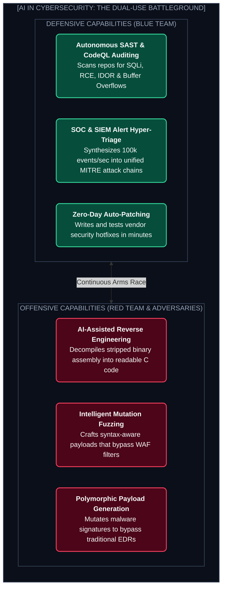
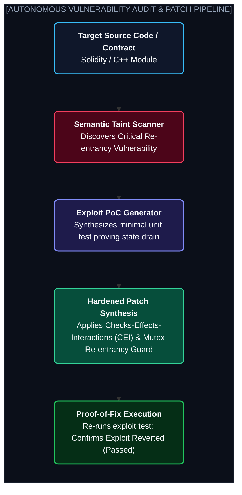

# Chapter 10: AI in Cybersecurity: The Dual-Use Battleground (সাইবার সিকিউরিটিতে এআই)

---

প্রতিদিন বিশ্বব্যাপী গড়ে **২,২০০টিরও বেশি** বড় ধরণের সাইবার আক্রমণ ঘটে।

একটি এন্টারপ্রাইজ কোম্পানিতে প্রতিদিন ফায়ারওয়াল, ক্লাউড এবং সার্ভার থেকে গড়ে **১,০০,০০০টিরও বেশি সিকিউরিটি এলার্ট** জমা হয়।

মাত্র ১০ জনের একটি মানব অ্যানালিস্ট টিমের পক্ষে এই লক্ষাধিক লগ স্ক্রিন করে রিয়েল-টাইম জিরো-ডে (Zero-Day) থ্রেট খুঁজে বের করা শারীরিকভাবে অসম্ভব।

ঠিক এই জায়গায় আবির্ভূত হয়েছে আধুনিক AI।

সাইবার সিকিউরিটির জগতে AI হলো একটি **"Dual-Use Technology" বা দ্বি-ধারী তলোয়ার**। 
* একদিকে ব্লু-টিম (ডিফেন্ডাররা) AI ব্যবহার করে স্বয়ংক্রিয়ভাবে কোডের বাগ খুঁজে প্যাচ তৈরি করছে এবং মিলিসেকেন্ডে সাইবার হামলা ব্লক করছে।
* অন্যদিকে রেড-টিম (হ্যাকাররা) AI ব্যবহার করে পলিমরফিক ম্যালওয়্যার, কাস্টম এক্সপ্লয়েট এবং অতি-বিশ্বাসযোগ্য ডিপফেক ফিশিং আক্রমণ তৈরি করছে।

এই চ্যাপ্টারে আমরা সাইবার সিকিউরিটিতে AI মডেলের সেই জাদুকরী কার্যপ্রণালী এবং ডিফেন্সিভ ইঞ্জিনিয়ারিংয়ের মূল কৌশলগুলো উন্মোচন করব।

---

## ১. The Dual-Use Landscape: Offensive vs. Defensive AI



---

## ২. 4 Core Superpowers of AI in Cybersecurity

আধুনিক মডেলগুলো (যেমন Claude 3.7 Sonnet, DeepSeek R1, GPT-4o) সাইবার সিকিউরিটিতে কোন কোন "জাদুকরী" কাজ সম্পন্ন করছে?

### ১. Semantic Taint Analysis (অটোনোমাস ভালনারেবিলিটি হান্টিং)
চিরাচরিত স্ট্যাটিক স্ক্যানারগুলো (যেমন SonarQube) কেবল টেক্সটের প্যাটার্ন বা রেজেক্স (Regex) খোঁজে। ফলে প্রচুর মিথ্যা সতর্কতা (False Positives) তৈরি হয়।
আধুনিক LLM কোডের **Taint Analysis** চালাতে পারে:
* ব্যবহারকারীর ইনপুট ($Source$) কোথায় নেওয়া হলো?
* সেই ইনপুটটি কোনো স্যানিটাইজার ছাড়া ডাটাবেস কোয়েরি বা সিস্টেম শেল এক্সিকিউশনে ($Sink$) যাচ্ছে কি না?
মডেলটি সম্পূর্ণ এক্সিকিউশন পাথ ট্রেস করে এবং মুহূর্তের মধ্যে জানিয়ে দেয়: *"Line 42-এ ব্যবহারকারীর দেওয়া ফাইলের নাম সরাসরি `os.system()`-এ যাচ্ছে, যা একটি গুরুতর Remote Code Execution (RCE) ঝুঁকি।"*

### ২. Assembly-to-Code Reverse Engineering (রিভার্স ইঞ্জিনিয়ারিং)
একটি কম্পাইল করা সফটওয়্যারের ভেতর কী কোড লুকিয়ে আছে তা জানা খুব কঠিন। হেক্স ভিউয়ার বা ঘিদরায় (Ghidra) দেখলে কেবল দুর্বোধ্য অ্যাসেম্বলি ইনস্ট্রাকশন (`mov eax, [ebp-8]`, `xor ecx, ecx`) দেখা যায়।
আধুনিক AI মডেলগুলো এই স্ট্রিপড অ্যাসেম্বলি বা বাইটকোড পড়ে:
* ভ্যারিয়েবলের অর্থপূর্ণ নাম পুনরুদ্ধার করে।
* লজিকাল কন্ট্রোল ফ্লো গ্রাফ তৈরি করে।
* এবং পুরো অ্যাসেম্বলিকে খাঁটি, পড়তে সহজ এমন **C/C++ সোর্স কোডে** ডিকম্পাইল করে দেয়।

### ৩. Smart Fuzzing (স্মার্ট ফাজিং)
ঐতিহ্যবাহী ফাজারগুলো (যেমন AFL++) বাইনারিতে র‍্যান্ডম আবর্জনা ডেটা ইনপুট দিয়ে ক্র্যাশ ঘটানোর চেষ্টা করে। এতে অনেক সময় নষ্ট হয়।
AI মডেল প্রটোকলের স্পেসিফিকেশন বোঝে। সে এমন স্মার্ট পে-লোড তৈরি করে যা প্রথম ভ্যালিডেশন চেক পার হয়ে ঠিক ভেতরের জটিল বাফার বাথরুমে গিয়ে মেমোরি ক্র্যাশ করায়!

### ৪. Automated SOC Triage (সিকিউরিটি অপারেশনস সেন্টার)
একটি ডাটা ব্রিচের সময় প্রতি সেকেন্ড মূল্যবান। যখন কোনো আক্রমণকারী সিস্টেমে ঢোকে, সে হাজার হাজার লগ রেখে যায়।
AI মডেল একাধিক সোর্স (Sysmon, Windows Event Logs, AWS CloudTrail) থেকে লগ নিয়ে **MITRE ATT&CK** ফ্রেমওয়ার্ক অনুযায়ী আক্রমণকারীর গতিবিধি ম্যাপ করে দেয়:
> *"আক্রমণকারী প্রথমে ফিশিং দিয়ে ঢুকলো (T1566) ➔ প্রসেস ইনজেকশন চালালো (T1055) ➔ তারপর ডোমেন কন্ট্রোলারে মুভ করলো (T1021)।"*

---

## ৩. The Vulnerability Discovery & Auto-Hardening Pipeline



---

## ৪. Hands-On Tutorial: Building an Automated Vulnerability Auditor

নিচে একটি পাইথন স্ক্রিপ্ট দেওয়া হলো যা যেকোনো সোর্স কোড স্ক্যান করে ক্রিটিক্যাল নিরাপত্তা ত্রুটি খুঁজে বের করে, এক্সপ্লয়েট ব্যাখ্যা করে এবং ফিক্সড কোড প্রদান করে:

```python
import os
import json
from openai import OpenAI

client = OpenAI()

VULNERABLE_CODE_SAMPLE = """
import sqlite3
from flask import Flask, request

app = Flask(__name__)

@app.route("/user_profile")
def get_user():
    user_id = request.args.get("id")
    conn = sqlite3.connect("database.db")
    cursor = conn.cursor()
    # VULNERABLE: Direct string concatenation allows SQL Injection
    query = f"SELECT username, email, ssn FROM users WHERE id = '{user_id}'"
    cursor.execute(query)
    data = cursor.fetchone()
    return {"user": data}
"""

def audit_source_code(code_snippet: str) -> dict:
    print("🛡️ Auditing code for security vulnerabilities...")
    
    prompt = f"""You are a principal application security engineer. Analyze the following code:
```python
{code_snippet}
```

Identify any high-severity security vulnerabilities (OWASP Top 10).
Return your response in strict JSON format with these exact keys:
{{
  "vulnerability_found": true/false,
  "vulnerability_type": "string",
  "cwe_id": "string",
  "exploit_scenario": "string",
  "secure_patched_code": "string"
}}"""

    response = client.chat.completions.create(
        model="gpt-4o",
        messages=[{"role": "user", "content": prompt}],
        response_format={"type": "json_object"},
        temperature=0.0
    )
    
    result = json.loads(response.choices[0].message.content)
    return result

if __name__ == "__main__":
    report = audit_source_code(VULNERABLE_CODE_SAMPLE)
    print("\n🚨 SECURITY AUDIT REPORT:")
    print(f"Vulnerability : {report['vulnerability_type']} ({report['cwe_id']})")
    print(f"Exploit Vector: {report['exploit_scenario']}")
    print("\n✅ SECURE PATCH PROPOSED:")
    print(report["secure_patched_code"])
```

---

Developer Perspective
সাইবার সিকিউরিটিতে LLM ব্যবহার করার সময় **Hallucinated CVE** একটি বড় ঝুঁকি। মডেল অনেক সময় এমন কাল্পনিক ভালনারেবিলিটি বা ভুল লাইন নাম্বার রিপোর্ট করে যা আসল কোডে নেই। তাই মডেলের আউটপুটকে সবসময় একটি ডিটারমিনিস্টিক ভেরিফায়ারের (যেমন Dynamic Application Testing বা PoC Unit Test) ভেতর দিয়ে পাস করিয়ে প্রমাণ করতে হবে যে বাগটি সত্যিই এক্সপ্লয়েটেবল।

---

Production Reality
কখনোই প্রোডাকশন ট্রাফিকের আনস্যানিটাইজড লগ বা ম্যালওয়্যার ট্রাফিকের Raw ডেটা সরাসরি ক্লাউড এআই API-তে (যেমন OpenAI বা Anthropic) পাঠাবে না। এতে সংবেদনশীল গ্রাহক তথ্য (PII) বা অ্যাক্সেস টোকেন কোম্পানির বাউন্ডারি ছেড়ে বাইরে চলে যেতে পারে। এন্টারপ্রাইজে সিকিউরিটি লগের জন্য সবসময় **On-Premise বা VPC-তে হোস্টেড লোকাল মডেল (যেমন Llama-3-70B বা DeepSeek)** ব্যবহার করতে হয়।

---

Common Mistake
মডেলকে দিয়ে সিকিউরিটি প্যাচ লিখে নেওয়ার পর রিগ্রেশন টেস্ট না করা। অনেক সময় দেখা যায়, SQL ইনজেকশন বন্ধ করতে গিয়ে মডেল এমন প্যাচ দিয়েছে যা পুরো সিস্টেমের অথেন্টিকেশন লজিকই অকেজো করে দিয়েছে। সিকিউরিটি প্যাচ দেওয়ার পর সমস্ত বিজনেস ফাংশনালিটি টেস্ট অবশ্যই সবুজ (Green) থাকতে হবে।

---

## Interview Flashcards

#### Beginner Level
* **প্রশ্ন:** সাইবার সিকিউরিটিতে AI-কে কেন "Dual-Use Technology" বলা হয়?
* **উত্তর:** কারণ এই একই প্রযুক্তি ডিফেন্ডাররা কোডের বাগ খোঁজা এবং সাইবার আক্রমণ ঠেকানোর জন্য ব্যবহার করতে পারে, আবার আক্রমণকারীরা স্বয়ংক্রিয় ম্যালওয়্যার তৈরি এবং স্মার্ট ফিশিং অ্যাটাকের জন্য অপব্যবহার করতে পারে।

#### Intermediate Level
* **প্রশ্ন:** স্ট্যাটিক কোড স্ক্যানারে (SAST) Semantic Taint Analysis কী এবং AI কীভাবে এতে সাহায্য করে?
* **উত্তর:** Taint Analysis হলো ব্যবহারকারীর ইনপুট (Source) কীভাবে কোডের ভেতর দিয়ে ট্রাভেল করে ডাটাবেস বা শেল কমান্ডের (Sink) সাথে মেশে তা ট্র্যাক করা। AI মডেল কোডের প্রেক্ষাপট ও লজিক বুঝে নির্ভুলভাবে চিহ্নিত করতে পারে ইনপুটটি কোনো স্যানিটাইজার ছাড়া ডাটাবেসে যাচ্ছে কি না, ফলে ফলস পজিটিভ অনেক কমে যায়।

#### Advanced Level
* **প্রশ্ন:** রিভার্স ইঞ্জিনিয়ারিংয়ে Ghidra বা IDA Pro-র সাথে LLM কীভাবে ইন্টিগ্রেট করা হয়?
* **উত্তর:** Ghidra-র পাইথন বা হেডলেস API দিয়ে বাইনারি অ্যাসেম্বলি এবং কন্ট্রোল ফ্লো গ্রাফ (CFG) এক্সট্র্যাক্ট করা হয়। এরপর মডেলটিকে এই অ্যাসেম্বলি ইনপুট হিসেবে দিয়ে ভ্যারিয়েবল ও ফাংশনের নাম ডিরিভার্স করে রিডেবল C সিউডোকোড তৈরি করানো হয়, যা বিশ্লেষকদের কাজ শতগুণ দ্রুত করে দেয়।
