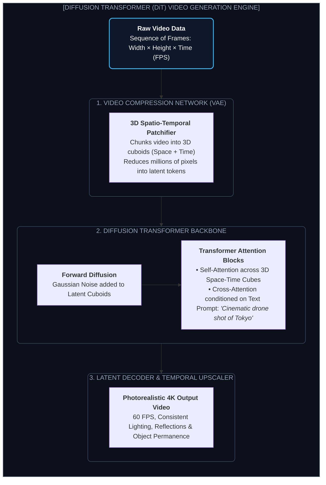

# Chapter 11: Generative Video, Audio & Multimodal Studio: Sora, DiT & Voice Cloning (জেনারেটিভ ভিডিও ও অডিও স্টুডিও)

---

২০২২ সালে যখন DALL-E 2 এবং Midjourney প্রথম বাজারে আসে, মানুষ একটি মাত্র প্রম্পটে হাইপার-রিয়েলিস্টিক ছবি তৈরি হতে দেখে চমকে উঠেছিল।

কিন্তু সবার মনে একটিই প্রশ্ন ছিল: **"ছবি তো বানাচ্ছে, কিন্তু সিনেমা বা ভিডিও কি AI কখনো বানাতে পারবে?"**

ভিডিও জেনারেশন ছিল কম্পিউটার ভিশন গবেষকদের জন্য এক দুঃস্বপ্নের মতো। কারণ ভিডিও হলো প্রতি সেকেন্ডে ২৪ থেকে ৬০টি ছবির ধারাবাহিক সিকোয়েন্স। 

আগের মডেলগুলোতে ভিডিও তৈরি করতে গেলে:
* ১ সেকেন্ডের মাথায় একজন মানুষের ২টি হাত থাকত, কিন্তু ৩ সেকেন্ডের মাথায় হুট করে ৩টি হাত গজিয়ে যেত!
* ক্যামেরা যখন সামনে এগোত, ব্যাকগ্রাউন্ডের বাড়িঘর গলে তরল হয়ে যেত! 

এই বিভীষিকাকে এআই জগতে বলা হতো **"Temporal Inconsistency" বা সময়ের সাথে রূপ হারিয়ে ফেলা**।

২০২৪-২০২৫ সালে এসে এই জটিল পদার্থবিজ্ঞানের ধাঁধা সমাধান করেছে **Diffusion Transformers (DiT)**—যার মাধ্যমে তৈরি হয়েছে OpenAI Sora, Runway Gen-3, Kling AI এবং Luma Dream Machine।

আজ AI শুধু ভিডিও বানায় না—এটি সম্পূর্ণ একটি স্টুডিও: ক্যামেরা মুভমেন্ট কন্ট্রোল, ভয়েস ক্লোনিং, ঠোঁটের নড়াচড়া মেলানো (Lip-Syncing), এবং অবজেক্ট রিমুভাল—সবকিছু এখন একটি প্রম্পটের দূরত্বে।

---

## ১. How Diffusion Transformers (DiT) Work: 3D Spatio-Temporal Patches

Sora বা Runway কীভাবে বাস্তব দুনিয়ার পদার্থবিজ্ঞান (Physics of Light, Gravity, Reflection) বুঝতে পারে?

নিচের আর্কিটেকচার ডায়াগ্রামে লক্ষ্য করো:



### ১. স্পেস-টাইম কিউবয়েড প্যাচ (Space-Time Cuboids)
একটি সাধারণ ইমেজ ট্র্যান্সফরমার (ViT) ছবিকে শুধুমাত্র $X$ এবং $Y$ অক্ষে ১৬x১৬ পিক্সেলের চারকোনা টুকরো করে।
কিন্তু ভিডিও তো দ্বিমাত্রিক নয়, ত্রিমাত্রিক (স্থান + সময়)!
DiT ভিডিওটিকে ছোট ছোট **ত্রিমাত্রিক বাক্সে (3D Cuboids)** ভাগ করে। প্রতিটি কিউবে শুধু ছবি থাকে না, সময়ের সাথে সাথে ওই অংশের পিক্সেল কীভাবে নড়াচড়া করছে তার গাণিতিক ভেক্টরও সংরক্ষিত থাকে।

### ২. অবজেক্ট পারম্যানেন্স (Object Permanence)
একটি গাড়ি যখন ব্রিজের নিচে দিয়ে যায়, তখন ক্যামেরা গাড়িটিকে ১ সেকেন্ডের জন্য দেখতে পায় না।
পুরনো মডেল ভাবত গাড়িটি ধ্বংস হয়ে গেছে, তাই ব্রিজ পার হওয়ার পর আর কোনো গাড়ি দেখাত না!
কিন্তু DiT-এর সেলফ-অ্যাটেনশন জানে: *"গাড়িটি স্থান এবং কালের একটি নির্দিষ্ট গতিবেগে চলেছে। ব্রিজ শেষ হলে গাড়িটি ঠিক ওপাশে বেরিয়ে আসবে।"* একেই বলে **ওয়ার্ল্ড সিমুলেশন (World Simulator)**।

---

## ২. The AI Video Editing Toolkit (ম্যাজিকাল এডিটিং ফিচারস)

আধুনিক এআই মডেলগুলো ভিডিও পোস্ট-প্রোডাকশনের সম্পূর্ণ কাজ নিজের কাঁধে তুলে নিয়েছে:

```
┌────────────────────────────────────────────────────────┐
│              THE AI MULTIMODAL VIDEO STUDIO            │
│                                                        │
│  ┌────────────────┐ ┌────────────────┐ ┌────────────┐  │
│  │ VIDEO INPAINT  │ │ MOTION BRUSH   │ │ CAMERA RIG │  │
│  │ (Erase people, │ │ (Animate water,│ │ (Drone pan, │  │
│  │  remove wires) │ │  smoke, clouds)│ │  zoom, roll)│  │
│  └────────────────┘ └────────────────┘ └────────────┘  │
│  ┌────────────────┐ ┌────────────────┐ ┌────────────┐  │
│  │ VOICE CLONING  │ │ NEURAL LIPSYNC │ │ AUTO CUTS  │  │
│  │ (Clone voice   │ │ (Translate to  │ │ (Whisper   │  │
│  │  in 5 seconds) │ │  30 languages) │ │  Subtitles)│  │
│  └────────────────┘ └────────────────┘ └────────────┘  │
└────────────────────────────────────────────────────────┘
```

1. **Video Inpainting ও অবজেক্ট রিমুভাল:** ভিডিওর ব্যাকগ্রাউন্ডে ভুল করে হেঁটে যাওয়া কোনো মানুষকে সাধারণ ব্রাশ দিয়ে মুছে দিলে AI পেছনের গাছপালা ও দেয়ালের টেক্সচার নিজে থেকেই তৈরি করে দেয়।
2. **Camera Rig Simulation:** তুমি ক্যামেরা স্পর্শ না করেও প্রম্পট দিতে পারো: *"360-degree orbital drone shot, slowly zooming into the actor's eyes"*—মডেলটি ভার্চুয়াল থ্রি-ডি স্পেসে নিখুঁত ক্যামেরা ট্র্যাজেক্টরি আঁকবে।
3. **Voice Cloning & Multilingual Lip-Syncing:** মাত্র ৫ সেকেন্ডের অডিও রেকর্ড শুনে মডেলটি কোনো মানুষের গলার ভয়েস, নিঃশ্বাসের ওঠা-নামা হুবহু নকল করতে পারে। এরপর ভিডিওর মূল বক্তার ঠোঁটকে জাপানি বা স্প্যানিশ ভাষার প্রতিটি সিলেবলের সাথে সিংক্রোনাইজ করে দেয় (Wav2Lip / SadTalker)।

---

## ৩. Hands-On Tutorial: Building an Automated Content Studio Pipeline

নিচে একটি স্বয়ংসম্পূর্ণ পাইথন স্ক্রিপ্ট দেওয়া হলো যা সম্পূর্ণ অটোমেটেড উপায়ে একটি টপিক থেকে স্ক্রিপ্ট জেনারেট করবে, অডিও ভয়েসওভার বানাবে এবং সাবটাইটেল সিঙ্ক করবে:

```python
import os
import subprocess
from openai import OpenAI

client = OpenAI()

def generate_script(topic: str) -> str:
    print(f"🎬 Generating viral video script for: {topic}...")
    prompt = f"""Write a compelling, fast-paced 30-second YouTube Short script about: '{topic}'.
Output ONLY the spoken narration. Do not include stage directions or speaker names."""
    
    response = client.chat.completions.create(
        model="gpt-4o",
        messages=[{"role": "user", "content": prompt}],
        max_tokens=150,
        temperature=0.7
    )
    return response.choices[0].message.content.strip()

def generate_voiceover(narration_text: str, output_audio_path: str = "voiceover.mp3"):
    print("🎙️ Generating neural speech synthesis...")
    response = client.audio.speech.create(
        model="tts-1-hd",
        voice="onyx", # Options: alloy, echo, fable, onyx, nova, shimmer
        input=narration_text
    )
    response.stream_to_file(output_audio_path)
    print(f"✅ Voiceover saved at: {output_audio_path}")
    return output_audio_path

def generate_subtitles_whisper(audio_file: str, srt_output: str = "subtitles.srt"):
    print("📝 Generating word-level accurate subtitles via Whisper...")
    with open(audio_file, "rb") as f:
        transcript = client.audio.transcriptions.create(
            model="whisper-1",
            file=f,
            response_format="srt"
        )
    with open(srt_output, "w", encoding="utf-8") as f:
        f.write(transcript)
    print(f"✅ Subtitles generated at: {srt_output}")
    return srt_output

def assemble_automated_short(topic: str):
    # Step 1: Script
    script = generate_script(topic)
    print(f"\n📜 Script Content:\n\"{script}\"\n")
    
    # Step 2: Voiceover
    audio = generate_voiceover(script)
    
    # Step 3: Subtitles
    subtitles = generate_subtitles_whisper(audio)
    
    print("\n🎉 Pipeline Step 1-3 complete! Now feed audio + subtitles into FFmpeg with B-Roll footage.")

if __name__ == "__main__":
    assemble_automated_short("Why do black holes bend time and space?")
```

---

Developer Perspective
ভিডিও মডেল ব্যবহারের সবচেয়ে বড় সীমাবদ্ধতা হলো **Compute Cost & Latency**। একটি ১০ সেকেন্ডের ফুল এইচডি ভিডিও বানাতে ৮টি H100 জিপিইউতে প্রায় ১ থেকে ২ মিনিট সময় লেগে যায়। তাই কাস্টমার-ফেসিং অ্যাপ্লিকেশনে ভিডিও জেনারেশন সবসময় **Asynchronous Webhook Architecture** (যেমন Celery, Redis Queue বা AWS SQS) দিয়ে হ্যান্ডেল করতে হয়, যাতে ইউজারকে স্ক্রিনে লোডিং স্পিনার নিয়ে অপেক্ষা করতে না হয়।

---

Production Reality
ভয়েস ক্লোনিং এবং ডিপফেক ভিডিও তৈরিতে **Watermarking & Provenance (C2PA Standard)** বাস্তবায়ন করা এখন আন্তর্জাতিক আইন অনুযায়ী বাধ্যতামূলক। কোনো AI-জেনারেটেড ভিডিও তৈরি হলে তার মেটাডাটার ভেতরে এবং অডিও ওয়েভলেটের ভেতরে একটি অদৃশ্য ক্রিপ্টোগ্রাফিক সিগনেচার এম্বেড করে দিতে হয়, যাতে ভিডিওটি কোনো ভুয়া অপরাধমূলক কাজে ব্যবহৃত হলে পুলিশ বা গবেষকরা সহজেই শনাক্ত করতে পারেন।

---

Common Mistake
ভিডিও এডিটিংয়ে প্রম্পটের ভেতর ক্যামেরা নির্দেশ না দেওয়া। অনেকেই শুধু লেখেন *"A cat running in a park"*, যার ফলে ভিডিওর ফ্রেম স্ট্যাটিক হয়ে থাকে বা ক্যাট ফ্রেমের বাইরে চলে যায়। সবসময় স্পেসিফিক ডিরেকশন দেওয়া উচিত: *"Cinematic low-angle tracking shot, 35mm lens, 4K HDR, maintaining the cat in center frame."*

---

## Interview Flashcards

#### Beginner Level
* **প্রশ্ন:** Diffusion Transformers (DiT) কীভাবে সাধারণ ইমেজ ডিফিউশন মডেল থেকে আলাদা?
* **উত্তর:** সাধারণ ইমেজ মডেল শুধু দ্বিমাত্রিক পিক্সেল স্পেস নিয়ে কাজ করে। কিন্তু DiT ভিডিওটিকে 3D Spatio-Temporal Cuboids (দৈর্ঘ্য, প্রস্থ এবং সময়)-এ ভাগ করে নেয়। ফলে এটি সময়ের সাথে সাথে বস্তুর স্থায়িত্ব এবং বাস্তব গতিবিধি বজায় রেখে ভিডিও তৈরি করতে পারে।

#### Intermediate Level
* **প্রশ্ন:** এআই ভিডিও জেনারেশনে "Temporal Consistency" বলতে কী বোঝায়?
* **উত্তর:** সময়ের সাথে সাথে ভিডিওর প্রতিটি ফ্রেমে চরিত্র, জামাকাপড়, মুখের অবয়ব এবং ব্যাকগ্রাউন্ডের আলো অপরিবর্তিত থাকাকে Temporal Consistency বলে। এই ধারাবাহিকতা না থাকলে প্রতি সেকেন্ডে মুখ বা হাত অদ্ভুতভাবে বদলে যায়।

#### Advanced Level
* **প্রশ্ন:** Neural Lip-Syncing মডেল কীভাবে কাজ করে?
* **উত্তর:** Wav2Lip বা SadTalker-এর মতো মডেলগুলো ইনপুট হিসেবে একটি ভিডিও ফ্রেম এবং একটি অডিও স্পিচ স্পেকট্রোগ্রাম নেয়। এরপর একটি স্পেশাল ডিসক্রিমিনেটর ঠোঁটের মাংসপেশির গতি এবং অডিওর প্রতি সেকেন্ডের ফোনিক সাউন্ডের মধ্যে সিঙ্ক নিশ্চিত করে মুখের নির্দিষ্ট মাস্কে নতুন ফ্রেম ব্লেন্ড করে দেয়।
