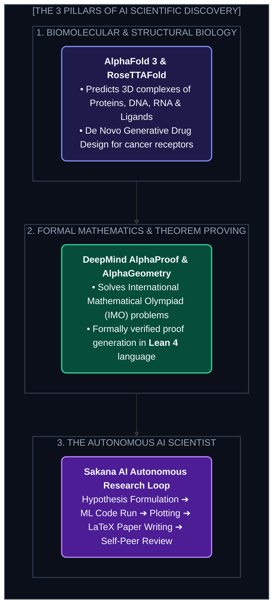
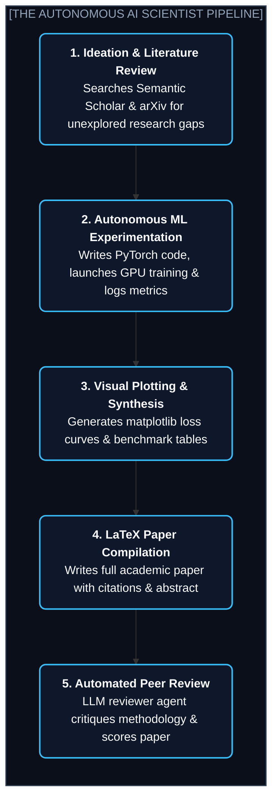

# Chapter 12: Frontier Science & Autonomous Discovery: AlphaFold, Lean 4 & AI Scientists (বৈজ্ঞানিক আবিষ্কার ও অটোনোমাস রিসার্চ)

---

AI কেবল চ্যাটবট বানানো, কোড লেখা বা ভিডিও এডিট করার মধ্যেই সীমাবদ্ধ নেই।

মানব ইতিহাসের সবচেয়ে বড় বিস্ময়টি ঘটছে বিজ্ঞানের গবেষণাগারে। 

জীববিজ্ঞানের একটি ৫০ বছর পুরনো অমীমাংসিত ধাঁধার নাম ছিল **"The Protein Folding Problem"**। 

শরীরের প্রতিটি প্রোটিন হলো অ্যামিনো অ্যাসিডের একটি সরল রৈখিক শিকল। কিন্তু পেটের ভেতর বা রক্তে প্রবেশ করার পর এই শিকলটি মাত্র কয়েক মাইক্রো-সেকেন্ডের মধ্যে একটি জটিল ত্রিমাত্রিক (3D) আকৃতি ধারণ করে। 

এই আকৃতিই নির্ধারণ করে প্রোটিনটি কি আমাদের ক্যান্সারের হাত থেকে বাঁচাবে, নাকি ভাইরাসের শিকার বানাবে!

মানব বিজ্ঞানীরা এক্স-রে ক্রিস্টালোগ্রাফি দিয়ে একটি মাত্র প্রোটিনের থ্রি-ডি কাঠামো বের করতে **কয়েক বছর এবং লাখ লাখ ডলার** খরচ করতেন।

কিন্তু ২০২০-২০২৪ সালে DeepMind-এর **AlphaFold** এসে মানব ইতিহাসের পরিচিত সমস্ত ২০ কোটি প্রোটিনের থ্রি-ডি কাঠামো মাত্র কয়েক মিনিটে নিখুঁতভাবে প্রেডিক্ট করে দিয়েছে! নোবেল কমিটি এজন্য ২০২৪ সালের রসায়নে নোবেল পুরস্কার প্রদান করে।

আজ AI শুধু বিজ্ঞানের সহকারী নয়—এটি স্বয়ংক্রিয়ভাবে ওষুধ ডিজাইন করছে, অলিম্পিয়াডের জটিল গাণিতিক উপপাদ্য প্রমাণ করছে এবং সম্পূর্ণ গবেষণা পেপার লিখে পাবলিশ করছে।

---

## ১. The 3 Frontiers of AI-Driven Science (বিজ্ঞানের ৩টি মহাবিপ্লব)



---

## ২. Deep Dive: AlphaFold 3 & Generative Chemistry

AlphaFold 3 কীভাবে সাধারণ LLM থেকে আলাদা?

একটি সাধারণ চ্যাটবট টেক্সট টোকেন প্রেডিক্ট করে। কিন্তু AlphaFold 3 হলো একটি **Evoformer ও Diffusion-ভিত্তিক বায়োমলিকুলার ইঞ্জিন**:

```
[অ্যামিনো অ্যাসিড সিকোয়েন্স] ➔ [Pair Representation & MSA] ➔ [Diffusion Module] ➔ [3D কোঅর্ডিনেটস (x, y, z)]
```

### ১. ডিফিউশনের মাধ্যমে আণবিক কোঅর্ডিনেট
AlphaFold 3 ছবির বদলে প্রতিটি পরমাণুর (Atom) থ্রি-ডি অবস্থানকে গাণিতিক গোলকের ভেতর ডিফাইন করে। একটি এলোমেলো পরমাণুর মেঘ থেকে নয়েজ ফিল্টার করে সে নিখুঁত হাইড্রোজেন বন্ড, সালফার ব্রিজ এবং ইলেক্ট্রন ক্লাউড মেপে প্রোটিনের আকৃতি দাঁড় করায়।

### ২. টার্গেটেড ড্রাগ ডিসকভারি (Targeted Drug Design)
আগে ফার্মাসিউটিক্যাল কোম্পানিগুলোকে একটি নতুন ক্যান্সারের ওষুধ বের করতে কোটি কোটি রাসায়নিক ল্যাবরেটরিতে টেস্ট-টিউবে মিশিয়ে পরীক্ষা করতে হতো (Hit-and-Trial)।
এখন AI মডেল বলে দেয়:
> *"এই ভাইরাসটির অমুক রিসেপ্টর খাঁজে একটি ছোট গহ্বর আছে। তুমি যদি এই নির্দিষ্ট রাসায়নিক অণুটি তৈরি করো, এটি প্লাগের মতো ভাইরাসের খাঁজে আটকে গিয়ে ভাইরাসটিকে নিষ্ক্রিয় করে দেবে।"*
এর ফলে ১০ বছরের ড্রাগ ডিসকভারি সাইকেল নেমে এসেছে মাত্র ৬ মাসে!

---

## ৩. Formal Mathematics: AlphaProof ও Lean 4-এর বিপ্লব

সাধারণ LLM-কে কঠিন গণিত দিলে সে প্রায়ই ভুলভাল ধাপ দেখিয়ে হ্যালুসিনেট করে (কারণ সে সম্ভাব্যতা দিয়ে শব্দ সাজায়, সত্য বোঝে না)।

কিন্তু DeepMind-এর **AlphaProof** গণিতকে টেক্সটে না রেখে **Lean 4** নামক একটি কঠোর গাণিতিক প্রোগ্রামিং ভাষায় রূপান্তর করে:

```
[ইংরেজি ভাষার গাণিতিক সমস্যা] 
          │
          ▼ (Formalizer LLM)
[Lean 4 Formal Code Specification] 
          │
          ▼ (Search & Reinforcement Learning Loop)
[Formal Lean 4 Proof Steps]
          │
          ▼ (Lean 4 Kernel Verification)
[100% Mathematically Proven without Hallucination! ✓]
```

Lean 4 কার্নেলে কোনো প্রমাণের লাইন ভুল হলে কোড কম্পাইলই হবে না! ফলে গণিতে কোনো ভুলের সুযোগ থাকে না। এই সিস্টেমে ২০২৪ সালের আন্তর্জাতিক গণিত অলিম্পিয়াডের (IMO) রৌপ্য পদক সমমানের জটিল সমস্যা সমাধান করা হয়েছে।

---

## ৪. The Autonomous AI Scientist: সম্পূর্ণ স্বয়ংক্রিয় রিসার্চ ল্যাব

২০২৪ সালের শেষভাগে টোকিওর **Sakana AI** ল্যাব উন্মোচন করে **"The AI Scientist"**—যা বিজ্ঞানের জগতে এক যুগান্তকারী পদক্ষেপ:



একটি সম্পূর্ণ গবেষণাপত্র লিখতে মানুষের যেখানে কয়েক মাস সময় লাগে, সেখানে এই সিস্টেম মাত্র **১৫ ডলারের কম্পিউট কস্টে** সম্পূর্ণ নতুন একটি মেশিন লার্নিং এক্সপেরিমেন্ট চালিয়ে তার ড্রাফট পেপার লিখে ফেলে!

---

## ৫. Hands-On Tutorial: Querying AlphaFold Database for 3D Biomolecules

নিচে একটি পাইথন স্ক্রিপ্ট দেওয়া হলো যা ইউরোপীয় বায়োইনফরমেটিক্স ইনস্টিটিউটের (EBI) ওপেন AlphaFold API ব্যবহার করে যেকোনো প্রোটিনের প্রেডিক্টেড থ্রি-ডি স্ট্রাকচার ও কনফিডেন্স স্কোর (pLDDT) ফেচ করে:

```python
import requests
import json

def fetch_alphafold_structure(uniprot_id: str):
    """
    Fetches predicted 3D structure metadata from the AlphaFold Protein Structure Database.
    Example UniProt ID: 'P69905' (Human Hemoglobin Subunit Alpha)
    """
    print(f"🧬 Querying AlphaFold Database for UniProt: {uniprot_id}...")
    api_url = f"https://alphafold.ebi.ac.uk/api/prediction/{uniprot_id}"
    
    response = requests.get(api_url)
    if response.status_code != 200:
        print(f"❌ Failed to fetch data. Status code: {response.status_code}")
        return None
        
    data = response.json()[0]
    
    pdb_url = data.get("pdbUrl")
    plddt_score = data.get("globalMetricValue") # Predicted local distance difference test (0-100)
    organism = data.get("organismScientificName")
    gene = data.get("gene")
    
    print("\n✅ ALPHAFOLD PREDICTION FOUND:")
    print(f"Organism           : {organism}")
    print(f"Associated Gene    : {gene}")
    print(f"Structural Metric  : pLDDT {plddt_score:.2f}/100 (High Confidence > 90)")
    print(f"PDB 3D Coordinates : {pdb_url}")
    
    return {
        "pdb_url": pdb_url,
        "confidence": plddt_score,
        "gene": gene
    }

if __name__ == "__main__":
    # Human Insulin: P01308 | Hemoglobin: P69905
    fetch_alphafold_structure("P01308")
```

---

Developer Perspective
বিজ্ঞানে AI মডেল ব্যবহারের সময় সবচেয়ে বড় সীমাবদ্ধতা হলো **Lab Verification**। একটি মডেল কাগজে-কলমে চমৎকার কোনো ভ্যাকসিনের ফর্মুলা দিতে পারে, কিন্তু জীবন্ত কোষে সেই প্রোটিন কীভাবে আচরণ করবে তা জানতে এখনও ফিজিক্যাল ওয়েট-ল্যাব (Wet-Lab) পরীক্ষার প্রয়োজন। AI বিজ্ঞানীদের প্রতিস্থাপিত করছে না, বরং বিজ্ঞানীদের গবেষণার গতিকে ১০ গুণ বাড়িয়ে দিচ্ছে।

---

Production Reality
বায়োটেক ও জেনেটিক এআই মডেল ব্যবহারের ক্ষেত্রে **Biosecurity Screening** বাধ্যতামূলক। অনেক ওপেন-সোর্স মডেলে ক্ষতিকারক ভাইরাস বা প্যাথোজেন সংশ্লেষণের জ্ঞান থাকতে পারে। আন্তর্জাতিক বায়োসিন্থেসিস কোম্পানিগুলো ডিএনএ প্রিন্ট করার আগে গ্রাহকের অর্ডারকে কঠোর স্ক্রিনিং ফ্রেমওয়ার্ক দিয়ে চেক করে, যাতে কোনো ক্ষতিকর জেনেটিক কোড ল্যাবরেটরি থেকে বাইরে বের হতে না পারে।

---

Common Mistake
গাণিতিক যুক্তির জন্য সাধারণ চ্যাট মডেলের উপর ১০০% অন্ধ বিশ্বাস রাখা। কোনো ম্যাথমেটিক্যাল থিওরেম প্রুফ করার ক্ষেত্রে সবসময় **Formal Verifier (যেমন Coq, Isabelle, বা Lean 4)** দিয়ে প্রতিটি পদক্ষেপ ভেরিফাই করিয়ে নিতে হবে।

---

## Interview Flashcards

#### Beginner Level
* **প্রশ্ন:** AlphaFold কীভাবে জীববিজ্ঞানের গবেষণায় বৈপ্লবিক পরিবর্তন এনেছে?
* **উত্তর:** প্রোটিনের দ্বিমাত্রিক অ্যামিনো অ্যাসিড সিকোয়েন্স থেকে তার জটিল ত্রিমাত্রিক (3D) আকৃতি প্রেডিক্ট করার ৫০ বছর পুরনো ধাঁধা AlphaFold সমাধান করেছে। আগে যে কাজ করতে বছরের পর বছর লাগত, তা এখন কয়েক মিনিটে করা যায়, যা নতুন ওষুধ ও ভ্যাকসিন তৈরির গতি অবিশ্বাস্য রকম বাড়িয়ে দিয়েছে।

#### Intermediate Level
* **প্রশ্ন:** সাধারণ LLM-এর টেক্সট জেনারেশন এবং Lean 4 ভিত্তিক ফর্মাল ম্যাথমেটিক্যাল প্রুফের মধ্যে পার্থক্য কী?
* **উত্তর:** সাধারণ LLM শব্দ দিয়ে সম্ভাব্য বাক্য সাজায়, ফলে গণিতের জটিল ধাপে হ্যালুসিনেশন বা ভুল করতে পারে। কিন্তু Lean 4 হলো একটি ফর্মাল প্রুফ সিস্টেম যার কার্নেল গাণিতিক লজিক অনুযায়ী প্রতিটি স্টেপ যাচাই করে। ফলে এখানে ভুলের সম্ভাবনা শূন্য।

#### Advanced Level
* **প্রশ্ন:** AlphaFold-এর pLDDT মেট্রিক কী নির্দেশ করে?
* **উত্তর:** pLDDT (Predicted Local Distance Difference Test) হলো ০ থেকে ১০০-এর মধ্যে একটি কনফিডেন্স স্কোর যা নির্দেশ করে প্রোটিনের প্রতিটি অংশের প্রেডিক্টেড থ্রি-ডি অবস্থান কতটা নিখুঁত। ৭০-এর বেশি স্কোর ভালো এবং ৯০-এর বেশি স্কোর ক্রিস্টালোগ্রাফি মানের অতি-উচ্চ নির্ভুলতা প্রকাশ করে।
