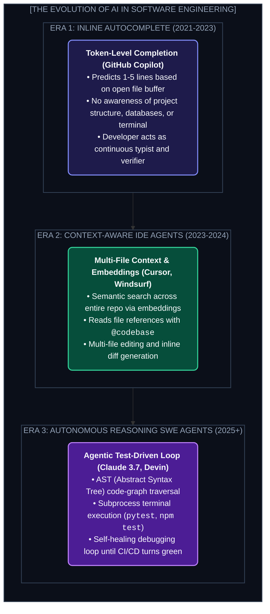
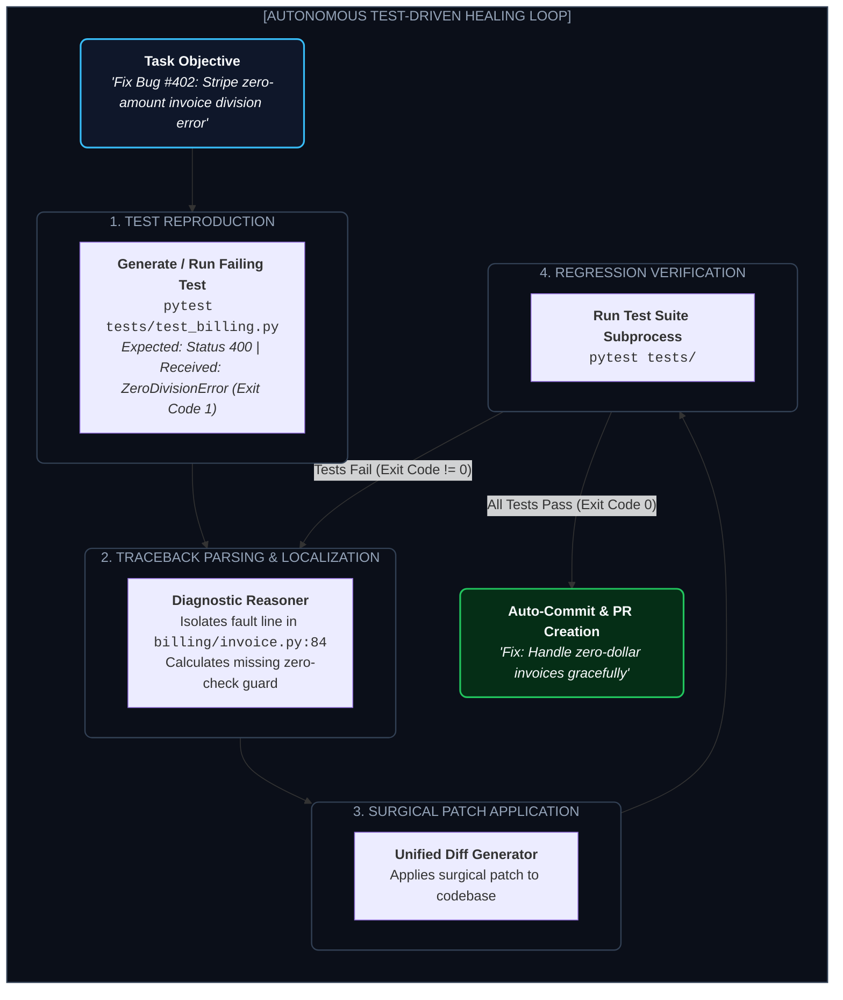

# Chapter 9: AI in Software Engineering — Autonomy, TDD & Legacy Migration (সফটওয়্যার ইঞ্জিনিয়ারিংয়ে এআই)

---

এক দশক আগেও সফটওয়্যার ডেভেলপমেন্টের সংজ্ঞা ছিল: কীবোর্ডে টাইপ করে লাইন-বাই-লাইন কোড লেখা, সিনট্যাক্স এরর ঠিক করা, আর স্ট্যাক ওভারফ্লোতে স্ক্রোল করা।

এরপর এলো GitHub Copilot-এর যুগ—যেখানে AI শুধু কার্সারের সামনে ৩-৪ শব্দের অটো-কমপ্লিশন সাজেস্ট করত।

কিন্তু ২০২৪-২০২৫ সালে এসে সফটওয়্যার ইঞ্জিনিয়ারিংয়ের পুরো সংজ্ঞাটি বদলে গেছে।

আজকের AI শুধু কোড সাজেস্ট করে না। **Claude 3.7 Sonnet, Cursor Agent, Devin, এবং SWE-bench-এর মতো অটোনোমাস সিস্টেমগুলো এখন পুরো একটি কোডবেস স্ক্যান করে, আর্কিটেকচার বোঝে, টেস্ট লিখে, টার্মিনালে টেস্ট রান করে, ফেইল্ড টেস্টের ট্রেসব্যাক দেখে কোড রিফ্যাক্টর করে এবং স্বয়ংক্রিয়ভাবে Git PR সাবমিট করে!**

এই চ্যাপ্টারে আমরা সফটওয়্যার ইঞ্জিনিয়ারিংয়ে AI মডেলগুলোর এই "জাদুকরী" ক্ষমতা এবং কীভাবে নিজের প্রজেক্টে এই অটোনোমাস পাওয়ার পাইপলাইন তৈরি করতে হয়, তা শিখব।

---

## ১. The 3 Eras of AI-Assisted Engineering (তিনটি যুগ)



---

## ২. The Core Capabilities: AI কীভাবে একটি পূর্ণাঙ্গ কোডবেস বোঝে?

একটি কোডবেসে যখন লক্ষাধিক লাইন কোড এবং শত শত ফাইল থাকে, তখন একটি মডেল কীভাবে নির্দিষ্ট বাগ খুঁজে বের করে?

### ১. Abstract Syntax Tree (AST) ও Code Graph Indexing
মডেল কেবল সাধারণ টেক্সট হিসেবে কোড পড়ে না। আধুনিক কোডিং টুলগুলো **Tree-sitter** ব্যবহার করে কোডবেসটিকে একটি সিনট্যাক্স গ্রাফে রূপান্তর করে:
* কোন ফাইল কোন ক্লাসকে ইমপোর্ট করেছে?
* কোন ফাংশনটি ডাটাবেস হ্যান্ডলারের সাথে সরাসরি যুক্ত?
ফলে ইউজার যখন বলে *"চেকআউট ফাংশনে ডিসকাউন্ট লজিক পরিবর্তন করো"*, মডেলটি এক সেকেন্ডে `CartService` ➔ `DiscountEngine` ➔ `StripeGateway`-এর ডিপেন্ডেন্সি ম্যাপ এঁকে ফেলে।

### ২. Spec-to-Code Generation (PRD থেকে ফুল-স্ট্যাক অ্যাপ)
মডার্ন মডেলগুলোর সবচেয়ে শক্তিশালী দিক হলো **Abstract Reasoning**। তুমি যদি একটি প্রডাক্ট রিকোয়ারমেন্ট ডকুমেন্ট (PRD) বা একটি ফিগমা ডিজাইনের স্ক্রিনশট ইনপুট দাও:
1. মডেলটি ডাটাবেস স্কিমা (`Prisma` / `SQL`) তৈরি করে।
2. ব্যাকএন্ডের API রাউট (`FastAPI` বা `Express`) ডিজাইন করে।
3. ফ্রন্টএন্ডে রিয়্যাক্ট কম্পোনেন্ট (`Tailwind CSS` সহ) জেনারেট করে।
4. এবং সম্পূর্ণ প্রজেক্টের জন্য ডকারফাইল (`Dockerfile`) প্রস্তুত করে দেয়।

### ৩. Legacy Code Modernization (পুরনো কোডের আধুনিকায়ন)
বিশ্বের ব্যাংক ও এয়ারলাইন্সগুলোর প্রায় ৮০% কোর ট্রানজ্যাকশন এখনও চলছে ৬০ বছর পুরনো **COBOL বা Fortran** কোডে। এই কোড বোঝার মতো মানব প্রোগ্রামার বাজারে দুর্লভ।
মডার্ন AI মডেলগুলো এখন হাজার হাজার লাইনের অদ্ভুত COBOL বিজনেস লজিক পড়ে তাকে নিখুঁত, টেস্টেড এবং মেমোরি-সেফ **Go বা Rust** মাইক্রোসার্ভিসে রূপান্তর করতে সক্ষম।

---

## ৩. The Auto-Healing Test Loop Architecture

একজন মানুষের মতো AI কীভাবে নিজের ভুল নিজে সংশোধন করে? এই আর্কিটেকচারাল প্যাটার্নকে বলা হয় **Auto-Healing TDD Loop**:



---

## ৪. Hands-On Tutorial: Building an Automated Bug-Fixing Pipeline

নিচে একটি স্বয়ংসম্পূর্ণ পাইথন স্ক্রিপ্ট দেওয়া হলো যা টার্মিনালে পাইটেস্ট রান করে, এরর লগ ক্যাপচার করে, এবং মডেল দিয়ে কোড ফিক্স করিয়ে পুনরায় টেস্ট ভেরিফাই করে:

```python
import subprocess
import os
from openai import OpenAI

client = OpenAI()

def run_tests():
    """Runs pytest and returns (success: bool, output: str)"""
    result = subprocess.run(
        ["pytest", "tests/"],
        capture_output=True,
        text=True
    )
    return result.returncode == 0, result.stdout + "\n" + result.stderr

def autonomous_healer(target_file: str, max_attempts: int = 3):
    print(f"🔍 Running initial test suite...")
    passed, logs = run_tests()
    
    if passed:
        print("✅ All tests already passing! No healing needed.")
        return True

    for attempt in range(1, max_attempts + 1):
        print(f"\n⚠️ Tests failed! Initiating Healing Loop (Attempt {attempt}/{max_attempts})...")
        
        with open(target_file, "r") as f:
            current_code = f.read()

        prompt = f"""You are an elite software engineer. The test suite failed with the following traceback:
------------------------
{logs[-2000:]}
------------------------
Here is the current code of '{target_file}':
------------------------
{current_code}
------------------------
Fix the bug. Output ONLY the complete, corrected python code for '{target_file}'. Do not explain."""

        response = client.chat.completions.create(
            model="gpt-4o",
            messages=[{"role": "user", "content": prompt}],
            temperature=0.1
        )
        
        fixed_code = response.choices[0].message.content.replace("```python", "").replace("```", "").strip()
        
        # Apply the fix
        with open(target_file, "w") as f:
            f.write(fixed_code)
            
        print("🔧 Patch applied. Re-running tests...")
        passed, logs = run_tests()
        if passed:
            print(f"🎉 Success! Bug fixed and all unit tests passed on attempt {attempt}!")
            return True

    print("❌ Failed to automatically heal bug within attempt budget.")
    return False

if __name__ == "__main__":
    autonomous_healer("app/calculator.py")
```

---

Developer Perspective
অটোনোমাস কোডিং এজেন্টের সবচেয়ে বড় শত্রু হলো **Hallucinated Dependencies**। মডেল অনেক সময় এমন লাইব্রেরি বা প্যাকেজ ইমপোর্ট করে বসে যা আসল প্রোডাকশনে নেই। তাই এজেন্টের জন্য একটি স্ট্রং **Linter (যেমন Ruff / ESLint)** এবং একটি **Isolated Docker Container বা Git Worktree** থাকা আবশ্যক, যাতে এজেন্ট কোনো ভুল করলে তোমার লোকাল মেশিন ক্ষতিগ্রস্ত না হয়।

---

Production Reality
কখনোই কোনো AI এজেন্টকে সরাসরি প্রোডাকশন ব্রাঞ্চে কোড মার্জ করার পারমিশন দেওয়া উচিত নয়। বেস্ট প্র্যাকটিস হলো: AI এজেন্ট কোড ফিক্স করবে, সমস্ত ইউনিট ও ইন্টিগ্রেশন টেস্ট পাস করাবে, এবং একটি **Draft Pull Request (PR)** ওপেন করবে। সেখানে একজন সিনিয়র সফটওয়্যার ইঞ্জিনিয়ার চূড়ান্ত রিভিউ করে "Approve" দিলে তবেই মার্জ হবে।

---

Common Mistake
মডেলকে পুরো রিপোজিটরির সমস্ত কোড একসাথে কনটেক্সটে পাঠানো। এতে টোকেন খরচ আকাশছোঁয়া হয় এবং মডেলের মনোযোগ নষ্ট হয়ে যায় (Context Distraction)। এর বদলে শুধুমাত্র ফেল করা টেস্ট ফাইলের স্ট্যাকট্রেস এবং এর সাথে সরাসরি যুক্ত মডিউলটি এজেন্টের সামনে পাঠালে ৯০% কম খরচে সঠিক সমাধান মেলে।

---

## Interview Flashcards

#### Beginner Level
* **প্রশ্ন:** সফটওয়্যার ডেভেলপমেন্টে AI Autocomplete এবং AI Coding Agent-এর মধ্যে পার্থক্য কী?
* **উত্তর:** Autocomplete শুধুমাত্র কার্সারের অবস্থান অনুযায়ী কয়েক লাইন কোড সাজেস্ট করে। অন্যদিকে AI Coding Agent সম্পূর্ণ প্রজেক্টের ফাইল স্ট্রাকচার বুঝতে পারে, টার্মিনালে টেস্ট রান করতে পারে, এরর ট্রেস দেখে নিজে নিজেই কোড এডিট করতে পারে এবং সমস্যা সমাধান না হওয়া পর্যন্ত লুপে কাজ করতে পারে।

#### Intermediate Level
* **প্রশ্ন:** কোডবেস ইন্ডেক্সিংয়ে Tree-sitter ও AST (Abstract Syntax Tree) ব্যবহারের সুবিধা কী?
* **উত্তর:** সাধারণ টেক্সট সার্চ দিয়ে ফাংশন বা ভ্যারিয়েবলের স্কোপ বোঝা যায় না। AST কোডকে একটি কাঠামোগত সিনট্যাক্স ট্রিতে পরিণত করে, ফলে মডেলটি নির্ভুলভাবে বুঝতে পারে কোন ফাংশনটি কোথায় কল করা হয়েছে এবং একটি ফাইল এডিট করলে অন্য কোন ফাইলে ব্রেকিং চেঞ্জ আসতে পারে।

#### Advanced Level
* **প্রশ্ন:** Auto-Healing Test Loop আর্কিটেকচারে Infinite Loop কীভাবে প্রতিহত করা হয়?
* **উত্তর:** তিনটি উপায়ে: ১. কঠোর **Step Budget** (সর্বোচ্চ ৩-৫টি প্রচেষ্টা), ২. **Git Rollback Checkpoint** (যদি নতুন প্যাচে এরর আরও বাড়ে তবে পূর্বের স্টেটে ফিরে যাওয়া), এবং ৩. **Convergence Tracking** (প্রতি পদক্ষেপে ফেইল্ড টেস্টের সংখ্যা কমছে কি না তা যাচাই করা)।
